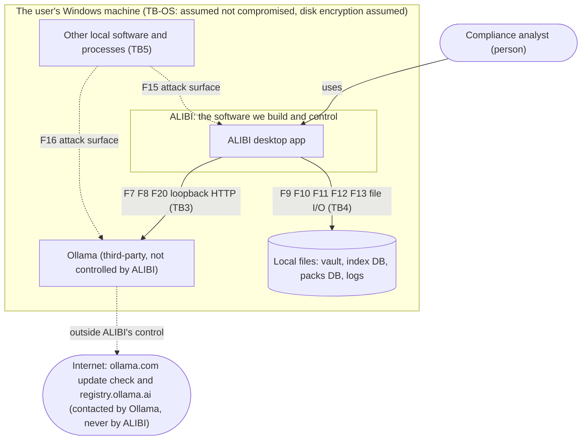
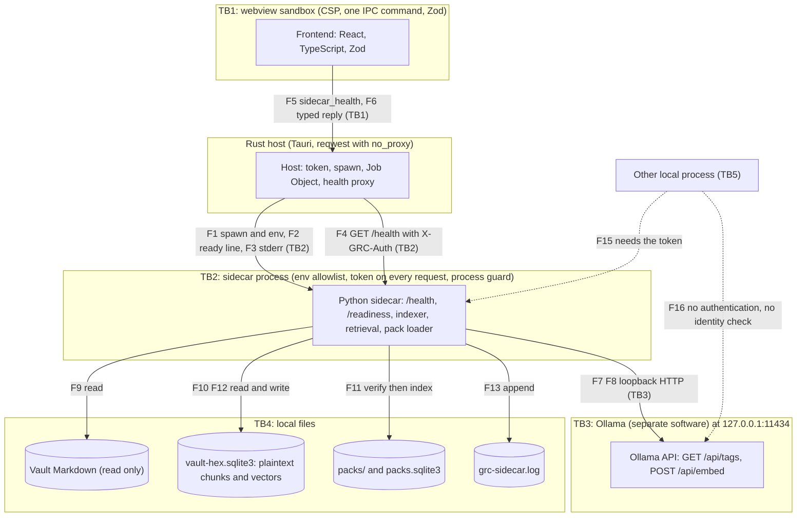

# ALIBI threat model

Status: first version. It describes the code at commit `39c4a85710e2166b3912095bf3ed0243b29c0d0a` (main, after PR #21, M4 merged). Facts about Ollama were checked on **2026-10-11** (Section 8). Platform: **Windows first**. Linux and macOS are not analysed (see ADR-003, `docs/adr/003-cargo-deny-windows-target.md:64`).

How to read this document:

- Every claim that something is **Mitigated** names a test, an ADR section (with a line), or a code location (`file:line`). If there is no such reference, the text says **claimed, not verified** or **no mitigation**. Nothing is called mitigated without evidence.
- Paths are repo-relative. A test is written as the full repo-relative file path, then `::`, then the test function name (Python and Rust alike). Line numbers refer to the commit above, except references into files that the pre-M5 fix PR changed (`retrieval/service.py`, `docs/adr/010-hybrid-retrieval.md`, `packs/loader.py`, `vault/scan.py`, `vault/indexer.py`, `tests/egress_guard.py`, `docs/adr/008-framework-packs.md`), which were re-anchored in the commit that changed each file.
- Scale for risk: Likelihood (L) and Impact (I) are each Low = 1, Medium = 2, High = 3. Risk = L x I. 1 to 3 is **Low**, 4 to 6 is **Medium**, 9 is **High**. "Residual" is the risk after the cited mitigation, and is the author's judgement, not a measurement.
- Counts, recomputed in the pre-M5 fix PR (final commit): 166 Rust `#[test]` functions in 21 files; **635 Python test functions** (`def test_` in `sidecar/tests` and `sidecar/ci`; a parametrized function counts once); **1,128 pytest collected cases** (`pytest` from `sidecar/`, which collects `sidecar/tests` only, so the 6 test functions in `sidecar/ci` are in the first number and not in this one; 9 more cases are deselected by the `ollama` marker). The two Python numbers are different things and are not comparable. 21 custom Semgrep rules (12 Python, 7 Rust, 2 TypeScript).
- Tally of the 73 STRIDE rows in Section 6: **42 Mitigated, 10 claimed, not verified, 21 no mitigation, 0 unlabelled.** Counting rule: a row's label is the bold phrase that opens its evidence cell (**Mitigated**, **claimed, not verified** or **No mitigation**). Every row has exactly one, and one row is one threat: a threat that is partly mitigated is written as separate rows with their own labels and evidence, and a row labelled with one phrase does not contain a phrase that belongs to another label. This was checked by a script run at this commit (not committed; G28), which also checks that every row ID mentioned in this document exists.

---

## 1. Scope and assumptions

ALIBI is a local-first desktop app (Tauri host, Python sidecar, local Ollama, a Markdown vault). Today the sidecar serves only `GET /health` and `GET /readiness` (`sidecar/src/grc_sidecar/main.py:78-79`). The indexer, retrieval and pack loader are library code that is exercised by tests and not yet wired to any route. Questionnaire answering (M5), the promise ledger and reality check (M5.5), the UI (M6) and policy-to-code (M7) are not built, so their flows are listed as planned (Section 5) and analysed when they are built.

### What ALIBI defends against (in scope)

| # | Adversary or failure | Example |
|---|---|---|
| A1 | Untrusted content inside the vault or in a questionnaire | A note that says "ignore your instructions", a file with hostile YAML, a symlink that points outside the vault |
| A2 | A remote party, through anything ALIBI's own code could do over a network | Telemetry, an update check, a cloud SDK, a proxy picked up from the environment |
| A3 | Another process on the machine that does **not** hold the auth token | Port scanning the sidecar, calling `/health` or `/readiness`, a web page trying a loopback request |
| A4 | The model being wrong or manipulated | Returning text that is not in the source, treating framework text as company evidence |
| A5 | Supply chain: a bad dependency or a tampered framework pack | A malicious package version, an edited pack file |
| A6 | Our own mistakes that leak data | Document text or the token ending up in logs or stdout |

### What ALIBI does not defend against (out of scope, with the reason)

| # | Not defended | Why |
|---|---|---|
| O1 | **Malware or another process running as the same Windows user** | It can read the vault, the plaintext index, the logs, and the sidecar's memory (including the token). ADR-002 states this (`docs/adr/002-auth-middleware.md:29`). A desktop app cannot protect itself from its own user account. |
| O2 | **A local administrator or SYSTEM** | Same reason, with more power (it can read any process and any file). |
| O3 | **A compromised or malicious operating system, driver or hypervisor** | ALIBI relies on the OS for process isolation, file access control and the loopback interface. |
| O4 | **Physical access to an unlocked or unencrypted machine** | Files are plaintext at rest (Section 7). **Assumption: the user enables OS disk encryption (BitLocker or equivalent). That is an assumption stated here, not a control ALIBI provides.** |
| O5 | **Ollama's own behaviour** (its network traffic, updates, logging, authentication) | It is separate software that ALIBI does not ship or control. Section 8 records what was verified about it. |
| O6 | Denial of service by a local user | A local user can kill the process or fill the disk. |
| O7 | Side channels and hardware attacks | Out of proportion to the product. |

Partly in scope: a same-user process is out of scope for confidentiality, but ALIBI still avoids making things worse (the token is removed from the sidecar's environment, children do not inherit it, ADR-002 and the tests in Section 6, F1).

### Trusted components

The Windows kernel, the Tauri/WebView2 runtime, Python and the pinned dependencies (checked by `pip-audit`, `cargo deny`, `pnpm audit`, see F18), and the Ollama process on 127.0.0.1:11434 are trusted to behave. The last one is not verified at runtime (Section 6, F16).

---

## 2. Assets

| Asset | Where | Sensitivity | Notes |
|---|---|---|---|
| Policy vault | A folder chosen by the user (`GRC_VAULT_DIR`; debug builds only today, `docs/adr/009-vault-indexing-contract.md:128`) | Confidential | Markdown, plaintext, the source of truth (CLAUDE.md 8.1). ALIBI only reads it. |
| Index DB | `<index_dir>/vault-<16 hex>.sqlite3` (`sidecar/src/grc_sidecar/repositories/sqlite_vec_repo.py:139-144`) | Confidential | Derived copy: chunk text, headings, source paths, link targets, vectors, in plaintext. Disposable. |
| Packs DB | `<index_dir>/packs.sqlite3` (`sidecar/src/grc_sidecar/packs/loader.py:37-39`) | Public or authored | Derived from `packs/`. |
| Framework packs | `packs/` in the repo | Public (NIST) and original authored text | Integrity-checked at load, not signed (`sidecar/src/grc_sidecar/packs/loader.py:3-6`). |
| Auth token | Host memory, then the sidecar's environment until read once, then the middleware's memory | Secret | 32 bytes from the OS CSPRNG, 64 lowercase hex (`apps/desktop/src-tauri/src/token.rs:35-40`). |
| Questionnaires and exports | Not built (M5, M5.5) | Confidential | Input files must never be overwritten (CLAUDE.md 11). |
| Logs | `<log_dir>/grc-sidecar.log`, 1 MB x 3 rotating (`sidecar/src/grc_sidecar/logging_config.py:22-44`) | Operational | One first-party log line exists today (`sidecar/src/grc_sidecar/llm/model_gate.py:132`). |
| Model files | Ollama's folder (Section 8) | Not secret | Provisioned by a human. ALIBI never pulls. |
| Source code and CI | The repository | Integrity | Section 12, F18. |

---

## 3. Actors and trust boundaries

Actors: the **user** (trusted, single); the **webview content** (our bundled UI, constrained by CSP and one IPC command); the **Rust host**; the **Python sidecar** (confined child); **Ollama** (separate software, trusted to behave, not controlled); **other local processes** (untrusted unless they hold the token); **document authors** (vault notes, framework text, vendor files and questionnaire cells are untrusted *data*, CLAUDE.md 8.6); **the model** (output is untrusted until the backend verifies it); **dependency authors** (supply chain).

| Boundary | Between | Enforced by |
|---|---|---|
| **TB1** | Webview and Rust host | Tauri capability with one command, strict CSP, Zod parsing (ADR-005, ADR-006) |
| **TB2** | Rust host and Python sidecar | Process boundary: env allowlist, token, ready-line protocol, Job Object (ADR-002, ADR-004) |
| **TB3** | Sidecar and Ollama | Loopback-only client, two allowed endpoints, model gate (ADR-009, ADR-011) |
| **TB4** | App and the filesystem | Path guard, no symlinks/junctions in the vault, index outside the vault, packs hash check |
| **TB5** | App and other local processes | Token on every request, loopback bind on an OS-assigned port |
| **TB6** | Development and supply chain | Pins, Dependabot, `pip-audit`, `cargo deny`, `pnpm audit`, gitleaks, Semgrep, Bandit, CI |

---

## 4. Diagrams

These are C4-style diagrams written as Mermaid `flowchart` blocks (no extra dependency, they render on GitHub). Dashed lines are attack surface or flows ALIBI does not control. Trust boundaries are the labelled boxes and the `TB` tags on edges.

### 4.1 System context

### 4.2 Containers

---

## 5. Data flow inventory

Classification: **Secret** (token), **Confidential** (policy text, anything derived from it), **Untrusted** (attacker-controlled input), **Operational** (status, paths, counts), **Public** (framework text).

| # | Flow | Source to destination | Transport | Boundary | Classification |
|---|---|---|---|---|---|
| F1 | Spawn and child environment: exactly five keys `SYSTEMROOT`, `GRC_AUTH_TOKEN`, `GRC_LOG_DIR`, `GRC_INDEX_DIR`, `GRC_VAULT_DIR` (the last is optional) | Host to sidecar | Process environment | TB2 | Secret (token), Operational (paths) |
| F2 | Ready handshake: one stdout line `{"event":"ready","port":N}`, then stdout is sealed | Sidecar to host | stdout pipe | TB2 | Operational |
| F3 | stderr drain: last 4 KiB kept, logged at debug only | Sidecar to host | stderr pipe | TB2 | Operational (may contain paths) |
| F4 | Authenticated health probe with `X-GRC-Auth` | Host to sidecar | HTTP on 127.0.0.1, OS-assigned port | TB2 | Secret (header) |
| F5 | `sidecar_health` command (no arguments) | Webview to host | Tauri IPC | TB1 | Operational |
| F6 | Typed reply parsed by a strict Zod schema | Host to webview | Tauri IPC | TB1 | Operational |
| F7 | Model presence check `GET /api/tags` (startup, and on demand through `/readiness`) | Sidecar to Ollama | HTTP 127.0.0.1:11434 | TB3 | Operational (model names) |
| F8 | Embedding `POST /api/embed`: chunk text at index time, question text at retrieval time | Sidecar to Ollama | HTTP 127.0.0.1:11434 | TB3 | **Confidential** |
| F9 | Vault scan: read Markdown, refuse symlinks and junctions | Vault folder to sidecar | File read | TB4 | Confidential, Untrusted |
| F10 | Index write: chunks, FTS5 text, vectors, links, metadata | Sidecar to `vault-<16 hex>.sqlite3` | SQLite file | TB4 | Confidential (plaintext) |
| F11 | Pack verify, then index | `packs/` to sidecar to `packs.sqlite3` | File read, SQLite | TB4 | Public |
| F12 | Retrieval read: FTS5, vec0, link table, staleness refresh (deletes stale rows). Not reachable over HTTP yet | Sidecar to both DBs | SQLite, in-process | TB4 | Confidential |
| F13 | Logging | Sidecar to `grc-sidecar.log` | File append | TB4 | Operational |
| F14 | Webview asset load under the CSP | Bundled assets to webview | Tauri asset protocol | TB1 | Public |
| F15 | A foreign process calls the sidecar's port | Any local process to sidecar | HTTP loopback | TB5 | Attack surface |
| F16 | A foreign process calls Ollama, or squats on port 11434 before Ollama starts | Any local process to or as Ollama | HTTP loopback | TB5, TB3 | Attack surface |
| F17 | Dev-time pack conversion (`tools/oscal_to_markdown.py`, source pinned by sha256) | Human to repo | File | TB6 | Public |
| F18 | Dependencies and CI (pins, Dependabot, audits, gitleaks, Semgrep) | Registries to dev machine and CI | HTTPS (development only, never the product) | TB6 | Code |
| F19 | Question text turned into an FTS5 `MATCH` string by the query builder. **Untrusted input; the escaping is the control** | Caller to `sidecar/src/grc_sidecar/retrieval/query.py` to `lexical_search` as a bound parameter | In-process | TB4 | Untrusted |
| F20 | `GET /readiness` response `{state, models_missing, ollama}`: authenticated, configured model names only, **not yet consumed by the host** (`docs/adr/011-startup-model-check.md:36`). Each call can trigger an on-demand loopback call to Ollama (`docs/adr/011-startup-model-check.md:34`) | Sidecar to any authenticated caller | HTTP loopback | TB2 | Operational |
| P1 | **Planned (M5):** retrieved text sent to the generation model, and its JSON answer back | Sidecar to and from Ollama | HTTP loopback | TB3 | Confidential, Untrusted |
| P2 | **Planned (M5):** questionnaire `.xlsx` in, a new answers file out | Disk to sidecar to disk | File | TB4 | Confidential, Untrusted |
| P3 | **Planned (M5.5):** offline import of IT exports | Disk to sidecar | File | TB4 | Confidential, Untrusted |
| P4 | **Planned (M7):** Terraform or Docker patch files for human review, static validation by subprocess | Sidecar to disk, sidecar to child process | File, process | TB4 | Untrusted output |

The M4 plan referred to a list of eight new flows. That list is not recorded in any file in the repository. This inventory was rebuilt from the ADRs and the code, and F19 and F20 were added on request.

---

## 6. STRIDE per data flow

Rows use the evidence rule from the top of the document. "no mitigation" rows are accepted or backlog items (Section 12).

### F1 Spawn and child environment (TB2)

| ID | STRIDE | Threat | L | I | Existing mitigation and evidence | Residual |
|---|---|---|---|---|---|---|
| F1-1a | Information disclosure | The token or paths reach a process that should not have them (inherited environment, child of the sidecar) | 1 | 3 | **Mitigated.** The host clears the environment and passes an allowlist (`apps/desktop/src-tauri/src/sidecar/spawn.rs:133`, `apps/desktop/src-tauri/src/child_env.rs:104-130`); the token goes only under its own key (`apps/desktop/src-tauri/src/child_env.rs::the_token_value_appears_only_under_its_own_key`, `apps/desktop/src-tauri/tests/supervisor_handshake.rs::the_child_environment_is_exactly_the_allowlist`). The sidecar reads the token once and deletes it from `os.environ` (`sidecar/src/grc_sidecar/security/auth.py:44-52`, `sidecar/tests/test_auth_token.py::test_valid_token_is_returned_and_removed_from_the_environment`). A real child of the sidecar does not inherit it (`sidecar/tests/test_child_spawns.py::test_no_subprocess_started_by_the_real_sidecar_inherits_the_token`). | Low (3) |
| F1-1b | Information disclosure | The token stays in the Windows process environment block of the sidecar after `os.environ.pop` | 1 | 3 | **claimed, not verified.** The sidecar deletes the token from `os.environ` (`sidecar/src/grc_sidecar/security/auth.py:44-52`), but whether that also clears the Windows process environment block was never checked (G17, M8). | Low (3) |
| F1-2a | Elevation of privilege | The sidecar (or a library inside it) starts a shell or another program through Python's process-creation APIs | 1 | 3 | **Mitigated.** An audit hook vetoes nine event types (`sidecar/src/grc_sidecar/security/process_guard.py:28-40`, `sidecar/src/grc_sidecar/security/process_guard.py:71-82`); `sidecar/tests/test_process_guard.py::test_every_process_creation_api_is_blocked_under_the_guard`, `sidecar/tests/test_process_guard.py::test_the_real_sidecar_blocks_spawns_after_it_is_ready`; `docs/adr/007-sidecar-process-guard.md:18-24`. | Low (3) |
| F1-2b | Elevation of privilege | Native code inside the sidecar (`ctypes`, `LoadLibraryExW` inside `vec0`) creates a process or loads a library without going through Python | 1 | 3 | **No mitigation.** The audit hook sees only Python-level events. The gap is pinned by a test, not closed (`sidecar/tests/test_process_guard.py::test_ctypes_dlopen_is_a_known_unguarded_path`, `docs/adr/007-sidecar-process-guard.md:85-87`); the kernel-level control is G15 (M8) and the `vec0` library is unaudited (G16). | Medium (L1 x I3, but the gap is known and the native library is unaudited; kept at Medium until the kernel-level control exists) |
| F1-3a | Tampering | The vault or index path is pointed somewhere sensitive | 1 | 2 | **Mitigated.** A release build never reads `GRC_VAULT_DIR` (`docs/adr/009-vault-indexing-contract.md:128`, `apps/desktop/src-tauri/src/dev_paths.rs::dev_vault_dir_is_none_in_release`); paths must be absolute and free of NUL (`apps/desktop/src-tauri/src/child_env.rs::relative_paths_are_rejected`); the sidecar resolves both through the path guard and rejects nesting (`sidecar/tests/test_runtime_dirs.py::test_index_symlinked_into_the_vault_is_rejected`, `sidecar/tests/test_runtime_dirs.py::test_vault_symlinked_into_the_index_is_rejected`). | Low (2) |
| F1-3b | Tampering | The host forwards a user-chosen folder to the sidecar without its own `canonicalize` + `starts_with` check (CLAUDE.md 3.6 asks for both layers) | 1 | 2 | **No mitigation.** The Rust-side check is not built yet (`docs/adr/009-vault-indexing-contract.md:37`, G9, M6); the sidecar-side path guard of F1-3a still applies. | Low (2) |
| F1-4a | Spoofing | A different program is launched as "the sidecar" in a debug build, or in a release build today | 1 | 3 | **Mitigated.** In debug builds the interpreter path is canonicalised and must stay inside the repository's `sidecar/` (`apps/desktop/src-tauri/src/sidecar/resolve.rs:27-62`, `apps/desktop/src-tauri/tests/resolve_paths.rs::a_dot_dot_escape_is_rejected`, `apps/desktop/src-tauri/tests/resolve_paths.rs::a_symlink_escape_is_rejected`). Release builds cannot start a sidecar at all until M8 (`apps/desktop/src-tauri/src/sidecar/resolve.rs::release_builds_have_no_sidecar_configured`). | Low (2) |
| F1-4b | Spoofing | A swapped or tampered sidecar binary is launched once the sidecar is packaged (M8) | 1 | 3 | **No mitigation.** There is no packaged sidecar yet and no integrity check for one; both arrive in M8 (CLAUDE.md Section 9, M8 row). | Low (2) for now; revisit at M8 |
| F1-5 | Denial of service | The sidecar never reports ready and the app hangs | 2 | 1 | **Mitigated.** 30 s timeout, then the job is killed (`apps/desktop/src-tauri/src/sidecar/supervisor.rs:41`, `apps/desktop/src-tauri/tests/supervisor_handshake.rs::silent_child_is_killed_on_timeout`). Orphans die with the host (`apps/desktop/src-tauri/tests/job_object.rs::the_grandchild_dies_when_the_job_handle_is_dropped_without_terminate`). | Low (1) |

### F2 Ready line and F3 stderr (TB2)

| ID | STRIDE | Threat | L | I | Existing mitigation and evidence | Residual |
|---|---|---|---|---|---|---|
| F2-1 | Tampering, Spoofing | A malformed or hostile ready line (extra fields, port 0, huge line, two objects) misleads the host | 1 | 2 | **Mitigated.** Strict single-object parser with a length cap (`apps/desktop/src-tauri/src/ready.rs::ready_rejects_extra_field`, `apps/desktop/src-tauri/src/ready.rs::ready_rejects_port_zero`, `apps/desktop/src-tauri/tests/supervisor_handshake.rs::an_oversized_line_fails_and_kills`, `apps/desktop/src-tauri/tests/supervisor_handshake.rs::two_objects_on_one_line_fail_and_kill`). | Low (2) |
| F2-2a | Information disclosure, Denial of service | Anything written to stdout after the ready line (library print, content) reaches the host pipe or floods it | 1 | 2 | **Mitigated.** stdout is sealed before the server starts (`sidecar/src/grc_sidecar/security/stdio.py:42-62`, `sidecar/tests/test_runtime_guards.py::test_stray_writes_after_ready_never_reach_the_host_pipe`, `sidecar/tests/test_startup.py::test_exactly_one_line_is_ever_written_to_stdout`); the host treats later output as a failure (`apps/desktop/src-tauri/tests/supervisor_handshake.rs::output_after_the_ready_line_fails_closed`). | Low (2) |
| F2-2b | Information disclosure, Denial of service | A write that bypasses Python's `sys.stdout` and reaches the Windows stdout handle reaches the host pipe | 1 | 2 | **claimed, not verified.** The stdout seal includes a `SetStdHandle` step. It has no mutation proof (`docs/adr/007-sidecar-process-guard.md:59`): nobody has shown that a test fails without it. | Low (2) |
| F3-1a | Information disclosure | The host keeps more than a bounded tail of the sidecar's stderr (tracebacks, paths) | 1 | 1 | **Mitigated.** Bounded to the last 4 KiB (`apps/desktop/src-tauri/src/sidecar/supervisor.rs::the_tail_buffer_keeps_only_the_last_bytes`). | Low (1) |
| F3-1b | Information disclosure | The host logs the sidecar's stderr tail above debug level | 1 | 1 | **claimed, not verified.** "Logged at debug only" is a recorded gap without a mutation proof (`docs/adr/004-host-sidecar-lifecycle.md:95-122`, item 5). | Low (1) |

### F4, F15, F20 Sidecar HTTP surface (TB2, TB5)

| ID | STRIDE | Threat | L | I | Existing mitigation and evidence | Residual |
|---|---|---|---|---|---|---|
| F4-1a | Spoofing | Another local process, or a browser page, calls the sidecar without the token | 2 | 3 | **Mitigated.** A pure-ASGI middleware wraps the whole app, so even 404, 405 and 422 answer 401 with an empty body; comparison uses `hmac.compare_digest`; bind is 127.0.0.1, port 0 (`sidecar/src/grc_sidecar/security/auth.py:66-86`, `sidecar/src/grc_sidecar/main.py:85-96`). Tests: `sidecar/tests/test_auth_middleware.py::test_missing_header_is_rejected`, `sidecar/tests/test_auth_middleware.py::test_wrong_token_is_rejected`, `sidecar/tests/test_auth_middleware.py::test_comparison_uses_hmac_compare_digest`, `sidecar/tests/test_auth_middleware.py::test_unauthenticated_requests_get_401_not_404`, `sidecar/tests/test_startup.py::test_real_server_rejects_missing_and_wrong_tokens`, `sidecar/tests/test_startup.py::test_server_is_not_reachable_over_ipv6_loopback`. A browser cross-origin request needs a custom header, so its preflight carries no token and gets 401. | Low (3) |
| F4-1b | Information disclosure | A same-user process reads the token from the sidecar's memory | 1 | 3 | **No mitigation, accepted.** Out of scope (O1, Section 1): a desktop app cannot protect itself from its own user account (`docs/adr/002-auth-middleware.md:29`). | Low (3), accepted |
| F4-2a | Information disclosure | The token, sent as a plain header on loopback, is logged or printed by ALIBI's own code | 1 | 3 | **Mitigated.** The header value is marked sensitive in the host client (`apps/desktop/src-tauri/src/health.rs::the_header_value_is_marked_sensitive`, `apps/desktop/src-tauri/src/health.rs::the_client_debug_output_shows_no_token`). The token never appears in log, stdout or stderr (`sidecar/tests/test_startup.py::test_token_never_appears_in_log_stdout_or_stderr`). | Low (3) |
| F4-2b | Information disclosure | The token, sent as a plain header on loopback, is sniffed from the network stack | 1 | 3 | **No mitigation, accepted.** Sniffing loopback traffic needs an administrator: out of scope (O2, Section 1). | Low (3), accepted |
| F4-3 | Tampering | The host's probe is redirected, proxied, or answered by something else on the port | 1 | 2 | **Mitigated.** `no_proxy`, no redirects, loopback-only endpoint, port 0 rejected (`apps/desktop/src-tauri/src/health.rs:131-146`, `apps/desktop/src-tauri/src/health.rs::a_redirect_is_not_followed`, `apps/desktop/src-tauri/tests/health_proxy.rs::health_client_ignores_proxy_env`, `apps/desktop/src-tauri/src/health.rs::the_endpoint_is_loopback_only_and_rejects_port_zero`). The port comes from the sidecar's own ready line. | Low (2) |
| F4-4a | Denial of service | A huge or never-ending sidecar response ties up the host | 2 | 1 | **Mitigated.** Response body capped at 1 KiB, timeouts set (`apps/desktop/src-tauri/src/health.rs::a_chunked_body_over_the_cap_is_refused`, `apps/desktop/src-tauri/src/health.rs::a_server_that_never_answers_times_out`). | Low (2) |
| F4-4b | Denial of service | A flood of requests exhausts the sidecar | 2 | 1 | **No mitigation.** There is no request rate limiting on the sidecar (unauthenticated requests are cheap 401s). | Low (2) |
| F4-5 | Repudiation | No record of who called which endpoint | 1 | 1 | **No mitigation, accepted.** The access log is off (`sidecar/src/grc_sidecar/main.py:126-137`) so that paths and timing do not accumulate. A single-user local app has no second party to dispute a call. | Low (1) |
| F20-1 | Information disclosure | `/readiness` leaks something beyond status | 1 | 1 | **Mitigated.** The body carries only fixed words and the configured model names (`sidecar/tests/test_model_gate.py::test_the_status_never_contains_response_text`, `sidecar/tests/test_readiness.py::test_unauthenticated_requests_never_get_a_body`, `sidecar/tests/test_readiness.py::test_readiness_requires_the_token`). | Low (1) |
| F20-2 | Denial of service | Repeated `/readiness` calls make many requests to Ollama | 1 | 1 | **Mitigated.** The gate re-checks at most every 5 s under one lock (`sidecar/tests/test_model_gate.py::test_recheck_respects_the_minimum_interval`, `sidecar/tests/test_model_gate.py::test_background_and_on_demand_checks_never_overlap`); the endpoint requires the token. | Low (1) |

### F5, F6, F14 Webview and IPC (TB1)

| ID | STRIDE | Threat | L | I | Existing mitigation and evidence | Residual |
|---|---|---|---|---|---|---|
| F5-1a | Elevation of privilege | Script in the webview calls host commands beyond health, or reaches the network | 1 | 3 | **Mitigated.** In configuration: one capability grants one command to the main window, and the production CSP allows nothing remote, inline or dynamic (`apps/desktop/src-tauri/tests/security_config.rs::the_capability_grants_exactly_the_health_command_to_the_main_window`, `apps/desktop/src-tauri/tests/security_config.rs::the_capability_covers_each_app_command_and_nothing_more`, `apps/desktop/src-tauri/tests/security_config.rs::csp_connect_src_is_ipc_only`, `apps/desktop/src-tauri/tests/security_config.rs::the_production_csp_allows_nothing_remote_inline_or_dynamic`; `docs/adr/005-webview-csp-and-capabilities.md:16-20`). Semgrep rules `grc-ts-external-fetch` and `grc-ts-dangerously-set-inner-html` back this in CI (`.semgrep/grc-airgap.yml`). The production CSP was also observed to refuse a `fetch` to a loopback address in the bundled debug build (`docs/adr/005-webview-csp-and-capabilities.md:37`). | Low (3) |
| F5-1b | Elevation of privilege | The webview runs without the production CSP or with DevTools open (`pnpm tauri dev`, debug builds), and no CI job renders a webview to catch a regression | 1 | 3 | **No mitigation.** `pnpm tauri dev` has no CSP and CI does not render a webview (`docs/adr/005-webview-csp-and-capabilities.md:24`); F12 opens DevTools in debug builds (`docs/adr/005-webview-csp-and-capabilities.md:89`). Backlog G12 (M6). | Low (3) |
| F6-1a | Tampering, Spoofing | A malformed or hostile reply is accepted by the IPC parsing layer | 1 | 1 | **Mitigated.** Strict Zod schemas, never throws, the channel decides and not the content (`apps/desktop/src/ipc/health.test.ts:128`, `apps/desktop/src/ipc/health.test.ts:188`, `apps/desktop/src/ipc/health.test.ts:221`, `apps/desktop/src/ipc/health.test.ts:225`; `apps/desktop/src-tauri/src/health.rs::the_ipc_contract_fixture_matches_what_rust_serializes`; `docs/adr/006-window-status-polling-and-ipc-contract.md:11-15`). | Low (1) |
| F6-1b | Tampering, Spoofing | The window (`App.tsx`) shows a parsed reply wrongly even though the parsing layer is correct | 1 | 1 | **claimed, not verified.** `App.tsx` is not rendered in any test, so what the window shows for each parsed state is not tested (`docs/adr/006-window-status-polling-and-ipc-contract.md:26-36`). | Low (1) |
| F14-1 | Information disclosure | The webview loads a remote asset or font | 1 | 2 | **Mitigated.** `default-src 'self'`, `connect-src ipc: http://ipc.localhost`, `object-src 'none'`, frozen prototype (`apps/desktop/src-tauri/tests/security_config.rs::the_production_csp_has_exactly_the_expected_directives`, `apps/desktop/src-tauri/tests/security_config.rs::the_prototype_is_frozen`). | Low (2) |

### F7, F8, F16, F20 Sidecar and Ollama (TB3, TB5)

| ID | STRIDE | Threat | L | I | Existing mitigation and evidence | Residual |
|---|---|---|---|---|---|---|
| F8-1 | Information disclosure | Policy text or question text is sent to a non-loopback endpoint | 1 | 3 | **Mitigated.** Strict loopback validation at configuration and on every request, no proxy from the environment, no redirects (`sidecar/src/grc_sidecar/security/net.py:62-96`, `sidecar/src/grc_sidecar/config.py:103-106`; `sidecar/tests/test_net.py::test_rejects_non_loopback_or_malformed_urls`, `sidecar/tests/test_net.py::test_proxy_environment_variables_are_ignored`, `sidecar/tests/test_net.py::test_redirect_is_not_followed`, `sidecar/tests/test_embeddings_ollama.py::test_a_non_loopback_url_is_refused`). Only the factory builds HTTP clients (`sidecar/tests/test_dependency_hygiene.py::test_httpx_only_used_in_the_client_factory`, Semgrep `grc-py-httpx-client-outside-factory`). Every test run has a socket guard that covers connects and all six DNS lookup functions (`sidecar/tests/test_egress_guard.py::test_non_loopback_ipv4_connect_blocked`, `sidecar/tests/test_egress_guard.py::test_getaddrinfo_hostname_blocked`, `sidecar/tests/test_egress_guard.py::test_gethostbyname_blocks_every_name_even_localhost`, `sidecar/tests/test_egress_guard.py::test_gethostbyname_ex_blocks_every_name_even_localhost`, `sidecar/tests/test_egress_guard.py::test_gethostbyaddr_blocks_names_and_non_loopback_addresses`, `sidecar/tests/test_egress_guard.py::test_getnameinfo_blocks_names_and_non_loopback_addresses`) and CI runs the suite with no network (`.github/workflows/airgap.yml`, `sidecar/ci/test_airgap_canary.py::test_isolated_when_loopback_works_and_outside_is_blocked`). | Low (3) |
| F8-2 | Spoofing, Information disclosure | **A rogue local listener on 127.0.0.1:11434** (started before Ollama) answers instead of Ollama and receives all chunk and question text, or returns poisoned vectors | 1 | 3 | **No mitigation.** The client only proves the address is loopback, not who answers. The loopback tests above cover non-loopback egress and do **not** cover impersonation. Dimension and model-digest checks catch an *inconsistent* embedder (`sidecar/tests/test_embeddings_ollama.py::test_probe_dimension_mismatch_fails_closed`, `sidecar/tests/test_indexer.py::test_a_different_model_digest_is_refused_and_changes_nothing`), not a malicious one. | Medium (L1 to 2 x I3 = 3 to 6). Backlog M8. Needs a same-machine attacker who starts first, so it overlaps O1. |
| F8-3 | Elevation of privilege | ALIBI is made to call another Ollama endpoint (for example `/api/pull`) | 1 | 2 | **Mitigated.** The client allows exactly `GET /api/tags` and `POST /api/embed`, enforced by a request hook, and no method takes a path (`sidecar/src/grc_sidecar/llm/ollama_embeddings.py:41-44`, `sidecar/src/grc_sidecar/llm/ollama_embeddings.py:58-61`; `sidecar/tests/test_embeddings_ollama.py::test_the_client_refuses_every_endpoint_but_tags_and_embed`, `sidecar/tests/test_dependency_hygiene.py::test_no_model_pull_endpoint_in_source`, `sidecar/tests/test_dependency_hygiene.py::test_no_model_management_endpoint_is_built_anywhere_in_source`, `sidecar/tests/test_model_gate.py::test_the_gate_never_calls_anything_but_tags`; Semgrep `grc-py-ollama-pull`). | Low (2) |
| F8-4 | Denial of service | Ollama is down, slow or missing a model | 2 | 2 | **Mitigated** by failing closed with typed errors, and retrieval degrades to keyword-only (`sidecar/tests/test_model_gate.py::test_ollama_unreachable_is_degraded_and_refuses`, `sidecar/tests/test_retrieval.py::test_embedding_failure_reports_lexical_only`, `sidecar/tests/test_startup.py::test_ready_line_does_not_wait_for_stuck_ollama`). | Low (2) |
| F8-5 | Tampering | Ollama silently truncates over-long text, so the vector no longer matches the stored chunk | 1 | 1 | **Mitigated.** `truncate: false`; an over-long input is a reported error and the file stays stale, never half-indexed (`sidecar/src/grc_sidecar/llm/ollama_embeddings.py:198`, `sidecar/tests/test_embeddings_ollama.py::test_requests_disable_truncation`; `docs/adr/009-vault-indexing-contract.md:55`). | Low (1) |
| F7-1 | Information disclosure | Ollama's error text (which could contain document text) is copied into our errors or logs | 1 | 2 | **Mitigated.** Fixed messages, nothing chained (`sidecar/tests/test_embeddings_ollama.py::test_an_ollama_error_body_never_appears_in_the_error_or_its_chain`, `sidecar/tests/test_embeddings_ollama.py::test_every_error_has_a_fixed_message`). | Low (2) |
| F16-1 | Information disclosure, Elevation of privilege | Any local process or an allowed browser origin calls Ollama directly (list models, run prompts, pull models) | 2 | 2 | **No mitigation by ALIBI.** Ollama has no authentication that was found in its source (Section 8, claim 2), and this is independent of ALIBI. ALIBI's own webview is the one origin ALIBI does control: see F16-2a to F16-2c. | Medium (4), accepted; documented in Section 8 |
| F16-2a | Information disclosure, Elevation of privilege | **ALIBI's own webview**, or script that got into it, calls Ollama directly on `127.0.0.1:11434` in a build that has the production CSP | 1 | 3 | **Mitigated.** In configuration, and observed once. The shipped CSP has `connect-src ipc: http://ipc.localhost`, so the webview may not connect to `http://127.0.0.1:11434`, whatever Ollama's CORS settings say (`apps/desktop/src-tauri/tauri.conf.json:22`, `apps/desktop/src-tauri/tests/security_config.rs::csp_connect_src_is_ipc_only`, `apps/desktop/src-tauri/tests/security_config.rs::the_production_csp_has_exactly_the_expected_directives`, `apps/desktop/src-tauri/tests/security_config.rs::the_production_csp_allows_nothing_remote_inline_or_dynamic`). In the bundled debug build, a `fetch` to another loopback address (`http://127.0.0.1:65000/`, not port 11434) was refused by `connect-src` on 2026-10-08 (`docs/adr/005-webview-csp-and-capabilities.md:37`, `docs/adr/005-webview-csp-and-capabilities.md:65`). The CSP is the control relied on here, not Ollama's origin list (F16-2c). This does not stop any other local process or browser origin: that is F16-1. | Low (3) |
| F16-2b | Information disclosure, Elevation of privilege | In `pnpm tauri dev`, which has no CSP, the development webview calls Ollama directly | 1 | 3 | **No mitigation.** The dev server serves the UI with no CSP and CI renders no webview (G12, `docs/adr/005-webview-csp-and-capabilities.md:24`). | Low (3) |
| F16-2c | Information disclosure, Elevation of privilege | Ollama's own origin check, the only barrier other than the CSP, would accept ALIBI's webview origin on Windows (`http://tauri.localhost`), where Ollama's default allowed origins include `tauri://*` | 1 | 3 | **claimed, not verified.** The webview's origin is `http://tauri.localhost` (`docs/adr/005-webview-csp-and-capabilities.md:63`); whether Ollama's `tauri://*` entry matches it is unverified (Section 8, claim 3), and a request from the webview to port 11434 itself was never tried. | Low (3) |

### F9, F10, F11, F12, F19 Files and retrieval (TB4)

| ID | STRIDE | Threat | L | I | Existing mitigation and evidence | Residual |
|---|---|---|---|---|---|---|
| F9-1a | Information disclosure, Tampering | A path, link or symlink makes the scanner read outside the vault | 2 | 3 | **Mitigated.** For `..`, absolute paths, symlinks and a junction that escapes (`sidecar/src/grc_sidecar/security/paths.py:60-83`, `sidecar/src/grc_sidecar/vault/scan.py:66-71`, `sidecar/src/grc_sidecar/vault/scan.py:83-89`; `sidecar/tests/test_paths.py::test_dotdot_traversal_rejected`, `sidecar/tests/test_paths.py::test_absolute_path_outside_rejected`, `sidecar/tests/test_paths.py::test_windows_junction_escape_rejected`, `sidecar/tests/test_scan.py::test_symlink_escaping_file_is_rejected`, `sidecar/tests/test_scan.py::test_a_symlinked_folder_is_not_entered`, `sidecar/tests/test_injection_fixtures.py::test_escaping_links_never_cause_a_read_outside_the_vault`). | Low (3) |
| F9-1b | Tampering | A junction inside the vault that points inside the vault makes one file appear under two paths | 2 | 3 | **claimed, not verified.** The scanner is meant to refuse it, but that refusal has no direct test (`docs/adr/009-vault-indexing-contract.md:23`, G10, M6). | Low (3) |
| F9-2 | Denial of service | A huge file, YAML bomb, alias loop or invalid encoding | 2 | 1 | **Mitigated.** 2 MB file cap, 64 KB frontmatter cap, no aliases, anchors or tags (`sidecar/tests/test_normalize.py::test_an_oversized_file_is_rejected_before_decoding`, `sidecar/tests/test_frontmatter.py::test_anchors_aliases_and_tags_are_rejected`, `sidecar/tests/test_frontmatter.py::test_an_oversized_block_is_an_error`, `sidecar/tests/test_scan.py::test_invalid_utf8_and_nul_files_are_reported`; Semgrep `grc-py-yaml-unsafe-load`). | Low (2) |
| F9-3 | Spoofing | A second file claims another document's `doc_id`, or a fake frontmatter block is planted mid-file | 2 | 2 | **Mitigated.** Every copy of a duplicate `doc_id` is excluded and reported (`sidecar/tests/test_scan.py::test_duplicate_doc_ids_exclude_every_copy_and_report_each`); a later `---` block is just text (`sidecar/tests/test_injection_fixtures.py::test_a_fake_frontmatter_block_in_the_middle_of_a_file_is_just_text`). | Low (2) |
| F10-1 | Information disclosure | Policy text, headings, paths and vectors are readable from the index file and its `-journal` by anything running as the user, by backups, or from a lost disk | 2 | 3 | **No mitigation by ALIBI** other than keeping the index outside the vault (`sidecar/src/grc_sidecar/config.py:88-96`, which protects the vault, not the index). No encryption and no ACL or permission code exists: a search of `sidecar/src`, `tools`, `sidecar/ci` and the Rust sources for `chmod`, `umask`, `icacls`, `SetNamedSecurityInfo` and `stat.S_I` found nothing (output pasted in the PR). Depends on the stated OS disk-encryption assumption (O4). | Medium (6), accepted; M8 documents and hardens permissions |
| F10-2a | Tampering | A local writer deliberately edits the index to change what retrieval returns | 1 | 3 | **No mitigation.** A deliberate writer is the same user (O1, Section 1). The index is disposable and rebuildable from the vault (`docs/adr/001-sqlite-vec.md:13-20`). | Low (3) |
| F10-2b | Tampering | The index becomes inconsistent by accident (a failed embed, orphan rows) | 1 | 3 | **Mitigated.** Stale rows are removed and orphans are reported (`sidecar/tests/test_staleness.py::test_embed_failure_old_chunk_not_returned_by_search`, `sidecar/tests/test_vector_repository.py::test_verify_integrity_detects_every_kind_of_orphan`). | Low (3) |
| F10-3 | Information disclosure | Stale or deleted policy text keeps being served | 2 | 2 | **Mitigated.** The staleness check runs before any search, stale rows are deleted, and a failed check returns nothing (`sidecar/src/grc_sidecar/retrieval/service.py:217-231`, `sidecar/tests/test_retrieval.py::test_edited_file_is_never_served_after_retrieval`, `sidecar/tests/test_retrieval.py::test_refresh_failure_raises_and_returns_nothing`, `sidecar/tests/test_indexer.py::test_edit_leaves_no_stale_chunks`). | Low (2) |
| F10-4 | Denial of service | A corrupt or mismatched index | 1 | 1 | **Mitigated.** Fails closed, a non-database file is never deleted, rebuild is explicit (`sidecar/tests/test_schema_version.py::test_current_version_with_damaged_meta_requires_a_rebuild`, `sidecar/tests/test_schema_version.py::test_a_file_that_is_not_a_database_is_never_deleted`). | Low (1) |
| F11-1a | Tampering | A pack file is edited or swapped before the packs are loaded | 1 | 2 | **Mitigated.** A content hash and the metadata are verified, one bad pack blocks all (`sidecar/src/grc_sidecar/packs/loader.py:73-117`, `sidecar/tests/test_pack_loader.py::test_tampered_pack_content_fails_closed`, `sidecar/tests/test_pack_loader.py::test_one_bad_pack_blocks_every_pack`, `sidecar/tests/test_pack_loader.py::test_tampered_pack_is_not_indexed_and_the_embedder_is_untouched`). | Low (2) |
| F11-1b | Tampering | A pack file changes between verification and indexing (this was finding F-A, fixed in the pre-M5 fix PR) | 1 | 2 | **Mitigated.** Each file is read once and the indexer is handed the bytes that were hashed, so a file changed after verification cannot reach the index (`sidecar/src/grc_sidecar/packs/loader.py:125-146`, `sidecar/src/grc_sidecar/vault/scan.py:137-154`, `sidecar/tests/test_pack_loader.py::test_a_file_changed_after_verification_never_reaches_the_index`, `docs/adr/008-framework-packs.md:35`). | Low (2) |
| F11-1c | Tampering | Someone who can rewrite both the pack files and `pack.json` gets their text indexed | 1 | 2 | **No mitigation, accepted.** The check is integrity, not authenticity (`sidecar/src/grc_sidecar/packs/loader.py:3-6`); signing is out of scope (`docs/adr/008-framework-packs.md:23`), and a writer with that access is the same user (O1, Section 1). | Low (2), accepted |
| F11-2 | Spoofing | The SOC 2 and ISO 27001 ID lists were authored from the author's knowledge and have not been compared with the standards | 2 | 1 | **claimed, not verified.** Marked `id_list_verified_against = "unverified"` (`docs/adr/008-framework-packs.md:47`, `sidecar/tests/test_authored_packs.py::test_pack_verifies_and_is_marked_authored_and_unverified`). | Low (2) |
| F12-1a | Spoofing | Framework text is mistaken for evidence that the company does something, because it is mislabelled | 2 | 3 | **Mitigated.** `source_kind` is computed from where the document was loaded, never from what it says (`sidecar/src/grc_sidecar/retrieval/service.py:88-94`; `sidecar/tests/test_retrieval.py::test_pack_chunks_are_framework_reference`, `sidecar/tests/test_retrieval.py::test_vault_note_claiming_framework_is_not_company_policy_or_the_reverse`, `sidecar/tests/test_retrieval.py::test_a_pack_chunk_is_framework_reference_whatever_its_document_type`). | Low (3) |
| F12-1b | Spoofing | Framework text enters the context beyond the framework cap, through the seeds or through the expansion slot (the slot was finding F-B, fixed in the pre-M5 fix PR) | 2 | 3 | **Mitigated.** Seeds are capped at 2 chunks and 40% (`sidecar/tests/test_selection.py::test_framework_text_never_exceeds_two_chunks`). The expansion slot accepts only a chunk whose derived kind is `company_policy`, so a link into a vault document typed `framework` is never expanded and the slot goes to a company chunk (`sidecar/src/grc_sidecar/retrieval/service.py:314-315`, `sidecar/tests/test_expansion.py::test_a_link_into_a_framework_typed_document_is_not_expanded`, `docs/adr/010-hybrid-retrieval.md:134-140`). | Low (3) |
| F12-1c | Spoofing | A later step treats a `framework_reference` chunk as evidence that the company does something | 2 | 3 | **No mitigation.** Code that refuses `framework_reference` as evidence does not exist yet (M5, G4, `docs/adr/010-hybrid-retrieval.md:148`). | Medium (L2 x I2 = 4) until M5 |
| F12-2a | Spoofing, Elevation of privilege | Retrieval returns text that merely *resembles* the question (there is no relevance floor) | 3 | 3 | **No mitigation.** In M4, by decision: a nonsense question still returns company text (`sidecar/tests/test_retrieval.py::test_nonsense_still_returns_company_text_there_is_no_relevance_floor`; `docs/adr/010-hybrid-retrieval.md:74`). | Carried by F12-2b |
| F12-2b | Spoofing, Elevation of privilege | Text that merely resembles the question is treated as proof | 3 | 3 | **claimed, not verified.** The control is the verbatim-quote check in M5 (CLAUDE.md 8.4), which does not exist yet (G4, M5). | High (9) until M5 lands; owner M5 |
| F12-3 | Tampering | Graph expansion pulls in text by similarity or through a broken link | 1 | 2 | **Mitigated.** Expansion follows only resolved explicit links, with a depth bound and a visited set (`sidecar/tests/test_expansion.py::test_expansion_never_follows_similarity`, `sidecar/tests/test_expansion.py::test_unresolved_ambiguous_and_rejected_links_are_not_followed`, `sidecar/tests/test_expansion.py::test_a_cycle_adds_nothing_twice`). At `expansion_depth` 2 the walk can pass through a vault document typed `framework` to company text behind it; every edge is still an explicit link (`docs/adr/010-hybrid-retrieval.md:134-140`). | Low (2) |
| F12-4a | Spoofing | Hidden instructions in a note are treated as commands by retrieval | 2 | 2 | **Mitigated.** Retrieval makes no model call: the text comes back verbatim as data (`sidecar/tests/test_injection_fixtures.py::test_hidden_instructions_are_kept_verbatim_as_data_and_change_nothing`, `sidecar/tests/test_retrieval.py::test_hidden_instructions_come_back_as_plain_data`). | Low (2) |
| F12-4b | Spoofing | Hidden instructions in a note are treated as commands by a generation prompt (M5) | 2 | 2 | **claimed, not verified.** The prompt-side defence is planned in M5 (Section 10, G5); no generation call exists yet. | Medium (4) until M5, then re-assess |
| F19-1 | Tampering, Elevation of privilege | Question text injects FTS5 syntax (column filters, `NEAR`, `NOT`, wildcards) or SQL | 2 | 2 | **Mitigated.** Every word is one quoted string and the only syntax is `OR`; the result is a bound parameter; length and term counts are capped (`sidecar/src/grc_sidecar/retrieval/query.py:59-120`, `sidecar/src/grc_sidecar/repositories/sqlite_vec_repo.py:551-557`). An independent oracle checks it: `sidecar/tests/test_query_builder.py::test_hostile_inputs_never_raise`, `sidecar/tests/test_query_builder.py::test_hostile_inputs_never_change_meaning`, `sidecar/tests/test_query_builder.py::test_the_words_that_are_fts5_operators_are_matched_as_words`, `sidecar/tests/test_query_builder.py::test_a_column_filter_is_not_a_column_filter`, `sidecar/tests/test_query_builder.py::test_hostile_text_never_adds_syntax_outside_quotes`, `sidecar/tests/test_query_builder.py::test_oracle_agrees_with_sqlite`, `sidecar/tests/test_query_builder.py::test_oracle_is_independent`, `sidecar/tests/test_lexical_search.py::test_user_text_cannot_reach_sql`, `sidecar/tests/test_lexical_search.py::test_a_raw_bad_match_string_is_a_clean_domain_error`. | Low (2) |
| F19-2 | Denial of service | Pathological or huge question text | 2 | 1 | **Mitigated.** Input cut at 2000 characters and 32 terms (`sidecar/tests/test_query_builder.py::test_input_and_term_counts_are_bounded`). | Low (2) |

### F13 Logging (TB4)

| ID | STRIDE | Threat | L | I | Existing mitigation and evidence | Residual |
|---|---|---|---|---|---|---|
| F13-1a | Information disclosure | The token appears in the log | 2 | 2 | **Mitigated.** The token never appears in the log, stdout or stderr (`sidecar/tests/test_startup.py::test_token_never_appears_in_log_stdout_or_stderr`). | Low (2) |
| F13-1b | Information disclosure | Document text or question text appears in the log | 2 | 2 | **claimed, not verified.** First-party code logs one line with model names only (`sidecar/src/grc_sidecar/llm/model_gate.py:132`) and errors have fixed messages, but the rule "no content above DEBUG" is a docstring (`sidecar/src/grc_sidecar/logging_config.py:6-7`) with no test, and a DEBUG level enables third-party logging that was not reviewed (G6). | Medium (4); owner M5 (the first chunk that handles question text) |
| F13-2 | Tampering, Repudiation | The log is edited, or rotation removes old lines | 1 | 1 | **No mitigation, accepted.** Rotating 1 MB x 3 (`sidecar/src/grc_sidecar/logging_config.py:22-44`). Not a tamper-evident audit log. | Low (1) |
| F13-3 | Information disclosure | Output to anywhere but the log file | 1 | 2 | **Mitigated.** No stream handler, no stdout writes (`sidecar/tests/test_logging.py::test_nothing_on_stdout_or_stderr_and_handler_is_a_file_handler`). | Low (2) |

### F17, F18 Development and supply chain (TB6)

| ID | STRIDE | Threat | L | I | Existing mitigation and evidence | Residual |
|---|---|---|---|---|---|---|
| F17-1 | Tampering | The NIST source file is swapped before conversion, or its text injects headings or frontmatter | 1 | 2 | **Mitigated.** The converter refuses unless the source sha256 matches, counts controls before and after, and has no network imports (`sidecar/tests/test_oscal_converter.py::test_wrong_source_hash_is_refused_and_converts_nothing`, `sidecar/tests/test_oscal_converter.py::test_a_source_that_loses_a_control_fails_the_count_check`, `sidecar/tests/test_oscal_converter.py::test_source_text_cannot_inject_headings_or_frontmatter`, `sidecar/tests/test_oscal_converter.py::test_tools_directory_has_no_network_imports`). | Low (2) |
| F18-1a | Tampering | A known-vulnerable dependency, or a tampered action, is used | 1 | 3 | **Mitigated.** Exact `==` pins, known-vulnerability scans, advisory checks, secret scanning and SAST run in CI (`.github/workflows/python.yml:68-73`, `.github/workflows/rust.yml:88`, `.github/workflows/frontend.yml:71-73`, `.github/workflows/sast.yml:62-64`, `.github/workflows/audit.yml:45-49`), actions are pinned to full SHAs (`.github/workflows/rust.yml:88`). | Low (3) |
| F18-1b | Tampering | A re-published dependency version under the same pin is installed | 2 | 3 | **No mitigation.** Hash-locked Python dependencies do not exist yet (CLAUDE.md Section 9, M8 row; G14), so a changed package under the same version is not detected. | Medium (L2 x I3 = 6 until hash locks) |
| F18-1c | Tampering | The `vec0` native library (sqlite-vec) is malicious or vulnerable | 1 | 3 | **No mitigation.** The library is unaudited (`docs/adr/001-sqlite-vec.md:27`, `docs/adr/001-sqlite-vec.md:45`, G16). | Low (3) |
| F18-1d | Tampering | A vulnerable dependency exists only on a non-Windows target | 1 | 3 | **No mitigation.** `cargo deny` covers the Windows target only; Linux and macOS are not analysed (`docs/adr/003-cargo-deny-windows-target.md:58-62`, G23). | Low (3) |
| F18-2a | Information disclosure | A secret is committed | 1 | 3 | **Mitigated.** gitleaks runs in pre-commit and in CI over full history (`.github/workflows/secrets.yml`, `.github/scripts/gitleaks_selftest.py`). | Low (3) |
| F18-2b | Information disclosure | A secret reaches the remote repository before CI sees it | 1 | 3 | **No mitigation.** Server-side push protection is enabled at M9 (G25); until then CI can only find a pushed secret after the push. | Low (3) |

### Planned flows P1 to P4

STRIDE rows for P1 (generation call), P2 (questionnaire files), P3 (IT exports) and P4 (generated infrastructure patches) are **to be completed in the PR that builds them** (Section 13). The threats that are already known are listed in Section 10 and in the backlog.

---

## 7. Local data at rest

Nothing ALIBI stores is encrypted by ALIBI. The product relies on the **assumption that the user's disk is protected by OS-level encryption such as BitLocker** (O4). That is an assumption, not an ALIBI control, and ALIBI does not check it.

| Data | Location | Plaintext? | What ALIBI does | What ALIBI does not do |
|---|---|---|---|---|
| Vault Markdown | User-chosen folder | Yes (it is the user's file) | Opens read-only; refuses symlinks and junctions; the index may not sit inside it (`sidecar/src/grc_sidecar/config.py:88-96`) | Does not encrypt, copy or move it |
| Index DB `vault-<16 hex>.sqlite3` (+ `-journal`) | Host-provided `app_local_data_dir()/index` (`docs/adr/009-vault-indexing-contract.md:35-37`); sidecar default `~/.grc-second-brain/index` (`sidecar/src/grc_sidecar/config.py:109-114`) | **Yes**: chunk text, headings, source paths, `doc_id`, owner, review date, link targets, model name and digest, float32 vectors, and an FTS5 copy of the text (`sidecar/src/grc_sidecar/repositories/sqlite_vec_repo.py:93-129`) | Keeps it disposable and rebuildable; fails closed on mismatch; deletes rows for changed or removed files | No encryption; no ACL or permission code; no secure delete. Vectors can leak information about the text they represent |
| Packs DB `packs.sqlite3` | `<index_dir>/packs.sqlite3` | Yes (public or authored text) | Hash-verified before indexing | No signature (integrity, not authenticity) |
| Packs | `packs/` in the repo and the install | Yes (public) | Refuses symlinks and unexpected files; indexes exactly the bytes it hashed (F11-1b) | No signature (integrity, not authenticity) |
| Logs | `<log_dir>/grc-sidecar.log`, 3 backups | Yes | One first-party line; no stream handler | No content-logging test above DEBUG; no ACLs |
| Temp files | None created by ALIBI source (a search for `tempfile`, `mkstemp` and `temp_store` found no match, output pasted in the PR) | n/a | n/a | **Unverified:** SQLite itself, Python or the OS may create temporary files (for example for large sorts); that was not examined |
| Auth token | Host memory, sidecar environment until read once, then memory | n/a (never on disk) | Not written to disk or logs (`sidecar/tests/test_startup.py::test_token_never_appears_in_log_stdout_or_stderr`) | Process memory and crash dumps: **claimed, not verified** |
| Ollama's files | `%USERPROFILE%\.ollama\models`, `%LOCALAPPDATA%\Ollama` (logs, downloaded updates) | Models: not secret. Whether `server.log` holds prompt text: **unverified** | Nothing (separate software) | Everything (Section 8) |
| Questionnaires, exports | Not built | n/a | Planned: never overwrite the input (CLAUDE.md 8.4) | n/a |

Also outside ALIBI's control and therefore only noted: the Windows pagefile and hibernation file, Windows Search indexing of the vault folder, File History, backups, and volume shadow copies, all of which can hold copies of plaintext.

---

## 8. Ollama as a dependency

Ollama is installed and updated by the user. ALIBI only talks to it on `127.0.0.1:11434` and never pulls models (CLAUDE.md 3.7). Everything below was checked on **2026-10-11**.

Method and limits: sources were fetched with a summarising web-fetch tool that was asked to quote verbatim; the quotes below are what it returned. Source files were read from the `main` branch at commit `eab97e9f92b9a25c2d52d2cc6c1b1c99bd9fae21` (commit date 2026-10-09T17:36:11Z, "server: skip local model compatibility migration (#18908)"). The latest GitHub release at that time was `v0.40.2` (published 2026-10-08T16:53:47Z), so `main` may be ahead of what a user has installed. The user's installed Ollama version is not recorded by ALIBI (`docs/adr/010-hybrid-retrieval.md:159`). A human should open the cited files once before relying on this section for a release.

| # | Claim | Finding | Status | Source |
|---|---|---|---|---|
| 1 | Default bind | `127.0.0.1` port `11434`; changeable with `OLLAMA_HOST`. Code: `host, port = "127.0.0.1", defaultPort` | **Verified** | FAQ: `https://raw.githubusercontent.com/ollama/ollama/main/docs/faq.mdx`; `https://raw.githubusercontent.com/ollama/ollama/main/envconfig/config.go` |
| 2 | The local API has no authentication, so any local process can call it | The FAQ page says nothing on authentication. `server/routes.go` was read in full (104,936 characters over two reads). A Host-header check and a CORS configuration were found; **no authentication middleware was found**. The `Authorization` header appears only in the CORS allowed-headers list and in handlers for the cloud features, not as a check on the local API | **Verified by absence** at that commit (not stated in the docs) | `https://raw.githubusercontent.com/ollama/ollama/main/server/routes.go` |
| 3 | Browser-origin requests are restricted | **Partly.** (a) CORS: the FAQ says cross-origin requests are allowed from `127.0.0.1` and `0.0.0.0` by default. The code adds `localhost` and also allows `app://*`, `file://*`, `tauri://*`, `vscode-webview://*` and `vscode-file://*`. The FAQ and the code differ; the code is the stronger source. How the host list expands to schemes and ports: **unverified**. (b) A Host-header check exists: when the server is bound to a loopback address, requests whose `Host` is not loopback, private, a local name, or the machine's own name get 403 (this blocks DNS rebinding). If bound to a non-loopback address the check is skipped. (c) CORS does not stop a non-browser local process, and does not stop a page from *sending* a "simple" request; whether any endpoint accepts such a request is **unverified** | CORS and Host check **verified**; the rest **unverified** | FAQ and `envconfig/config.go` (`AllowedOrigins`), `server/routes.go` (`allowedHostsMiddleware`, `GenerateRoutes`) |
| 4 | Model pulls only when asked | `POST /api/pull` exists. `/api/embed` returns `404 model '<name>' not found` for a missing model and does not pull. The behaviour of `/api/generate` and `/api/chat` for a missing model was **not read** and must be checked before M5 uses them. The registry host is `registry.ollama.ai` | `/api/embed` and the registry host **verified**; generate and chat **unverified** | `server/routes.go` (`EmbedHandler`, `r.POST("/api/pull", s.PullHandler)`); `https://raw.githubusercontent.com/ollama/ollama/main/types/model/name.go` (`defaultHost`) |
| 5 | Update checks by the Ollama app itself | **Yes, the Ollama Windows app makes outbound internet requests of its own.** The FAQ: "Ollama on macOS and Windows will automatically download updates." The updater source: every hour (first check 3 s after start) it requests `https://ollama.com/api/update` with `os`, `arch`, `version`, a timestamp and a nonce, plus a signature header and a `User-Agent` that carries the version, architecture and Go version. It downloads only if `AutoUpdateEnabled` is true; the check itself runs regardless (comment in code: "Always check for updates"). No environment variable controls it in that file. Whether the check can be disabled in the UI or configuration: **unverified** | **Verified** (checks happen; downloads can be turned off); full disable **unverified** | FAQ; `https://raw.githubusercontent.com/ollama/ollama/main/app/updater/updater.go` |
| 6 | Telemetry and cloud features | The FAQ says "We don't see your prompts or data when you run locally." It has no explicit telemetry statement ("NOT IN PAGE"), so **"no telemetry in Ollama" is unverified**. Cloud features exist (cloud models, web search) and are disabled by `OLLAMA_NO_CLOUD` (environment) or `disable_ollama_cloud` in `~/.ollama/server.json`. ALIBI never calls them | Cloud switches **verified**; absence of telemetry **unverified** | FAQ; `envconfig/config.go` |
| 7 | Storage and logs on Windows | Models and configuration: `%HOMEPATH%\.ollama` (models in `C:\Users\%username%\.ollama\models`, overridable by `OLLAMA_MODELS`). Logs and downloaded updates: `%LOCALAPPDATA%\Ollama` (`app.log`, `server.log`, `upgrade.log`). Whether the server log can contain prompt text: **unverified** | Locations **verified**; log content **unverified** | `https://raw.githubusercontent.com/ollama/ollama/main/docs/windows.mdx`; FAQ |
| 8 | Registry used by a human pull | `registry.ollama.ai` | **Verified** | `types/model/name.go` |

Consequences for ALIBI (carried into Sections 9 and 12): the Ollama process can contact `ollama.com` on its own while ALIBI is running, any local process can use its API, and ALIBI cannot tell whether the process on port 11434 is the real Ollama. Setting `OLLAMA_NO_CLOUD` and turning off automatic update downloads are hardening steps for the user's setup guide (M8), and are not controls ALIBI enforces.

---

## 9. What "nothing left the machine" can and cannot mean

**ALIBI guarantees (the app's own code), with evidence:**

- The sidecar only builds HTTP clients through one factory that accepts loopback IP literals, ignores proxy variables and does not follow redirects (F8-1). The sidecar's test suite passes inside a container with no network, and a canary proves loopback works while outbound and DNS fail (`.github/workflows/airgap.yml`, `sidecar/ci/test_airgap_canary.py`).
- The Rust host's one HTTP client is loopback-only with no proxy (F4-3). The webview CSP allows only IPC (F5-1a, F14-1).
- No telemetry, updater, cloud SDK or model-pull path exists in the code, and Semgrep rules and tests block adding one (`.semgrep/grc-airgap.yml`, `sidecar/tests/test_dependency_hygiene.py::test_no_model_pull_endpoint_in_source`).

**ALIBI cannot guarantee:**

- **Ollama.** It is separate software. Its Windows app checks `ollama.com` for updates every hour (Section 8, claim 5), and its other behaviour is partly unverified.
- **Windows and other software**: telemetry, antivirus cloud lookup, backup and sync clients, Windows Search, crash reporting. A process can copy the plaintext files (Section 7).
- **The host and the webview at the OS level.** The no-network proof covers the sidecar only. For the host and webview the evidence is the code, the tests and the CSP. An OS-level check (firewall rule or capture) does not exist yet (M8, "Egress attestation").
- Anything the user does with exported files.

**Wording to use.** Short form (README and brief): *"ALIBI's own code makes no network connection except to Ollama on 127.0.0.1, and the sidecar's no-network operation is tested in CI. ALIBI cannot vouch for Ollama, Windows, or other software on the machine, which have their own network behaviour."*

Long form (docs): *"ALIBI itself never sends a byte off your machine: the application code talks only to Ollama on 127.0.0.1, ships no telemetry, accounts or updater, and cannot download models. This is enforced by code review rules and tests, and the sidecar's tests run in CI with the network disabled. ALIBI does not control Ollama, which may check for its own updates, or the rest of your computer. An operating-system-level check of ALIBI's connections is planned (M8) and is not yet available."*

**Edits made in this PR** (approved): `docs/product-brief.md` line 21 now reads "and ALIBI itself never sends a byte off your machine: it talks only to Ollama on this computer."; the "Egress attestation" row now reads "A report of every connection ALIBI's own process made (loopback only), plus an OS-level check"; `README.md` line 7 carries the short form above; `README.md` line 13 now says the current milestone is M5. One deliberate difference from the wording that was proposed: the draft said "and this is tested in CI", and it is now "the sidecar's no-network operation is tested in CI", because the CI network-disabled container runs only the sidecar's tests.

---

## 10. LLM-specific threats

Reference: **OWASP Top 10 for LLM Applications, 2025 edition** ("2025 Top 10 Risk & Mitigations for LLMs and Gen AI Apps"), `https://genai.owasp.org/llm-top-10/`, titles and IDs checked on 2026-10-11. The page shows no publication date for the list.

Status today: there is **no generation call yet**. Retrieval (M4) uses only embeddings. The generation-side controls below are designed in CLAUDE.md and are built in M5, so they are "claimed, not verified" until then.

| OWASP ID and title | Relevance to ALIBI | Existing controls and evidence | Status |
|---|---|---|---|
| LLM01:2025 Prompt Injection | Vault notes, vendor documents and questionnaire cells are untrusted data that will be placed in the model's prompt (M5) | Today: hostile text is stored and returned verbatim as data and changes nothing (`sidecar/tests/test_injection_fixtures.py::test_hidden_instructions_are_kept_verbatim_as_data_and_change_nothing`, `sidecar/tests/test_retrieval.py::test_hidden_instructions_come_back_as_plain_data`); adversarial fixtures exist (`fixtures/vault-adversarial/hidden-instructions.md`). Planned: delimiters around untrusted data and an instruction to treat it as data (CLAUDE.md 8.6), questionnaire-cell fixtures | Retrieval side verified; prompt side **claimed, not verified** (M5) |
| LLM02:2025 Sensitive Information Disclosure | Policy text goes to Ollama (F8); outputs may repeat it; logs and index hold it | Loopback-only transport (F8-1); token not logged (F13-1a), content not logged is claimed, not verified (F13-1b); index plaintext (F10-1, accepted) | Partly verified; see F8-2, F10-1, F13-1b |
| LLM03:2025 Supply Chain | Python and Rust dependencies, the unaudited `vec0` library, Ollama models provisioned by a human, the framework packs | F18-1a to F18-1d, F11-1a to F11-1c, F17-1 | Partly mitigated; hash locks and model provenance are backlog (M8) |
| LLM04:2025 Data and Model Poisoning | A poisoned vault note or pack skews answers; a malicious embedder skews retrieval | Hash-checked packs (F11-1a, F11-1b); index is derived and rebuildable; a rogue embedder is not defended (F8-2) | Partly; the model itself is out of scope (O5) |
| LLM05:2025 Improper Output Handling | The model's JSON will drive file writes (M5) and generated Terraform or Docker (M7) | Planned: strict Pydantic parsing, 2 attempts, backend-computed status, no deployment path (CLAUDE.md 8.3 to 8.5, 11) | **claimed, not verified** (M5, M7) |
| LLM06:2025 Excessive Agency | The model could be given the ability to act | The model has no tools by design (CLAUDE.md 8.6); the process guard blocks process creation from Python (F1-2a); there is no path to `terraform apply` or any deployment (CLAUDE.md 8.5); the host exposes one read-only command (F5-1a) | Verified for the current code (no model calls exist); re-verify at M5 and M7 |
| LLM07:2025 System Prompt Leakage | Prompts will hold instructions, not secrets | No secret is ever placed in a prompt (the token is held only by the middleware, F1-1a) | Low relevance; re-check at M5 |
| LLM08:2025 Vector and Embedding Weaknesses | The index is plaintext vectors; retrieval can return near but irrelevant text; embeddings can leak information about text | Index stays local and outside the vault (F10-1); `source_kind` and the framework cap (F12-1a, F12-1b); no relevance floor, so a non-empty result is not evidence (F12-2a) | Partly; F12-2b is High until M5 |
| LLM09:2025 Misinformation | A confident but unsupported compliance claim | Planned: verbatim-quote grounding check and backend-computed status, never `SUPPORTED` without a verified quote (CLAUDE.md 8.4, 11); a hand-off note requires M5 to decide "no evidence" itself (`docs/adr/010-hybrid-retrieval.md:148`) | **claimed, not verified** (M5) |
| LLM10:2025 Unbounded Consumption | Long prompts or loops could exhaust the machine | Bounded: chunk, budget and query caps (F19-2), at most 2 generation attempts (CLAUDE.md 8.3, planned), explicit embedding timeouts (`sidecar/tests/test_embeddings_ollama.py::test_the_default_timeouts_are_explicit_and_the_first_call_is_longer`) | Partly verified; generation limits at M5 |

---

## 11. Control mapping to NIST SP 800-53 Rev 5

Control IDs only, taken from the pack shipped in `packs/nist-sp800-53-r5/` (each ID was found as a heading in that pack, with the same spelling). The mapping says which control a mitigation *most relates to*. It does not claim compliance with that control.

| Mitigation (flow rows) | NIST SP 800-53 Rev 5 ID |
|---|---|
| Token on every request, constant-time compare (F4-1a) | IA-3, IA-5 |
| Path guard, no symlinks, one IPC command, least-privilege capability (F9-1a, F5-1a, F1-3a) | AC-3, AC-6 |
| Loopback-only clients, CSP, no proxy, no redirects (F8-1, F4-3, F14-1) | SC-7, SC-8 |
| Plaintext index and logs at rest (F10-1, Section 7) | SC-28 |
| Process guard, Job Object, sealed stdout (F1-2a, F2-2a) | SC-39, SC-4 |
| No shell, no updater, two Ollama endpoints only (F8-3) | CM-7 |
| Query builder, frontmatter and file validation (F19-1, F9-2) | SI-10 |
| Pack hashing (F11-1a, F11-1b), signed-component gap (F11-1c) | SI-7, CM-14 |
| Logging policy (F13-1a, F13-1b) | AU-2, AU-3, AU-9 |
| Tests, SAST, mutation proofs (all) | SA-11 |
| Dependency and CI controls (F18-1a to F18-1d) | SR-3, RA-5 |
| Status and degraded-state monitoring (F20, F8-4) | SI-4 |
| Cryptographic token generation (F1-1a) | SC-13 |

---

## 12. Gaps and backlog

Every residual risk that needs work. Owners: **pre-M5 fix PR** (a separate small PR that must merge before M5 starts), M5, M6, M8, M9.

| # | Item | Owner | Reference |
|---|---|---|---|
| G1 | **Closed** (pre-M5 fix PR, commit 2). **F-A:** the pack loader hashed the files and then the indexer re-read them. Fixed: the indexer is handed the bytes that were hashed | closed | `sidecar/src/grc_sidecar/packs/loader.py:125-146`, `sidecar/tests/test_pack_loader.py::test_a_file_changed_after_verification_never_reaches_the_index`, `docs/adr/008-framework-packs.md:35` |
| G2 | **Closed** (pre-M5 fix PR, commit 1). **F-B:** the expanded chunk was added without counting against the framework cap (2 chunks, 40%). The M4 plan's claim that "an expanded chunk is always company" was **false for vault documents typed `framework`**. Fixed: the slot accepts only `company_policy` targets | closed | `sidecar/src/grc_sidecar/retrieval/service.py:314-315`, `sidecar/tests/test_expansion.py::test_a_link_into_a_framework_typed_document_is_not_expanded`, `docs/adr/010-hybrid-retrieval.md:134-140` |
| G3 | **Closed** (pre-M5 fix PR, commit 3). The test egress guard did not cover `gethostbyname`, `gethostbyname_ex`, `gethostbyaddr` or `getnameinfo`; a DNS lookup is egress. Now all six lookup functions are guarded (`getaddrinfo` already was). A name, including `localhost`, raises in the three name-to-address functions; the two reverse lookups allow only a loopback IP literal. Still not covered: native code that reaches the network without Python's socket functions | closed | `sidecar/tests/egress_guard.py:96-168`, `sidecar/tests/test_egress_guard.py::test_gethostbyname_blocks_every_name_even_localhost`, `sidecar/tests/test_egress_guard.py::test_gethostbyname_ex_blocks_every_name_even_localhost`, `sidecar/tests/test_egress_guard.py::test_gethostbyaddr_blocks_names_and_non_loopback_addresses`, `sidecar/tests/test_egress_guard.py::test_getnameinfo_blocks_names_and_non_loopback_addresses` |
| G4 | No relevance floor: a non-empty retrieval result is not evidence. M5 decides "no evidence" itself with the verbatim-quote check, and must refuse `framework_reference` chunks as evidence in code | M5 | `docs/adr/010-hybrid-retrieval.md:74`, `docs/adr/010-hybrid-retrieval.md:148` |
| G5 | Untrusted-data delimiters, schema-validated output, grounding check, questionnaire-cell injection fixtures; threat rows for P1 and P2 | M5 | CLAUDE.md 8.3, 8.4, 8.6 |
| G6 | A test that no document or question content is logged above DEBUG (and a review of third-party DEBUG logging) | M5 | `sidecar/src/grc_sidecar/logging_config.py:6-7` |
| G7 | `control_mappings` are not searchable | M5 | `docs/adr/010-hybrid-retrieval.md:48` |
| G8 | `EnvRejected` is reused when the host cannot prepare the index folder; add a dedicated failure kind in the IPC contract | M6 | `docs/adr/011-startup-model-check.md:37` |
| G9 | Rust-side `canonicalize` + `starts_with` check for user-chosen folders (CLAUDE.md 3.6) | M6 | `docs/adr/009-vault-indexing-contract.md:37` |
| G10 | **Junction test gap:** the scanner's refusal of a junction inside the vault has no direct test | M6 | `docs/adr/009-vault-indexing-contract.md:23`, `docs/adr/009-vault-indexing-contract.md:130` |
| G11 | The host does not read `/readiness` yet; the window cannot show a degraded model state | M6 | `docs/adr/011-startup-model-check.md:36` |
| G12 | DevTools open in debug builds; the dev server has no CSP | M6 | `docs/adr/005-webview-csp-and-capabilities.md:24`, `docs/adr/005-webview-csp-and-capabilities.md:89` |
| G13 | OS-level egress rules and the egress attestation report (a firewall rule for the app and the sidecar, plus a check) | M8 | `docs/product-brief.md:42` |
| G14 | Hash-locked Python dependencies | M8 | CLAUDE.md Section 9 (M8 row), `docs/adr/001-sqlite-vec.md:46-48` |
| G15 | Job Object `ActiveProcessLimit` to enforce "no child processes" from the kernel, including native code. It changes the `0x2000` limit-flag test and the grandchild tests, and conflicts with the 3 to 4 processes the job legitimately holds | M8 | `docs/adr/007-sidecar-process-guard.md:49`, `docs/adr/004-host-sidecar-lifecycle.md:29-30` |
| G16 | `ctypes` and `LoadLibraryExW` inside `vec0`: native code is not covered by the audit hook; the library is unaudited | M8 | `docs/adr/007-sidecar-process-guard.md:85-87`, `docs/adr/001-sqlite-vec.md:27` |
| G17 | Verify whether the auth token is absent from the Windows process environment block after `os.environ.pop` (**claimed, not verified** in F1-1b) | M8 | `sidecar/src/grc_sidecar/security/auth.py:44-52` |
| G18 | Rogue listener on port 11434 (F8-2): decide whether to add an identity check, or document it | M8 | F8-2 |
| G19 | File ACLs for the index, packs DB and logs; document SQLite and Windows temporary files | M8 | F10-1, Section 7 |
| G20 | Setup guide: `OLLAMA_NO_CLOUD`, turn off automatic update downloads, record the Ollama version | M8 | Section 8 |
| G21 | The installer must contain only the app and the sidecar `externalBin`, never `fake_sidecar`; `kill_process_by_pid` ships in the library (a `test-support` feature is "a follow-up, not done"); stale `apps/desktop/src-tauri/permissions/autogenerated/greet.toml` for a command that no longer exists | M8 | `docs/adr/004-host-sidecar-lifecycle.md:95-122`, CLAUDE.md Section 9 (M8 row) |
| G22 | `docs/dependency-licenses.md` is a snapshot dated 2026-10-06 that predates `sqlite-vec`; regenerate | M8 | `docs/dependency-licenses.md` |
| G23 | `cargo deny` covers the Windows target only; Linux and macOS are not analysed | M8 (any non-Windows build) | `docs/adr/003-cargo-deny-windows-target.md:64-66` |
| G24 | `packs_dir` and `log_dir` are not resolved at startup (packs are checked at load) | M8 | `sidecar/src/grc_sidecar/config.py:148-157` |
| G25 | Branch protection, CodeRabbit, a SECURITY.md file (not yet created), history scan, push protection, Semgrep Rules License review | M9 | CLAUDE.md Section 9 (M9 row), Section 10 |
| G26 | M7 must extend the process guard with an allowlist of absolute paths and arguments and must not widen the extension allowlist | M7 | `docs/adr/007-sidecar-process-guard.md:43` |
| G27 | STRIDE rows for P1 to P4 | owning milestone (M5, M5.5, M7) | Section 5 |
| G28 | Commit the evidence-resolution check as `.github/scripts/check_threat_model_refs.py`, with unit tests, so CI verifies that every test and `file:line` reference in this document resolves. Until then the check is run by hand in each PR that edits this file (the pre-M5 fix PR ran a throwaway version, which is not committed). Not built in the pre-M5 fix PR | M8, or earlier by choice | Section 13 ("A 'Mitigated' label without a resolvable reference is a defect") |

---

## 13. Review cadence

Update this document **in the same PR** as any of:

1. A new data flow (a new endpoint, file type, process, network peer, or IPC command).
2. A new dependency or a version change of a security-relevant one (`sqlite-vec`, `httpx`, `tauri`, `reqwest`, PyYAML, `openpyxl` at M5).
3. A change to a MUST rule in CLAUDE.md Section 3 or 11.

Also review it at the start of M5, M6, M7 and M8, before M9 (public release), and when the Ollama version that users run changes materially (Section 8 was checked against `main` at commit `eab97e9`, not against a user's installed version).

When a flow is added, add a row to Section 5, a STRIDE table in Section 6, and update the backlog. When a mitigation is added, add the test name next to it. A "Mitigated" label without a resolvable reference is a defect in this document. CLAUDE.md Section 10 carries a one-paragraph pointer to this file.
