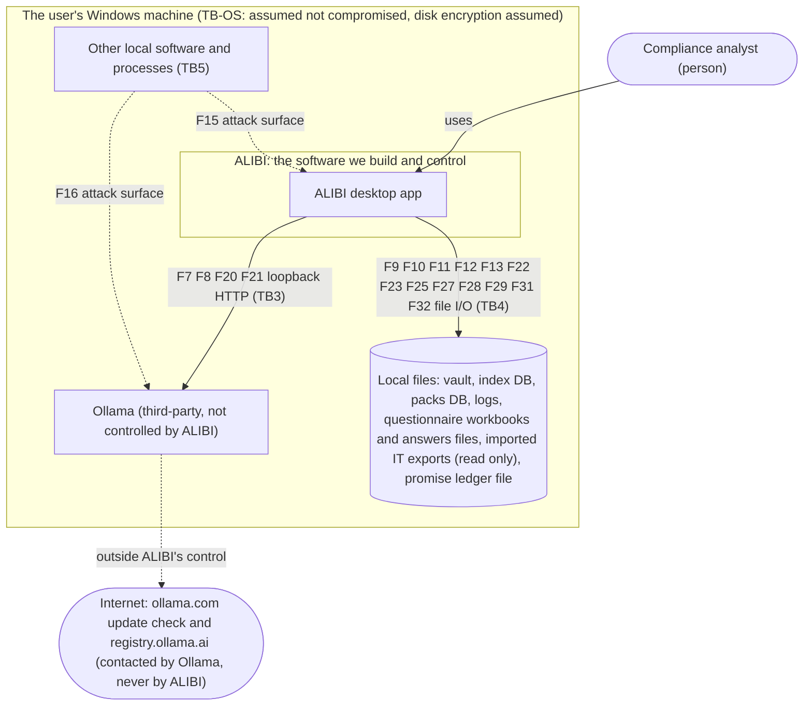
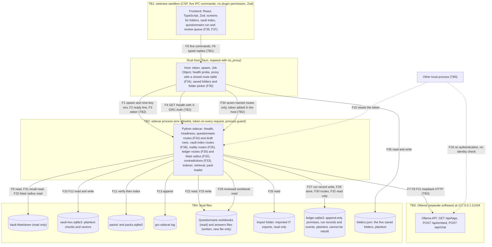

# ALIBI threat model

Status: first version. It describes the code at commit `92268cb` (main, after PR #24 merged), plus the PR 2 changes up to the end of M5 (M5i to M5n: the reading and writing halves of the questionnaire engine, its runs and routes, and live check B), plus M5.5 PR 1 (the reality check) and M5.5 PR 2 (the promise ledger, recall and blast radius, chunks 2b to 2f, branch `m55-2-ledger-recall`; Section 6, F27 to F32), plus M5.5 PR 4 (the contradiction detector, chunks 4a-1 to 4d, branch `m55-4-contradictions`; Section 6, F33; rows planned in 4a-1, labelled at the PR 4 close, with live check C measured by the owner on 2026-10-15). Facts about Ollama were checked on **2026-10-11** (Section 8). Platform: **Windows first**. Linux and macOS are not analysed (see ADR-003, `docs/adr/003-cargo-deny-windows-target.md:64`). M6 chunk 6a2 (2026-10-15) added flows F34 to F38 and rows F34-1 to F38-4 as planned; M6 chunk 6i (2026-10-16) labels them against the code at `926780b` (M6 core, chunks 6b to 6h, built in a debug build only; the rows cite tests and say what a test run was not seen to prove). Where a row cites a mutation proof, it was recorded in a pull request body and not in the repository (see the intro of Section 6, F34 to F38). Line cites into the files that M6 changed (`child_env.rs`, `sidecar_client.rs`, `tauri.conf.json`, `health.test.ts`) and into `sidecar/src/grc_sidecar/main.py` were re-anchored at the 6i close; every other line cite still points at the commit named at the start of this paragraph.

How to read this document:

- Every claim that something is **Mitigated** names a test, an ADR section (with a line), or a code location (`file:line`). If there is no such reference, the text says **claimed, not verified** or **no mitigation**. Nothing is called mitigated without evidence.
- The three labels. **Mitigated**: a control exists and evidence for it is cited (above). **claimed, not verified**: the control exists in code or configuration, but there is no test or mutation evidence for it. **No mitigation**: no control exists. That includes a control that is planned but not built, which is written as "No mitigation (planned, M5)" with the milestone that owns it, and a risk that is accepted on purpose.
- Paths are repo-relative. A test is written as the full repo-relative file path, then `::`, then the test function name (Python and Rust alike). Line numbers refer to the commit above, except references into files that the pre-M5 fix PR changed (`retrieval/service.py`, `docs/adr/010-hybrid-retrieval.md`, `packs/loader.py`, `vault/scan.py`, `vault/indexer.py`, `tests/egress_guard.py`, `docs/adr/008-framework-packs.md`), which were re-anchored in the commit that changed each file.
- Scale for risk: Likelihood (L) and Impact (I) are each Low = 1, Medium = 2, High = 3. Risk = L x I. 1 to 3 is **Low**, 4 to 6 is **Medium**, 9 is **High**. "Residual" is the risk after the cited mitigation, and is the author's judgement, not a measurement.
- Counts, **current (M6 chunk 6i, 2026-10-16)**, on `926780b` plus the uncommitted 6i documentation edits (docs only, no code changed), from `recount_counts_6i.py` run under `python -I` (a copy of the earlier throwaway counts script with a Vitest count added; output saved outside the repository, sha256 `e01ba5a6ff0e8fd489ce9e0cc69de4b1ca4250d743199c2651e4d18de5af1eb0`): **260 Rust `#[test]` functions in 31 files; 1,828 Python test functions (1,822 in `sidecar/tests`, 6 in `sidecar/ci`); 3,240 pytest collected cases (15 more deselected by the `ollama` marker); 327 `it(` and `test(` calls in 22 Vitest test files, and 422 Vitest tests run by `vitest run` (422 passed, 0 failed, 0 skipped); 31 custom Semgrep rules (22 Python, 7 Rust, 2 TypeScript)**. The script ran `pytest --collect-only` and `vitest run`: the Python and Rust tests were not executed, the 422 frontend tests were (report sha256 `a3534c8a6ed747f6b014ba639b246a61e052b73a0ec5fb02c90b424f53c294c3`; a second run gave the same numbers and a different output hash, `71f3d41abefccc379e79d6a8ffc9badb53b015ae1aafca4d8889357d28c0d763`, only because the Vitest report holds run times, report sha256 `bc7bf5237463c44d41efac5913bd71dcce6c056dea95dc2d25b620b38cb32719`). The Vitest figures are new, because no earlier count had one; the call count and the run total are different things, as the Python function count and the pytest case count are. Previous counts, recomputed at the M5.5 PR 4 close (chunk 4d) on 2026-10-15 (on `c92ba79` plus the uncommitted 4d documentation edits, which change no code; the same throwaway counts script as before, run with `python -I`, output saved outside the repository, sha256 `b0c81a04d0f616ec3d43bd4e80ef324b8e0107cc842bcfbc0272552b755570b1`; a second run gave the same numbers and a different file hash only because the output prints the collection time, sha256 `5896247dd4836e8e9045ee87921de27cece4e542bcd4aebcad2bd56ad1c5cfa6`): 166 Rust `#[test]` functions in 21 files; **1,773 Python test functions** (1,767 in `sidecar/tests`, 6 in `sidecar/ci`; the regular expression `^\s*(?:async\s+)?def test_`, matched per line over every `*.py` file under those two folders; it counts `async def test_` and methods inside classes, at any indentation, and a parametrized function counts once); **3,164 pytest collected cases** (`pytest --collect-only` from `sidecar/`, which collects `sidecar/tests` only, so the test functions in `sidecar/ci` are not in this number; 15 more cases are deselected by the `ollama` marker); 31 custom Semgrep rules (22 Python, 7 Rust, 2 TypeScript). The Python function count and the collected-case count are different things and are not comparable. Earlier counts (docs sweep 1,210 functions, 2,128 cases, 27 rules; PR 1 close 1,351, 2,433, 28; PR 2 close 1,590, 2,851, 29; chunk 4a-1 1,592, 2,853, 29) are in the git history of this file. **Re-run in M6 chunk 6a2 (2026-10-15)**, on `1711b1b` plus the uncommitted 6a2 documentation edits (docs only, no code changed), with the same counts script under `python -I`: the same four numbers, 166 Rust test functions in 21 files, 1,773 Python test functions, 3,164 pytest collected cases (15 deselected) and 31 custom Semgrep rules; the script runs `pytest --collect-only`, so no test was executed. Output hashes: before the 6a2 edits `3c0bcff88477f3222878656d3cf87fc96fa4392a150cd6f86488b803dbbcc3ea`, after `4c62d7fefc3aea7e1a0a4acbbce41b3ab2de4241c77451d1c7847e312b14c417`.
- Vitest after chunk 6l (2026-10-17, `pnpm test`, an observation from the 6l session): 440 tests in 25 test files, 0 failed. The 6i figures are dated records and were not recomputed after 6l: the 327 `it(` and `test(` calls and the 422 total are in the counts bullet above, and the 72 Vitest references are in the reference-script results further down (6l renamed one cited title, in F37-5, and cited no new test).
- Tally of the STRIDE rows in Section 6, **current (M6 chunk 6i, 2026-10-16): 225 rows, 169 Mitigated, 15 claimed, not verified, 41 no mitigation, 0 unlabelled** (from `recount_tally.py`, unchanged; the 33 rows added in 6a2, F34-1 to F38-4 including the split rows, were all "No mitigation (planned)" and are now 32 Mitigated and F37-1 claimed, not verified; F1-3b moved from no mitigation to Mitigated, F9-1b and F6-1b from claimed to Mitigated; three rows were added, all claimed, not verified: F6-1c, F20-3 and F35-3b). The script also reports one ID that is mentioned but is not a row, `F37-4`: it appears only inside verbatim Vitest titles ("edited rows (F37-4)") that were written before the 6a2 split, and no code was changed to rename it, so the earlier statement "no mentioned row ID missing" does not hold literally for this recount. The "edited rows (F37-4)" tests are the ones cited by the rows F37-4a and F37-4b (and not by F37-4c, which cites the "whole-queue refusals" tests). Counting rule: a row's label is the bold phrase that opens its evidence cell (**Mitigated**, **claimed, not verified** or **No mitigation**, defined in the list above; "No mitigation (planned, M5)" counts as no mitigation). Every row has exactly one, and one row is one threat: a threat that is partly mitigated is written as separate rows with their own labels and evidence, and a row labelled with one phrase does not contain a phrase that belongs to another label. The tally and reference scripts are throwaway, run with `python -I`, and live outside the repository, with their outputs (G28). Figures at each step, from the saved script outputs:

  | Step | Rows | Mitigated | Claimed, not verified | No mitigation | Commit |
  |---|---|---|---|---|---|
  | Docs sweep (2026-10-13) | 116 | 82 | 10 | 24 | `fed55d6` (checked on `660ea05` plus the sweep edits; wording changed, no label) |
  | PR 1 close, chunk 1f (2026-10-13) | 140 | 102 | 11 | 27 | `24051c3` (checked on `1931924` plus the 1f edits) |
  | PR 2 close (2026-10-14) | 174 | 125 | 13 | 36 | `a3e38a1` (checked on `64b6a71` plus the close edits; also run on `6171410`) |
  | PR 4 close, chunk 4d (2026-10-15) | 189 | 134 | 13 | 42 | `f81e541` (checked on `c92ba79` plus the 4d edits; re-run on `b172ce7`) |
  | M6 chunk 6a2 (2026-10-15) | 222 | 134 | 13 | 75 | uncommitted (checked on `1711b1b` plus the 6a2 edits; 33 planned rows added) |
  | M6 chunk 6i (2026-10-16) | 225 | 169 | 15 | 41 | uncommitted (checked on `926780b` plus the 6i edits; 33 planned rows labelled, three rows added) |

  Checks between those steps: PR 1 chunk 1a, 130 rows, 82 / 10 / 38; PR 2 chunk 2a, 165 rows, 102 / 11 / 52; PR 4 chunk 4a-1, 187 rows, 125 / 13 / 49 (unchanged in chunk 4a-2). What each step changed in the rows: PR 1 close, the 14 planned F25 and F26 rows got labels, the fourth F25 row was split into F25-4a and F25-4b, and ten rows were added (F25-4b, F25-11 to F25-14, F26-5 to F26-9); PR 2 close, the 25 ledger rows got labels (20 Mitigated, F29-3 and F29-5 claimed, not verified), nine rows were added (F29-8, F30-7, F31-4a, F31-4b, F32-1 to F32-5; six No mitigation, three Mitigated) and the fourth F31 row was split into F31-4a and F31-4b; that split of the change is worked out from the script's before and after totals, not counted separately; PR 4 close, F33-11 and F33-12 were added (both No mitigation, accepted) and the 13 planned F33 rows got labels (F33-1, F33-2b, F33-3, F33-4a, F33-5, F33-6, F33-7, F33-8 and F33-9 Mitigated, with F33-5 and F33-6 citing tests and no numbered mutation proof; F33-2a, F33-2c, F33-4b and F33-10 No mitigation); the same script before the owner's review fixes, with F33-6 as claimed, gave 133 / 14 / 42. Earlier additions: F12-2c, F12-4c and F21-1 to F21-9 (M5f), F22-1 to F22-10 (M5i), F23-1 to F23-12 (M5j), F24-1 to F24-10 (M5k); F12-1c, F12-2b, F12-4b and F13-1b moved to Mitigated (M5f), F21-3 from claimed to Mitigated on the live oversize probe (M5h), F23-11 and F21-8 from no mitigation to Mitigated (M5j review, M5n). M6 chunk 6i close: the 33 planned rows F34-1 to F38-4 got labels (32 Mitigated; F37-1 claimed, not verified, because a sentence on the screen cannot show that a reader acted on it); F1-3b moved from no mitigation to Mitigated; F9-1b moved from claimed to Mitigated; F6-1b moved from claimed to Mitigated after its threat was reworded to the presentational components, and the part it could not cover became the new row F6-1c; F20-3 and F35-3b were added for a hook and a test that no test exercises (all three claimed, not verified); F12-2c and F12-4c keep their label, and F5-1b stays open.

  Output hashes (sha256) of the saved runs: M6 chunk 6i tally `0bd62e5594bd9a0c0b54a6f62512fb89bf83f3e0805b2c2d922771e27d7f952f` (225 / 169 / 15 / 41, 0 unlabelled); M6 chunk 6i reference script `check_refs_6i.py` (a copy of `check_refs_4a1.py` that also resolves Rust names that do not start with `test_`, Vitest titles written as `path::"describe > it"`, and prints the current text of a `file:line` cite into a file that changed since `1711b1b`; it does not judge whether that text still shows what the sentence says): before the 6i edits, on `926780b`, 1 unresolved reference (the renamed `the_capability_grants_exactly_the_health_command_to_the_main_window` in F5-1a), sha256 `b81f30a10983a085b3a441e7b89f15fbd19c6da747e8e6919726e0d1f53b6f3a`; after the edits, 565 Rust and Python references, 72 Vitest references and 119 `file:line` references in this document, 1 and 1 in ADR-019, none in ADR-020 and ADR-021, 0 unresolved, sha256 `7c43f40d0a3fef056f81aeab667248ae82e24624145eedd655cbfc23ef8bc9bf`; re-run at the end of chunk 6i, after the ADR, CLAUDE.md, README and plan edits and the move of the mutation-proof tables into ADR-020 and ADR-021 (4 Rust and Python references and 2 `file:line` references in ADR-020, 1 Rust and Python reference in ADR-021, still 0 unresolved, 72 Vitest references in this document), sha256 `46773296d824bd33d6a171a28e4b7af02f4fdba34df59aac23962b6d066d7261`, and the tally gave the same 225 / 169 / 15 / 41 with the same hash (the first run after the edits, sha256 `a5b86fb4ec9118224964aad1e4665843f0128b331f21e43936e1697825275d4a`, found one Vitest title that is a generated test name, now cited as its group; the Rust and Python count is higher than the 442 of the earlier script only because that script matched names starting with `test_`); M6 chunk 6a2 tally `d31123718ac6ced44fcb96615803095cca106a15fa3dcecd95df27f5eea1940d` (222 / 134 / 13 / 75, after the rows were split so that each row is one threat; an earlier run with 28 planned rows, before the split, gave 217 / 134 / 13 / 70 with sha256 `5a25cf28759515bbd3c37d6ea8fd3a8aafc7895bd5a5b8c35947ba1b1771193f`; the same script before the 6a2 edits, on `1711b1b` plus the two new ADRs and five amendment notes, gave 189 / 134 / 13 / 42 with sha256 `32def7312790415931aae92efb8fbe85dbb78224ef035108a290e5a693948007`); M6 chunk 6a2 reference script `check_refs_4a1.py` (run unchanged; it resolves `path::test_name` and `file:line` references only, and the planned rows cite none): 442 test references and 114 `file:line` references in this document, 1 and 1 in ADR-019, 0 unresolved, sha256 `7bc7d01a2410d411a8d035f619170601f9cd7526489161687a1c3cacb5782878` (identical before and after the edits; its "changed rows" check still examines only the F33, G38 and LLM06 rows, so the new rows are covered by the whole-document check only); PR 4 close tally `322cad65b176d3c3042699e9e91900f89e675cf29a9f46bb07534c217f7d1236` (after the review fixes); PR 2 close tally `d1b95d6696720903afca58515fde9be914eb5fc2e2f1e6c9df9b9f45d6e9805c`; chunk 1f tally `bbe3d2a5f59e229aa226f9b7336653eae36f7ea943ad893c700283b4ca590cf2`. The reference script (`check_refs_4a1.py`, which checks that every `path::test_name` and `file:line` reference resolves) found at the PR 4 close (chunk 4d) 441 test references and 112 `file:line` references in this document and 1 `file:line` reference in ADR-019, 18 changed or added rows examined (51 test references in them), 0 unresolved, output sha256 `e0dc11dc9e280c5f467495f4f021d8c13496af41f7e3b1699b12532be863d7e9`; re-run at the M5.5 close on `43d4b5a` plus the close edits (G43, added in `b03a8f3`, cites one test and two `file:line` references): 442 test references and 114 `file:line` references in this document, 1 test reference and 1 `file:line` reference in ADR-019, 0 unresolved, output sha256 `25b646859b2bc38b8acdde04419349472ca33bf463b2447483fa49dbb8de607c`. The tally re-run at the close (twice, identical) gave 189 / 134 / 13 / 42, 0 unlabelled, sha256 `a5bad2ba03b242a0551605e28cc6377a93bae62744fe94295a137d34957931c5`. It checks that a test function exists, not that it passes, and its header text still says "chunk 4a-1". **Limit:** it recognizes `file:line` references only when they start with a top-level folder such as `sidecar/`, so unprefixed paths cited in ADR-017 and ADR-018 (`questionnaire/writer.py`, `questionnaire/runs.py`) were checked by reading, not by the script. Hashes of the other saved runs, and the earlier reference-script totals (293 test references at PR 1, 396 at PR 2, 398 to 399 at chunk 4a), are in the git history of this file.

---

## 1. Scope and assumptions

ALIBI is a local-first desktop app (Tauri host, Python sidecar, local Ollama, a Markdown vault). Today the sidecar serves `GET /health`, `GET /readiness`, the five questionnaire routes (the four of M5k plus `POST /questionnaire/draft`, which returns the rows of a finished draft for the review queue, M6 chunk 6b; `sidecar/src/grc_sidecar/main.py:130-136` lists every router), the two vault-index routes `POST /vault/index` and `GET /vault/index/{job_id}` (M6 chunk 6b) and the three reality-check routes `POST /reality/inspect`, `GET /reality/claims` and `POST /reality/check` (M5.5 PR 1). The indexer is reached through the vault-index routes and, for the pack loader, at load; retrieval is library code reached only through a questionnaire run. Reading and writing questionnaire files and the routes that run an answering job are built (M5i to M5k, Sections 5 and 6, F22 to F24), the reality check is built (M5.5 PR 1, F25 and F26). The promise ledger is built (M5.5 PR 2, chunks 2b to 2f, F27 to F32): the run record, the append-only ledger file, the reviewed-workbook import, recall, void, acknowledge and the blast-radius preview, with their routes `POST /ledger/import`, `GET /ledger/customers`, `GET /ledger/promises`, `POST /ledger/recall`, `POST /ledger/promises/{id}/void`, `POST /ledger/promises/{id}/acknowledge` and `POST /ledger/blast-radius`. The contradiction detector is built (M5.5 PR 4, F33), with its route `POST /contradictions/run`. Policy-to-code (M7) is not built, so its flow is listed as planned (Section 5) and analysed when it is built. **Built in M6 core, debug build only** (chunks 6b to 6h; `docs/adr/020-host-proxy-folders-polling.md` and `docs/adr/021-read-only-routes-and-review-queue.md`): the host proxy with a closed route table, folders saved by the host and applied at the next launch, a vault index action, a questionnaire run with polled progress and a read-only review queue of the finished draft. They are analysed as flows F34 to F38 and as rows in Section 6, labelled at the M6 close (chunk 6i); a row that no test runs is claimed, not verified (F6-1c, F20-3, F35-3b, F37-1), and the close checklist in the real window was run once by hand on 2026-10-16, on one machine (F5-1b, G12). **Planned, not built:** the ledger, recall, blast-radius, contradiction and reality screens and the graph view (M6.5). Until M8 a release build cannot start the sidecar, so every M6 screen is checked in a debug build only.

### What ALIBI defends against (in scope)

| # | Adversary or failure | Example |
|---|---|---|
| A1 | Untrusted content inside the vault or in a questionnaire | A note that says "ignore your instructions", a file with hostile YAML, a symlink that points outside the vault |
| A2 | A remote party, through anything ALIBI's own code could do over a network | Telemetry, an update check, a cloud SDK, a proxy picked up from the environment |
| A3 | Another process on the machine that does **not** hold the auth token | Port scanning the sidecar, calling `/health` or `/readiness`, a web page trying a loopback request |
| A4 | The model being wrong or manipulated | Returning text that is not in the source, treating framework text as company evidence |
| A5 | Supply chain: a bad dependency or a tampered framework pack | A malicious package version, an edited pack file |
| A6 | Our own mistakes that leak data | Document text or the token ending up in logs or stdout |

### What ALIBI does not defend against (out of scope, with the reason)

| # | Not defended | Why |
|---|---|---|
| O1 | **Malware or another process running as the same Windows user** | It can read the vault, the plaintext index, the logs, and the sidecar's memory (including the token). ADR-002 states this (`docs/adr/002-auth-middleware.md:29`). A desktop app cannot protect itself from its own user account. |
| O2 | **A local administrator or SYSTEM** | Same reason, with more power (it can read any process and any file). |
| O3 | **A compromised or malicious operating system, driver or hypervisor** | ALIBI relies on the OS for process isolation, file access control and the loopback interface. |
| O4 | **Physical access to an unlocked or unencrypted machine** | Files are plaintext at rest (Section 7). **Assumption: the user enables OS disk encryption (BitLocker or equivalent). That is an assumption stated here, not a control ALIBI provides.** |
| O5 | **Ollama's own behaviour** (its network traffic, updates, logging, authentication) | It is separate software that ALIBI does not ship or control. Section 8 records what was verified about it. |
| O6 | Denial of service by a local user | A local user can kill the process or fill the disk. |
| O7 | Side channels and hardware attacks | Out of proportion to the product. |

Partly in scope: a same-user process is out of scope for confidentiality, but ALIBI still avoids making things worse (the token is removed from the sidecar's environment, children do not inherit it, ADR-002 and the tests in Section 6, F1).

### Trusted components

The Windows kernel, the Tauri/WebView2 runtime, Python and the pinned dependencies (checked by `pip-audit`, `cargo deny`, `pnpm audit`, see F18), and the Ollama process on 127.0.0.1:11434 are trusted to behave. The last one is not verified at runtime (Section 6, F16).

---

## 2. Assets

| Asset | Where | Sensitivity | Notes |
|---|---|---|---|
| Policy vault | A folder chosen by the user: since M6 chunk 6e the host saves it and passes it as `GRC_VAULT_DIR` at the next launch; the host's own `GRC_VAULT_DIR` fallback is read in debug builds only and only when no vault is saved (`docs/adr/009-vault-indexing-contract.md:128`, `apps/desktop/src-tauri/tests/folders_settings.rs::the_debug_vault_is_used_only_when_no_vault_is_saved`) | Confidential | Markdown, plaintext, the source of truth (CLAUDE.md 8.1). ALIBI only reads it. |
| Index DB | `<index_dir>/vault-<16 hex>.sqlite3` (`sidecar/src/grc_sidecar/repositories/sqlite_vec_repo.py:139-144`) | Confidential | Derived copy: chunk text, headings, source paths, link targets, vectors, in plaintext. Disposable. |
| Packs DB | `<index_dir>/packs.sqlite3` (`sidecar/src/grc_sidecar/packs/loader.py:37-39`) | Public or authored | Derived from `packs/`. |
| Framework packs | `packs/` in the repo | Public (NIST) and original authored text | Integrity-checked at load, not signed (`sidecar/src/grc_sidecar/packs/loader.py:3-6`). |
| Auth token | Host memory, then the sidecar's environment until read once, then the middleware's memory | Secret | 32 bytes from the OS CSPRNG, 64 lowercase hex (`apps/desktop/src-tauri/src/token.rs:35-40`). |
| Questionnaires and exports | The approved questionnaire folder (`GRC_QUESTIONNAIRE_DIR`; input workbooks, read only) and the export folder (`GRC_EXPORT_DIR`; answers files). Imported IT exports (`GRC_IMPORT_DIR`, read only; built in M5.5 PR 1, F25). The promise ledger (`GRC_LEDGER_DIR`, built in M5.5 PR 2, F27 to F32; Section 7) | Confidential | Reading and writing questionnaire files is built (M5i to M5k; F22 to F24). Input files must never be overwritten (CLAUDE.md 11); the input is never opened for writing (F23-2). |
| Saved-folders file (built, M6 chunk 6e) | `folders.json`, a small JSON file in the app's config folder, written by the host (`docs/adr/020-host-proxy-folders-polling.md` decision 5; PR #42) | Operational (folder paths, no secrets) | Holds the five folders the user picked. Plaintext and writable by the same Windows user (O1). Re-validated at every start; a folder that is no longer valid is not passed to the sidecar (F35-1, F35-5). |
| Logs | `<log_dir>/grc-sidecar.log`, 1 MB x 3 rotating (`sidecar/src/grc_sidecar/logging_config.py:22-44`) | Operational | First-party code logs counts, codes and exception type names only, never document, question, answer or quote text (`sidecar/src/grc_sidecar/questionnaire/runs.py:297`, `sidecar/src/grc_sidecar/questionnaire/service.py:136`, `sidecar/src/grc_sidecar/llm/model_gate.py:149-152`; F13-1b, F24-3). |
| Model files | Ollama's folder (Section 8) | Not secret | Provisioned by a human. ALIBI never pulls. |
| Source code and CI | The repository | Integrity | Section 12, F18. |

---

## 3. Actors and trust boundaries

Actors: the **user** (trusted, single); the **webview content** (our bundled UI, constrained by CSP and one IPC command); the **Rust host**; the **Python sidecar** (confined child); **Ollama** (separate software, trusted to behave, not controlled); **other local processes** (untrusted unless they hold the token); **document authors** (vault notes, framework text, vendor files and questionnaire cells are untrusted *data*, CLAUDE.md 8.6); **the model** (output is untrusted until the backend verifies it); **dependency authors** (supply chain).

| Boundary | Between | Enforced by |
|---|---|---|
| **TB1** | Webview and Rust host | Tauri capability with five commands and no plugin permission, strict CSP, Zod parsing, a closed route table in the host (ADR-005, ADR-006, ADR-020; built in M6 chunks 6d to 6f) |
| **TB2** | Rust host and Python sidecar | Process boundary: env allowlist, token, ready-line protocol, Job Object (ADR-002, ADR-004) |
| **TB3** | Sidecar and Ollama | Loopback-only client, two allowed endpoints, model gate (ADR-009, ADR-011) |
| **TB4** | App and the filesystem | Path guard, no symlinks/junctions in the vault, index outside the vault, packs hash check |
| **TB5** | App and other local processes | Token on every request, loopback bind on an OS-assigned port |
| **TB6** | Development and supply chain | Pins, Dependabot, `pip-audit`, `cargo deny`, `pnpm audit`, gitleaks, Semgrep, Bandit, CI |

---

## 4. Diagrams

These are C4-style diagrams written as Mermaid `flowchart` blocks (no extra dependency, they render on GitHub). Dashed lines are attack surface or flows ALIBI does not control. Trust boundaries are the labelled boxes and the `TB` tags on edges.

### 4.1 System context

### 4.2 Containers

Drawn at the M6 close (chunk 6i): the host gained a proxy command with a closed route table (F34), a saved-folders file and a folder picker that only Rust calls (F35); the window gained screens that render untrusted text (F36) and a review queue (F37); the sidecar gained three routes (F38). The ledger, recall, blast-radius, contradiction and reality routes are not in the host's route table until M6.5, so no screen reaches them. Everything drawn for M6 runs in a debug build only until M8.

---

## 5. Data flow inventory

Classification: **Secret** (token), **Confidential** (policy text, anything derived from it), **Untrusted** (attacker-controlled input), **Operational** (status, paths, counts), **Public** (framework text).

| # | Flow | Source to destination | Transport | Boundary | Classification |
|---|---|---|---|---|---|
| F1 | Spawn and child environment: exactly nine keys, `SYSTEMROOT`, `GRC_AUTH_TOKEN`, `GRC_LOG_DIR`, `GRC_INDEX_DIR` (always present) and the five user folders (`GRC_VAULT_DIR`, `GRC_QUESTIONNAIRE_DIR`, `GRC_EXPORT_DIR`, `GRC_IMPORT_DIR`, `GRC_LEDGER_DIR`), each present only when saved and valid (built in M6 chunk 6e, ADR-020 decision 6) | Host to sidecar | Process environment | TB2 | Secret (token), Operational (paths) |
| F2 | Ready handshake: one stdout line `{"event":"ready","port":N}`, then stdout is sealed | Sidecar to host | stdout pipe | TB2 | Operational |
| F3 | stderr drain: last 4 KiB kept, logged at debug only | Sidecar to host | stderr pipe | TB2 | Operational (may contain paths) |
| F4 | Authenticated health probe with `X-GRC-Auth` | Host to sidecar | HTTP on 127.0.0.1, OS-assigned port | TB2 | Secret (header) |
| F5 | Five commands (built in M6 chunks 6d and 6e, ADR-020): `sidecar_health` (no arguments), `sidecar_call` (a route name from a closed enum and typed arguments) and three folder commands, `folders_get`, `folder_pick` (a folder kind from a closed list) and `folder_list_files` | Webview to host | Tauri IPC | TB1 | Operational |
| F6 | Typed reply parsed by a strict Zod schema | Host to webview | Tauri IPC | TB1 | Operational |
| F7 | Model presence check `GET /api/tags` (startup, and on demand through `/readiness`) | Sidecar to Ollama | HTTP 127.0.0.1:11434 | TB3 | Operational (model names) |
| F8 | Embedding `POST /api/embed`: chunk text at index time, question text at retrieval time | Sidecar to Ollama | HTTP 127.0.0.1:11434 | TB3 | **Confidential** |
| F9 | Vault scan: read Markdown, refuse symlinks and junctions | Vault folder to sidecar | File read | TB4 | Confidential, Untrusted |
| F10 | Index write: chunks, FTS5 text, vectors, links, metadata | Sidecar to `vault-<16 hex>.sqlite3` | SQLite file | TB4 | Confidential (plaintext) |
| F11 | Pack verify, then index | `packs/` to sidecar to `packs.sqlite3` | File read, SQLite | TB4 | Public |
| F12 | Retrieval read: FTS5, vec0, link table, staleness refresh (deletes stale rows). Reached over HTTP only through a questionnaire run (F24); the index is built through the vault-index routes (F38, M6 chunk 6b) | Sidecar to both DBs | SQLite, in-process | TB4 | Confidential |
| F13 | Logging | Sidecar to `grc-sidecar.log` | File append | TB4 | Operational |
| F14 | Webview asset load under the CSP | Bundled assets to webview | Tauri asset protocol | TB1 | Public |
| F15 | A foreign process calls the sidecar's port | Any local process to sidecar | HTTP loopback | TB5 | Attack surface |
| F16 | A foreign process calls Ollama, or squats on port 11434 before Ollama starts | Any local process to or as Ollama | HTTP loopback | TB5, TB3 | Attack surface |
| F17 | Dev-time pack conversion (`tools/oscal_to_markdown.py`, source pinned by sha256) | Human to repo | File | TB6 | Public |
| F18 | Dependencies and CI (pins, Dependabot, audits, gitleaks, Semgrep) | Registries to dev machine and CI | HTTPS (development only, never the product) | TB6 | Code |
| F19 | Question text turned into an FTS5 `MATCH` string by the query builder. **Untrusted input; the escaping is the control** | Caller to `sidecar/src/grc_sidecar/retrieval/query.py` to `lexical_search` as a bound parameter | In-process | TB4 | Untrusted |
| F20 | `GET /readiness` response `{state, models_missing, ollama}`: authenticated, configured model names only, read by the host through the proxy every 5 s while the window believes health is healthy (built in M6 chunks 6d and 6f, ADR-020; `docs/adr/011-startup-model-check.md:36` said it was not consumed yet). Each call can trigger an on-demand loopback call to Ollama (`docs/adr/011-startup-model-check.md:34`) | Sidecar to any authenticated caller | HTTP loopback | TB2 | Operational |
| F21 | Generation call (was P1; built in M5c to M5f): retrieved text and the question sent to the model as exactly two chat messages, its JSON answer back, parsed strictly and judged by code. **Called by a questionnaire run through the F24 routes** (M5k) | Sidecar to and from Ollama (`POST /api/chat`, plus `GET /api/tags` for the gate and the digest) | HTTP loopback | TB3 | Confidential, Untrusted |
| F22 | Questionnaire workbook read (built in M5i): the `.xlsx` or `.xlsm` is read once from inside the approved questionnaire folder, hashed, scanned as raw bytes (size caps, DOCTYPE and ENTITY search, content type), then parsed from those same bytes. **Reached through the F24 routes** (`inspect` and a run) | Disk to sidecar | File read | TB4 | Confidential, Untrusted |
| F23 | Answers file write (built in M5j): a new workbook with answer columns is created in the export folder, exclusively, after a read-back check and an input re-hash. **Reached through the F24 run route** | Sidecar to disk | File write | TB4 | Confidential, Untrusted (the text in it) |
| F24 | Questionnaire routes, runs and events (built in M5k): inspect, start a run, read its status and its server-sent events; one run at a time; codes and counts only. **Consumed by the host since M6** (chunks 6d to 6g): the host proxies the inspect, start and status routes and the window polls the status route about once a second; the host does not relay the event stream (ADR-020 decision 4) | Any authenticated caller to sidecar | HTTP on 127.0.0.1 | TB5 | Confidential (what it starts), Operational (what it returns) |
| F25 | **Built in M5.5 PR 1 (was P3), `docs/adr/016-control-mappings-and-reality-check.md`:** IT export import. One Okta "MFA Enrollment by User" CSV is read once from the approved import folder, streamed in chunks, four fields kept per row, counted, never stored | Disk to sidecar | File read | TB4 | Confidential (personal data), Untrusted |
| F26 | **Built in M5.5 PR 1:** the three reality-check routes (`POST /reality/inspect`, `GET /reality/claims`, `POST /reality/check`), the claim finder's read-only vault scan, and the `ControlMap` vault read (frontmatter `control_mappings` read at call time, nothing added to the index) | Any authenticated caller to sidecar; vault folder to sidecar | HTTP on 127.0.0.1; file read | TB5, TB4 | Confidential, Operational |
| F27 | **Built in M5.5 PR 2, chunk 2c, `docs/adr/017-promise-ledger-run-record-and-recall.md`:** the run record. At the end of a questionnaire run, after the answers file is written, the run's question hashes, final statuses, citations (path, lines, quote), cell-text hashes and cited-lines hashes are written to the ledger. No answer text, only hashes | Questionnaire run to the ledger file | In-process, SQLite | TB4 | Confidential (hashes, question hashes, quotes) |
| F28 | **Built in M5.5 PR 2, chunk 2b:** the ledger store `<GRC_LEDGER_DIR>/ledger.sqlite3`: customers, questions, answers, quotes, hashes and run records, append-only; not derived state | Sidecar to the ledger file | SQLite file | TB4 | Confidential (plaintext at rest) |
| F29 | **Built in M5.5 PR 2, chunk 2d:** reviewed-workbook import. The reviewed `.xlsx` is read once from the export folder through the existing loader; the Review and Answer cells are read and the Status and Evidence cells are compared with hashes from the run record | Disk to sidecar | File read | TB4 | Confidential, Untrusted |
| F30 | **Built in M5.5 PR 2, chunks 2d and 2e:** the ledger routes: import, customers, promises, recall, void, acknowledge. **Not yet consumed by the host** (planned: the ledger routes are added to the host proxy in M6.5, not in M6 core, ADR-020) | Any authenticated caller to sidecar | HTTP on 127.0.0.1 | TB5 | Confidential (names and answers in responses), Operational |
| F31 | **Built in M5.5 PR 2, chunk 2e:** recall reads the current bytes of each cited vault file (never the index) and compares the cited lines | Vault folder to sidecar | File read | TB4 | Confidential, Untrusted |
| F32 | **Built in M5.5 PR 2, chunk 2f, `docs/adr/018-blast-radius.md`:** the blast-radius route `POST /ledger/blast-radius`. It reads the live promises of one file from the ledger and the current vault file (never the index), takes the proposed new text of that file (or a delete) in the request body, holds it in memory for the request only, and writes nothing: no file, no event, no log line. Promises only; controls and backlinks are not built | Any authenticated caller to sidecar; ledger and vault folder to sidecar | HTTP on 127.0.0.1; file read | TB5, TB4 | Confidential, **Untrusted** (the proposed text) |
| F33 | **Built in M5.5 PR 4 (design and results in `docs/adr/019-contradiction-detector.md`; rows F33-1 to F33-12):** contradiction detection, `POST /contradictions/run`. Company-policy chunks are read from the index, claims with numbers are extracted by code, and each candidate pair is sent to the model as exactly two chat messages (instructions in the system message, the whole chunk of each claim and the compared sentence as delimited untrusted data), its JSON verdict comes back, and code verifies both quotes and sets the status. A use of F21, plus a route in the sidecar's one heavy-job slot, answering with one JSON response. Findings are derived on demand and not stored | Sidecar to and from Ollama (`POST /api/chat`); any authenticated caller to sidecar | HTTP loopback; HTTP on 127.0.0.1 | TB3, TB5 | Confidential, Untrusted |
| F34 | **Built in M6 core, chunk 6d (`docs/adr/020-host-proxy-folders-polling.md`; debug build only):** the host proxy. One command takes a route name from a closed enum and typed arguments; the host builds the request from a fixed table (method, path, body schema, size caps, timeout), sends it to the sidecar with the token, and returns a status and a JSON body or one of eight fixed error words. The window never supplies a URL, header, method or port | Webview to host to sidecar | Tauri IPC; HTTP on 127.0.0.1 | TB1, TB2 | Secret (token, in the host only), Confidential (replies), Operational |
| F35 | **Built in M6 core, chunk 6e (ADR-020; debug build only):** saved folders. The host saves the five folders the user picks in a small file in the app config folder, re-checks them at every start (canonical path, directory, no overlap), passes them to the sidecar at the next launch as part of nine environment keys, and opens the folder picker itself (the picker plugin is registered in Rust and the window has no permission for it). The window asks for a folder by kind and gets back a display value | Webview to host; host to config file; host to sidecar | Tauri IPC; file; process environment | TB1, TB2, TB4 | Operational (paths) |
| F36 | **Built in M6 core, chunks 6f to 6h (`docs/DESIGN.md`; debug build only):** the window renders untrusted text (question cells, draft answers, quotes) as plain text, and builds status words from code only | Sidecar replies to webview | Tauri IPC; DOM | TB1 | Confidential, Untrusted |
| F37 | **Built in M6 core, chunk 6h (`docs/adr/021-read-only-routes-and-review-queue.md`; debug build only):** the review queue shows the rows of a finished draft with the code's status, reasons and citation from the run record and the answer and question text from the workbook; it records no approval | Sidecar to webview | Tauri IPC | TB1 | Confidential, Untrusted |
| F38 | **Built in M6 core, chunk 6b (ADR-021):** three new sidecar routes, a read-only draft-rows route (reads one draft workbook from the export folder and joins the run record) and a vault index start route and status route (the start takes the shared heavy-job slot and the model gate, then the indexer writes only the index folder) | Any authenticated caller to sidecar; export, ledger and vault folders to sidecar | HTTP on 127.0.0.1; file read | TB5, TB4 | Confidential, Untrusted, Operational |
| P4 | **Planned (M7):** Terraform or Docker patch files for human review, static validation by subprocess | Sidecar to disk, sidecar to child process | File, process | TB4 | Untrusted output |

The M4 plan referred to a list of eight new flows. That list is not recorded in any file in the repository. This inventory was rebuilt from the ADRs and the code, and F19 and F20 were added on request.

---

## 6. STRIDE per data flow

Rows use the evidence rule from the top of the document. "no mitigation" rows are accepted or backlog items (Section 12).

### F1 Spawn and child environment (TB2)

| ID | STRIDE | Threat | L | I | Existing mitigation and evidence | Residual |
|---|---|---|---|---|---|---|
| F1-1a | Information disclosure | The token or paths reach a process that should not have them (inherited environment, child of the sidecar) | 1 | 3 | **Mitigated.** The host clears the environment and passes an allowlist (`apps/desktop/src-tauri/src/sidecar/spawn.rs:133`, `apps/desktop/src-tauri/src/child_env.rs:134-196`); the allowlist is exactly nine keys, `SYSTEMROOT`, `GRC_AUTH_TOKEN` and seven folder variables with the five user folders optional, and nothing is inherited (`apps/desktop/src-tauri/src/child_env.rs::the_allowlist_is_exactly_these_nine_keys`, `apps/desktop/src-tauri/src/child_env.rs::child_env_contains_only_allowlist`, `apps/desktop/src-tauri/src/child_env.rs::allowlist_never_contains_inherited_or_proxy_variables`, `apps/desktop/src-tauri/tests/supervisor_handshake.rs::with_no_user_folders_the_child_sees_only_the_four_always_present_keys`, `apps/desktop/src-tauri/tests/supervisor_handshake.rs::only_the_folders_that_are_given_reach_the_child`); the token goes only under its own key (`apps/desktop/src-tauri/src/child_env.rs::the_token_value_appears_only_under_its_own_key`, `apps/desktop/src-tauri/tests/supervisor_handshake.rs::the_child_environment_is_exactly_the_allowlist`). The sidecar reads the token once and deletes it from `os.environ` (`sidecar/src/grc_sidecar/security/auth.py:44-52`, `sidecar/tests/test_auth_token.py::test_valid_token_is_returned_and_removed_from_the_environment`). A real child of the sidecar does not inherit it (`sidecar/tests/test_child_spawns.py::test_no_subprocess_started_by_the_real_sidecar_inherits_the_token`). Built in M6 chunk 6e (`docs/adr/020-host-proxy-folders-polling.md` decision 6, PR #42): the allowlist grew from five keys to nine and the tests that pinned five keys were re-pinned to nine. Mutation proofs: PR #42 body, six proofs, not itemized; the PR body is not in the repository. | Low (3) |
| F1-1b | Information disclosure | The token stays in the Windows process environment block of the sidecar after `os.environ.pop` | 1 | 3 | **claimed, not verified.** The sidecar deletes the token from `os.environ` (`sidecar/src/grc_sidecar/security/auth.py:44-52`), but whether that also clears the Windows process environment block was never checked (G17, M8). | Low (3) |
| F1-2a | Elevation of privilege | The sidecar (or a library inside it) starts a shell or another program through Python's process-creation APIs | 1 | 3 | **Mitigated.** An audit hook vetoes nine event types (`sidecar/src/grc_sidecar/security/process_guard.py:28-40`, `sidecar/src/grc_sidecar/security/process_guard.py:71-82`); `sidecar/tests/test_process_guard.py::test_every_process_creation_api_is_blocked_under_the_guard`, `sidecar/tests/test_process_guard.py::test_the_real_sidecar_blocks_spawns_after_it_is_ready`; `docs/adr/007-sidecar-process-guard.md:18-24`. | Low (3) |
| F1-2b | Elevation of privilege | Native code inside the sidecar (`ctypes`, `LoadLibraryExW` inside `vec0`) creates a process or loads a library without going through Python | 1 | 3 | **No mitigation.** The audit hook sees only Python-level events. The gap is pinned by a test, not closed (`sidecar/tests/test_process_guard.py::test_ctypes_dlopen_is_a_known_unguarded_path`, `docs/adr/007-sidecar-process-guard.md:85-87`); the kernel-level control is G15 (M8) and the `vec0` library is unaudited (G16). | Medium (L1 x I3, but the gap is known and the native library is unaudited; kept at Medium until the kernel-level control exists) |
| F1-3a | Tampering | The vault or index path is pointed somewhere sensitive | 1 | 2 | **Mitigated.** A release build never reads `GRC_VAULT_DIR` (`docs/adr/009-vault-indexing-contract.md:128`, `apps/desktop/src-tauri/src/dev_paths.rs::dev_vault_dir_is_none_in_release`); paths must be absolute and free of NUL (`apps/desktop/src-tauri/src/child_env.rs::relative_paths_are_rejected`); the sidecar resolves both through the path guard and rejects nesting (`sidecar/tests/test_runtime_dirs.py::test_index_symlinked_into_the_vault_is_rejected`, `sidecar/tests/test_runtime_dirs.py::test_vault_symlinked_into_the_index_is_rejected`). | Low (2) |
| F1-3b | Tampering | The host forwards a user-chosen folder to the sidecar without its own `canonicalize` + `starts_with` check (CLAUDE.md 3.6 asks for both layers) | 1 | 2 | **Mitigated.** The host checks every folder before it reaches the sidecar: a picked folder is canonicalized, must be a directory and must not overlap another folder, and every saved folder is checked again at each start; an invalid one is left out of the sidecar's environment (`apps/desktop/src-tauri/tests/folders_settings.rs::a_saved_folder_that_is_not_usable_is_absent_with_a_typed_reason`, `apps/desktop/src-tauri/tests/folders_settings.rs::a_tampered_file_is_checked_again_at_the_next_start`, `apps/desktop/src-tauri/tests/folders_settings.rs::unc_device_and_nul_texts_are_never_opened_or_passed`, `apps/desktop/src-tauri/src/dev_paths.rs::an_existing_directory_is_returned_canonical_and_without_the_prefix`, `apps/desktop/src-tauri/src/folders/mod.rs::overlap_is_equal_inside_or_containing_on_whole_components`). A file name from the window gets the same kind of check before it is forwarded (F35-3). The sidecar-side path guard of F1-3a still applies, so both layers check (CLAUDE.md 3.6). Built in M6 chunk 6e (`docs/adr/020-host-proxy-folders-polling.md` decisions 5 to 7, PR #42); closes G9. Mutation proofs: PR #42 body, six proofs, not itemized. **Limit:** the overlap rule is a separate Rust copy of the sidecar's rule and no test compares the two; the link case for a file name has a weak test (F35-3b). | Low (2) |
| F1-4a | Spoofing | A different program is launched as "the sidecar" in a debug build, or in a release build today | 1 | 3 | **Mitigated.** In debug builds the interpreter path is canonicalised and must stay inside the repository's `sidecar/` (`apps/desktop/src-tauri/src/sidecar/resolve.rs:27-62`, `apps/desktop/src-tauri/tests/resolve_paths.rs::a_dot_dot_escape_is_rejected`, `apps/desktop/src-tauri/tests/resolve_paths.rs::a_symlink_escape_is_rejected`). Release builds cannot start a sidecar at all until M8 (`apps/desktop/src-tauri/src/sidecar/resolve.rs::release_builds_have_no_sidecar_configured`). | Low (2) |
| F1-4b | Spoofing | A swapped or tampered sidecar binary is launched once the sidecar is packaged (M8) | 1 | 3 | **No mitigation.** There is no packaged sidecar yet and no integrity check for one; both arrive in M8 (CLAUDE.md Section 9, M8 row). | Low (2) for now; revisit at M8 |
| F1-5 | Denial of service | The sidecar never reports ready and the app hangs | 2 | 1 | **Mitigated.** 30 s timeout, then the job is killed (`apps/desktop/src-tauri/src/sidecar/supervisor.rs:41`, `apps/desktop/src-tauri/tests/supervisor_handshake.rs::silent_child_is_killed_on_timeout`). Orphans die with the host (`apps/desktop/src-tauri/tests/job_object.rs::the_grandchild_dies_when_the_job_handle_is_dropped_without_terminate`). | Low (1) |

### F2 Ready line and F3 stderr (TB2)

| ID | STRIDE | Threat | L | I | Existing mitigation and evidence | Residual |
|---|---|---|---|---|---|---|
| F2-1 | Tampering, Spoofing | A malformed or hostile ready line (extra fields, port 0, huge line, two objects) misleads the host | 1 | 2 | **Mitigated.** Strict single-object parser with a length cap (`apps/desktop/src-tauri/src/ready.rs::ready_rejects_extra_field`, `apps/desktop/src-tauri/src/ready.rs::ready_rejects_port_zero`, `apps/desktop/src-tauri/tests/supervisor_handshake.rs::an_oversized_line_fails_and_kills`, `apps/desktop/src-tauri/tests/supervisor_handshake.rs::two_objects_on_one_line_fail_and_kill`). | Low (2) |
| F2-2a | Information disclosure, Denial of service | Anything written to stdout after the ready line (library print, content) reaches the host pipe or floods it | 1 | 2 | **Mitigated.** stdout is sealed before the server starts (`sidecar/src/grc_sidecar/security/stdio.py:42-62`, `sidecar/tests/test_runtime_guards.py::test_stray_writes_after_ready_never_reach_the_host_pipe`, `sidecar/tests/test_startup.py::test_exactly_one_line_is_ever_written_to_stdout`); the host treats later output as a failure (`apps/desktop/src-tauri/tests/supervisor_handshake.rs::output_after_the_ready_line_fails_closed`). | Low (2) |
| F2-2b | Information disclosure, Denial of service | A write that bypasses Python's `sys.stdout` and reaches the Windows stdout handle reaches the host pipe | 1 | 2 | **claimed, not verified.** The stdout seal includes a `SetStdHandle` step. It has no mutation proof (`docs/adr/007-sidecar-process-guard.md:59`): nobody has shown that a test fails without it. | Low (2) |
| F3-1a | Information disclosure | The host keeps more than a bounded tail of the sidecar's stderr (tracebacks, paths) | 1 | 1 | **Mitigated.** Bounded to the last 4 KiB (`apps/desktop/src-tauri/src/sidecar/supervisor.rs::the_tail_buffer_keeps_only_the_last_bytes`). | Low (1) |
| F3-1b | Information disclosure | The host logs the sidecar's stderr tail above debug level | 1 | 1 | **claimed, not verified.** "Logged at debug only" is a recorded gap without a mutation proof (`docs/adr/004-host-sidecar-lifecycle.md:95-122`, item 5). | Low (1) |

### F4, F15, F20 Sidecar HTTP surface (TB2, TB5)

| ID | STRIDE | Threat | L | I | Existing mitigation and evidence | Residual |
|---|---|---|---|---|---|---|
| F4-1a | Spoofing | Another local process, or a browser page, calls the sidecar without the token | 2 | 3 | **Mitigated.** A pure-ASGI middleware wraps the whole app, so even 404, 405 and 422 answer 401 with an empty body; comparison uses `hmac.compare_digest`; bind is 127.0.0.1, port 0 (`sidecar/src/grc_sidecar/security/auth.py:66-86`, `sidecar/src/grc_sidecar/main.py:142-153`). Tests: `sidecar/tests/test_auth_middleware.py::test_missing_header_is_rejected`, `sidecar/tests/test_auth_middleware.py::test_wrong_token_is_rejected`, `sidecar/tests/test_auth_middleware.py::test_comparison_uses_hmac_compare_digest`, `sidecar/tests/test_auth_middleware.py::test_unauthenticated_requests_get_401_not_404`, `sidecar/tests/test_startup.py::test_real_server_rejects_missing_and_wrong_tokens`, `sidecar/tests/test_startup.py::test_server_is_not_reachable_over_ipv6_loopback`. A browser cross-origin request needs a custom header, so its preflight carries no token and gets 401. | Low (3) |
| F4-1b | Information disclosure | A same-user process reads the token from the sidecar's memory | 1 | 3 | **No mitigation, accepted.** Out of scope (O1, Section 1): a desktop app cannot protect itself from its own user account (`docs/adr/002-auth-middleware.md:29`). | Low (3), accepted |
| F4-2a | Information disclosure | The token, sent as a plain header on loopback, is logged or printed by ALIBI's own code | 1 | 3 | **Mitigated.** The header value is marked sensitive in the host client (`apps/desktop/src-tauri/src/health.rs::the_header_value_is_marked_sensitive`, `apps/desktop/src-tauri/src/health.rs::the_client_debug_output_shows_no_token`). The token never appears in log, stdout or stderr (`sidecar/tests/test_startup.py::test_token_never_appears_in_log_stdout_or_stderr`). | Low (3) |
| F4-2b | Information disclosure | The token, sent as a plain header on loopback, is sniffed from the network stack | 1 | 3 | **No mitigation, accepted.** Sniffing loopback traffic needs an administrator: out of scope (O2, Section 1). | Low (3), accepted |
| F4-3 | Tampering | The host's probe is redirected, proxied, or answered by something else on the port | 1 | 2 | **Mitigated.** `no_proxy`, no redirects, loopback-only endpoint, port 0 rejected (`apps/desktop/src-tauri/src/sidecar_client.rs:34-42`, `apps/desktop/src-tauri/src/sidecar_client.rs:80-100` (the shared client that `health.rs` and the M6 proxy both use, moved there in M6 chunk 6d), `apps/desktop/src-tauri/src/health.rs::a_redirect_is_not_followed`, `apps/desktop/src-tauri/tests/health_proxy.rs::health_client_ignores_proxy_env`, `apps/desktop/src-tauri/src/health.rs::the_endpoint_is_loopback_only_and_rejects_port_zero`). The port comes from the sidecar's own ready line. | Low (2) |
| F4-4a | Denial of service | A huge or never-ending sidecar response ties up the host | 2 | 1 | **Mitigated.** Response body capped at 1 KiB, timeouts set (`apps/desktop/src-tauri/src/health.rs::a_chunked_body_over_the_cap_is_refused`, `apps/desktop/src-tauri/src/health.rs::a_server_that_never_answers_times_out`). | Low (2) |
| F4-4b | Denial of service | A flood of requests exhausts the sidecar | 2 | 1 | **No mitigation.** There is no request rate limiting on the sidecar (unauthenticated requests are cheap 401s). | Low (2) |
| F4-5 | Repudiation | No record of who called which endpoint | 1 | 1 | **No mitigation, accepted.** The access log is off (`sidecar/src/grc_sidecar/main.py:183-194`) so that paths and timing do not accumulate. A single-user local app has no second party to dispute a call. | Low (1) |
| F20-1 | Information disclosure | `/readiness` leaks something beyond status | 1 | 1 | **Mitigated.** The body carries only fixed words and the configured model names (`sidecar/tests/test_model_gate.py::test_the_status_never_contains_response_text`, `sidecar/tests/test_readiness.py::test_unauthenticated_requests_never_get_a_body`, `sidecar/tests/test_readiness.py::test_readiness_requires_the_token`). Built in M6 chunks 6d and 6f (PR #41, PR #43): the host reads this route through the proxy with a response cap of 16 KiB (`apps/desktop/src-tauri/src/proxy/call.rs::response_over_cap_is_refused_declared_and_chunked`, which uses the readiness route) and the window parses the reply with a strict schema that lists the closed words (`apps/desktop/src/ipc/proxy.test.ts::"the reply schemas > parses a success body for every route"`, `apps/desktop/src/readiness.test.ts::"readinessView > maps the three states of the sidecar"`). The reply is still only fixed words and model names. The 16 KiB cap is an owner decision that differs from the 1 KiB of `M6_PLAN.md` B.4 and the 1 MiB of ADR-020 decision 2 (`apps/desktop/src-tauri/src/proxy/route.rs:25-27`). | Low (1) |
| F20-2 | Denial of service | Repeated `/readiness` calls make many requests to Ollama | 1 | 1 | **Mitigated.** The gate re-checks at most every 5 s under one lock (`sidecar/tests/test_model_gate.py::test_recheck_respects_the_minimum_interval`, `sidecar/tests/test_model_gate.py::test_background_and_on_demand_checks_never_overlap`); the endpoint requires the token. Built in M6 chunk 6f (PR #43): the status bar polls this route every 5 s, the same interval as the gate's minimum, with one probe at a time (`apps/desktop/src/readiness.test.ts::"startReadinessPolling > asks once at once, then every 5 s, one probe at a time"`, `apps/desktop/src/readiness.test.ts::"startReadinessPolling > stops at once, and drops the answer of a probe still in flight"`), so the window adds at most one on-demand check per interval. That the window polls only while health is healthy is done in `apps/desktop/src/hooks/useReadiness.ts`, which no test runs (F20-3). | Low (1) |
| F20-3 | Denial of service | The window polls `/readiness` while the sidecar is starting, failed or stopped, because the hook that gates the polling on health is wrong | 1 | 1 | **claimed, not verified.** `apps/desktop/src/hooks/useReadiness.ts` starts the poller only while health is `healthy` and goes back to `unknown` otherwise, but no test runs the hook; the poller it calls is tested (F20-2), and the gate tests in `apps/desktop/src/poller.test.ts::"the hooks' polling target > stops asking when health leaves healthy, and resumes when it returns"` cover the index and run hooks' target function, not this hook. A call while the sidecar is not ready would be refused by the host as `not_ready` without a connection (`apps/desktop/src-tauri/tests/host_proxy.rs::a_call_is_not_ready_while_starting_and_after_stop_and_makes_no_connection`), so the cost of a wrong gate is wasted requests, not a leak. | Low (1) |

### F5, F6, F14 Webview and IPC (TB1)

| ID | STRIDE | Threat | L | I | Existing mitigation and evidence | Residual |
|---|---|---|---|---|---|---|
| F5-1a | Elevation of privilege | Script in the webview calls host commands beyond health, or reaches the network | 1 | 3 | **Mitigated.** In configuration: one capability grants exactly the five app commands (`sidecar_health`, `sidecar_call`, `folders_get`, `folder_pick`, `folder_list_files`) to the main window and no plugin permission, and the production CSP allows nothing remote, inline or dynamic (`apps/desktop/src-tauri/tests/security_config.rs::the_capability_grants_exactly_the_app_commands_to_the_main_window`, `apps/desktop/src-tauri/tests/security_config.rs::the_app_manifest_commands_are_exactly_the_app_commands`, `apps/desktop/src-tauri/tests/security_config.rs::the_capability_covers_each_app_command_and_nothing_more`, `apps/desktop/src-tauri/tests/security_config.rs::the_window_is_granted_no_plugin_permission`, `apps/desktop/src-tauri/tests/security_config.rs::csp_connect_src_is_ipc_only`, `apps/desktop/src-tauri/tests/security_config.rs::the_production_csp_allows_nothing_remote_inline_or_dynamic`; `docs/adr/005-webview-csp-and-capabilities.md:16-20`). Semgrep rules `grc-ts-external-fetch` and `grc-ts-dangerously-set-inner-html` back this in CI (`.semgrep/grc-airgap.yml`). The production CSP was also observed to refuse a `fetch` to a loopback address in the bundled debug build (`docs/adr/005-webview-csp-and-capabilities.md:37`). Built in M6 chunks 6d and 6e (`docs/adr/020-host-proxy-folders-polling.md` decisions 1 and 8, PR #41 and PR #42): the capability tests were changed to the exact new list on purpose, and the F34 and F35 rows describe the new tests. Mutation proofs: PR #42 body, six proofs, not itemized, so it is not known from the repository whether one of them added a dialog permission as M6_PLAN E.1 item 8 planned. | Low (3) |
| F5-1b | Elevation of privilege | The webview runs without the production CSP or with DevTools open (`pnpm tauri dev`, debug builds), and no CI job renders a webview to catch a regression | 1 | 3 | **No mitigation.** `pnpm tauri dev` has no CSP and CI does not render a webview (`docs/adr/005-webview-csp-and-capabilities.md:24`); F12 opens DevTools in debug builds (`docs/adr/005-webview-csp-and-capabilities.md:89`). Backlog G12 (M6, still open). Hand probes in the bundled debug build were reported in PR #42 (the window was refused `plugin:dialog|open`; a `fetch` to loopback was blocked by `connect-src`) and PR #45 (the page was styled under the shipped CSP; the only console error was DevTools' own request); they are in the PR bodies only, not in the repository. **Seen at the M6 close checklist (2026-10-16, owner hand check, one machine, Windows; debug build made with `pnpm build` and `pnpm tauri build --debug --no-bundle` from the 6j branch content, identical to main after PR #50; owner reports and screenshots seen by the reviewer; an observation, not a test):** in the bundled window's DevTools console, `location.origin` and `location.href` were `http://tauri.localhost` and `typeof window.__TAURI__` was `'undefined'`; a `fetch` to `http://example.com` and to `http://127.0.0.1:9` was blocked by `connect-src "ipc: http://ipc.localhost"`; `window.__TAURI_INTERNALS__.invoke('plugin:dialog|open')` was rejected with "dialog.open not allowed. Permissions associated with this command: dialog:allow-open, dialog:default"; `invoke('plugin:fs|read_dir')` was rejected with "fs.read_dir not allowed. Plugin not found"; `eval('1')` threw an `EvalError` that names `unsafe-eval` and `script-src 'self'` with a sha256 source; `invoke('sidecar_health')` returned `{status: 'healthy'}`. **DevTools Issues tab:** before chunk 6j it listed, at startup, a CSP violation "blocks the use of eval" from `index-DKLdwHig.js` line 9, caused by the `allowsEval` check in zod 4.6.5 (a caught `Function("")` probe); after chunk 6j (PR #50, `13b7f56`, merge `dc71367`) it listed only DevTools' own request for `/.well-known/appspecific/com.chrome.devtools.json`, blocked by `connect-src`. The 6j tests: the first (`apps/desktop/src/zodConfig.test.ts::"zodConfig > turns jitless on"`) proves `jitless` is set; the second (`apps/desktop/scripts/zodConfigImport.test.mjs::"zodConfig is loaded first (jitless before any schema) > finds the files that import zod at runtime"`) proves the check finds the files that import zod; one more test per such file, whose title is built in a loop and is not cited, proves the first import is `zodConfig`. None of them proves the violation is gone, and only the hand check shows that. **Release build, same date and machine** (made with `pnpm build` and `pnpm tauri build --no-bundle`, no installer): F12, Ctrl+Shift+I and right-click did nothing and no DevTools opened; the window showed "Sidecar: failed (sidecar: not_configured)" and "Navigation is off until the sidecar is healthy.", as expected for a release build. **Not done:** the installer (M8) was not tested; other checks not done are listed in docs/dev-setup.md and M6_PLAN.md. A hand check adds no CI check, and the label stays No mitigation: `pnpm tauri dev` still has no CSP and CI still renders no webview. | Low (3) |
| F6-1a | Tampering, Spoofing | A malformed or hostile reply is accepted by the IPC parsing layer | 1 | 1 | **Mitigated.** Strict Zod schemas, never throws, the channel decides and not the content (`apps/desktop/src/ipc/health.test.ts::"parseHealthResult: invalid replies are invalid_response > a JSON object that carries __proto__ is not healthy"`, `apps/desktop/src/ipc/health.test.ts::"parseHealthRejection > never throws for a hostile value"`, `apps/desktop/src/ipc/health.test.ts::"fetchHealth > an error shape that RESOLVES is invalid_response"`, `apps/desktop/src/ipc/health.test.ts::"fetchHealth > a reply shape that REJECTS is rejected, not healthy"`; `apps/desktop/src-tauri/src/health.rs::the_ipc_contract_fixture_matches_what_rust_serializes`; `docs/adr/006-window-status-polling-and-ipc-contract.md:11-15`). | Low (1) |
| F6-1b | Tampering, Spoofing | A presentational component of the window (the status bar, the health and readiness indicators, the shell, the screens) shows a parsed reply wrongly even though the parsing layer is correct | 1 | 1 | **Mitigated.** Each presentational component is rendered to static markup (no jsdom) for the parsed states it can be given, and the words for each state come from pure functions with their own tests (`apps/desktop/src/statusText.test.ts::"describeView > says starting and healthy plainly"`, `apps/desktop/src/statusText.test.ts::"describeView > shows a failure as its source and fixed code only"`, `apps/desktop/src/components/components.test.tsx::"health in the status bar > shows each of the 25 failure kinds by its code"`, `apps/desktop/src/components/components.test.tsx::"readiness in the status bar > lists the missing model names and always shows the fixed statement when degraded"`, `apps/desktop/src/components/components.test.tsx::"the shell > disables navigation and says why while the sidecar is not healthy"`; the screens are covered in F35-5, F35-6, F36-2 and F37-1 to F37-5). Built in M6 chunks 6f to 6h (`docs/adr/006-window-status-polling-and-ipc-contract.md:26-36` named the gap; PR #43, PR #46, PR #47). Mutation proofs: PR #43 body (adding a status, renaming an error word and dropping a route each failed named tests; this covers the status words and the contract names, not every component). **Limit:** static markup is not a real DOM, and the colours are placeholders with no contrast measured. `App.tsx` and the hooks are not covered here (F6-1c). | Low (1) |
| F6-1c | Tampering, Spoofing | `App.tsx` or a hook in `apps/desktop/src/hooks/` hands a parsed state to the wrong component or the wrong props | 1 | 1 | **claimed, not verified.** The glue exists (`apps/desktop/src/App.tsx`, `apps/desktop/src/hooks/`), but no test renders `App.tsx` and no test runs a hook: the pure reducers, views and pollers the hooks call are tested, and the glue is checked by type and lint only (PR #43 and PR #46 bodies say so). The only other evidence is hand checks in the bundled debug build (PR #45 and PR #46 bodies); the hand-check lines of PR #46 and PR #47 were left as placeholders. | Low (1) |
| F14-1 | Information disclosure | The webview loads a remote asset or font | 1 | 2 | **Mitigated.** `default-src 'self'`, `connect-src ipc: http://ipc.localhost`, `object-src 'none'`, frozen prototype (`apps/desktop/src-tauri/tests/security_config.rs::the_production_csp_has_exactly_the_expected_directives`, `apps/desktop/src-tauri/tests/security_config.rs::the_prototype_is_frozen`). | Low (2) |

### F7, F8, F16, F20 Sidecar and Ollama (TB3, TB5)

| ID | STRIDE | Threat | L | I | Existing mitigation and evidence | Residual |
|---|---|---|---|---|---|---|
| F8-1 | Information disclosure | Policy text or question text is sent to a non-loopback endpoint | 1 | 3 | **Mitigated.** Strict loopback validation at configuration and on every request, no proxy from the environment, no redirects (`sidecar/src/grc_sidecar/security/net.py:62-96`, `sidecar/src/grc_sidecar/config.py:103-106`; `sidecar/tests/test_net.py::test_rejects_non_loopback_or_malformed_urls`, `sidecar/tests/test_net.py::test_proxy_environment_variables_are_ignored`, `sidecar/tests/test_net.py::test_redirect_is_not_followed`, `sidecar/tests/test_embeddings_ollama.py::test_a_non_loopback_url_is_refused`). Only the factory builds HTTP clients (`sidecar/tests/test_dependency_hygiene.py::test_httpx_only_used_in_the_client_factory`, Semgrep `grc-py-httpx-client-outside-factory`). Every test run has a socket guard that covers connects and all six DNS lookup functions (`sidecar/tests/test_egress_guard.py::test_non_loopback_ipv4_connect_blocked`, `sidecar/tests/test_egress_guard.py::test_getaddrinfo_hostname_blocked`, `sidecar/tests/test_egress_guard.py::test_gethostbyname_blocks_every_name_even_localhost`, `sidecar/tests/test_egress_guard.py::test_gethostbyname_ex_blocks_every_name_even_localhost`, `sidecar/tests/test_egress_guard.py::test_gethostbyaddr_blocks_names_and_non_loopback_addresses`, `sidecar/tests/test_egress_guard.py::test_getnameinfo_blocks_names_and_non_loopback_addresses`) and CI runs the suite with no network (`.github/workflows/airgap.yml`, `sidecar/ci/test_airgap_canary.py::test_isolated_when_loopback_works_and_outside_is_blocked`). Live check B (2026-10-12): a full 15-question run through the real sidecar completed with Wi-Fi turned off by hand (passed, 654.82 s; `docs/adr/014-questionnaire-files-and-runs.md`, "Live check B results"). **Limit:** the owner's statement is "the network test result was not captured", so this shows the engine works with Wi-Fi off, not that no connection was attempted. | Low (3) |
| F8-2 | Spoofing, Information disclosure | **A rogue local listener on 127.0.0.1:11434** (started before Ollama) answers instead of Ollama and receives all chunk and question text, or returns poisoned vectors | 1 | 3 | **No mitigation.** The client only proves the address is loopback, not who answers. The loopback tests above cover non-loopback egress and do **not** cover impersonation. Dimension and model-digest checks catch an *inconsistent* embedder (`sidecar/tests/test_embeddings_ollama.py::test_probe_dimension_mismatch_fails_closed`, `sidecar/tests/test_indexer.py::test_a_different_model_digest_is_refused_and_changes_nothing`), not a malicious one. | Medium (L1 to 2 x I3 = 3 to 6). Backlog M8. Needs a same-machine attacker who starts first, so it overlaps O1. |
| F8-3 | Elevation of privilege | ALIBI is made to call another Ollama endpoint (for example `/api/pull`) | 1 | 2 | **Mitigated.** The client allows exactly `GET /api/tags` and `POST /api/embed`, enforced by a request hook, and no method takes a path (`sidecar/src/grc_sidecar/llm/ollama_embeddings.py:41-44`, `sidecar/src/grc_sidecar/llm/ollama_embeddings.py:58-61`; `sidecar/tests/test_embeddings_ollama.py::test_the_client_refuses_every_endpoint_but_tags_and_embed`, `sidecar/tests/test_dependency_hygiene.py::test_no_model_pull_endpoint_in_source`, `sidecar/tests/test_dependency_hygiene.py::test_no_model_management_endpoint_is_built_anywhere_in_source`, `sidecar/tests/test_model_gate.py::test_the_gate_never_calls_anything_but_tags`; Semgrep `grc-py-ollama-pull`). | Low (2) |
| F8-4 | Denial of service | Ollama is down, slow or missing a model | 2 | 2 | **Mitigated** by failing closed with typed errors, and retrieval degrades to keyword-only (`sidecar/tests/test_model_gate.py::test_ollama_unreachable_is_degraded_and_refuses`, `sidecar/tests/test_retrieval.py::test_embedding_failure_reports_lexical_only`, `sidecar/tests/test_startup.py::test_ready_line_does_not_wait_for_stuck_ollama`). | Low (2) |
| F8-5 | Tampering | Ollama silently truncates over-long text, so the vector no longer matches the stored chunk | 1 | 1 | **Mitigated.** `truncate: false`; an over-long input is a reported error and the file stays stale, never half-indexed (`sidecar/src/grc_sidecar/llm/ollama_embeddings.py:198`, `sidecar/tests/test_embeddings_ollama.py::test_requests_disable_truncation`; `docs/adr/009-vault-indexing-contract.md:55`). | Low (1) |
| F7-1 | Information disclosure | Ollama's error text (which could contain document text) is copied into our errors or logs | 1 | 2 | **Mitigated.** Fixed messages, nothing chained (`sidecar/tests/test_embeddings_ollama.py::test_an_ollama_error_body_never_appears_in_the_error_or_its_chain`, `sidecar/tests/test_embeddings_ollama.py::test_every_error_has_a_fixed_message`). | Low (2) |
| F16-1 | Information disclosure, Elevation of privilege | Any local process or an allowed browser origin calls Ollama directly (list models, run prompts, pull models) | 2 | 2 | **No mitigation by ALIBI.** Ollama has no authentication that was found in its source (Section 8, claim 2), and this is independent of ALIBI. ALIBI's own webview is the one origin ALIBI does control: see F16-2a to F16-2c. | Medium (4), accepted; documented in Section 8 |
| F16-2a | Information disclosure, Elevation of privilege | **ALIBI's own webview**, or script that got into it, calls Ollama directly on `127.0.0.1:11434` in a build that has the production CSP | 1 | 3 | **Mitigated.** In configuration, and observed once. The shipped CSP has `connect-src ipc: http://ipc.localhost`, so the webview may not connect to `http://127.0.0.1:11434`, whatever Ollama's CORS settings say (`apps/desktop/src-tauri/tauri.conf.json:25`, `apps/desktop/src-tauri/tests/security_config.rs::csp_connect_src_is_ipc_only`, `apps/desktop/src-tauri/tests/security_config.rs::the_production_csp_has_exactly_the_expected_directives`, `apps/desktop/src-tauri/tests/security_config.rs::the_production_csp_allows_nothing_remote_inline_or_dynamic`). In the bundled debug build, a `fetch` to another loopback address (`http://127.0.0.1:65000/`, not port 11434) was refused by `connect-src` on 2026-10-08 (`docs/adr/005-webview-csp-and-capabilities.md:37`, `docs/adr/005-webview-csp-and-capabilities.md:65`). The CSP is the control relied on here, not Ollama's origin list (F16-2c). This does not stop any other local process or browser origin: that is F16-1. | Low (3) |
| F16-2b | Information disclosure, Elevation of privilege | In `pnpm tauri dev`, which has no CSP, the development webview calls Ollama directly | 1 | 3 | **No mitigation.** The dev server serves the UI with no CSP and CI renders no webview (G12, M6, still open: the owner's close checklist was run by hand on 2026-10-16 against the bundled debug build, not against `pnpm tauri dev`, see F5-1b; `docs/adr/005-webview-csp-and-capabilities.md:24`). | Low (3) |
| F16-2c | Information disclosure, Elevation of privilege | Ollama's own origin check, the only barrier other than the CSP, would accept ALIBI's webview origin on Windows (`http://tauri.localhost`), where Ollama's default allowed origins include `tauri://*` | 1 | 3 | **claimed, not verified.** The webview's origin is `http://tauri.localhost` (`docs/adr/005-webview-csp-and-capabilities.md:63`); whether Ollama's `tauri://*` entry matches it is unverified (Section 8, claim 3), and a request from the webview to port 11434 itself was never tried. | Low (3) |

### F21 Generation call (TB3)

Evidence for the generation client's rules is `docs/adr/012-generation-client.md` (decisions, Step 0 findings with their basis, mutation proofs) and for the status rules `docs/adr/013-answer-status-and-grounding.md`. Every test below is offline against a fake Ollama (`httpx.MockTransport`) unless it says otherwise; what the real Ollama does was tested at live check A on 2026-10-11 (`docs/adr/012-generation-client.md`, "Live check A results (M5h)"), and rows that depend on it say what that check did and did not show.

| ID | STRIDE | Threat | L | I | Existing mitigation and evidence | Residual |
|---|---|---|---|---|---|---|
| F21-1 | Information disclosure, Spoofing | The prompt goes to ollama.com because the configured model is a cloud model, or a model that Ollama forwards to another host (Section 8, claim 9) | 2 | 3 | **Mitigated.** Before any request is sent, the gate refuses a model whose name matches Ollama's own cloud rule, whose `GET /api/tags` entry has `remote_host` or `remote_model` set (any non-empty value of any type), or that has a remote duplicate; the refusal is the typed 503 and covers embedding and generation alike (`sidecar/src/grc_sidecar/llm/ollama_embeddings.py:75`, `sidecar/src/grc_sidecar/llm/ollama_embeddings.py:131`, `sidecar/src/grc_sidecar/llm/generation_client.py:228`; `sidecar/tests/test_model_entries.py::test_find_local_entry_refuses_a_remote_entry`, `sidecar/tests/test_model_entries.py::test_find_local_entry_refuses_a_cloud_name_even_when_listed_as_ordinary`, `sidecar/tests/test_model_entries.py::test_one_remote_duplicate_refuses_the_name_even_if_another_entry_is_local`, `sidecar/tests/test_model_entries.py::test_ensure_ready_refuses_a_remote_embedding_model_and_sends_no_text`, `sidecar/tests/test_model_gate.py::test_a_remote_generation_model_is_refused_while_embedding_still_works`, `sidecar/tests/test_generation_client.py::test_a_cloud_or_remote_model_is_refused_before_any_request`; mutation proofs 2 and 11a to 11d, `docs/adr/012-generation-client.md`). | Low (3) |
| F21-2 | Information disclosure | Ollama forwards a request although the name and the listing both look local (for example a cloud model that does not appear in `/api/tags`, whose behaviour is unverified, Section 8, claim 9) | 1 | 3 | **claimed, not verified.** A reply that carries `remote_host` or `remote_model` is refused, but only after the prompt has left, so this is a tripwire and not a control (`sidecar/src/grc_sidecar/llm/generation_client.py:118`, `sidecar/tests/test_generation_client.py::test_a_reply_that_names_a_remote_host_is_a_tripwire`). Whether Ollama stamps every forwarded reply is unverified, and `OLLAMA_NO_CLOUD` is the user's setting, not ours (Section 8, claim 6). | Low (3); live check A prints the model list |
| F21-3 | Tampering | An over-long prompt is cut silently and the model answers from a partial context, possibly with the cited source dropped (Section 8, claim 10) | 2 | 3 | **Mitigated.** The control exists, its request side is tested, and live check A probed the real server once (see below). Every request sets `shift: false` and is exactly one system and one user message (so Ollama's message-dropping has nothing to drop), the assembled size is capped before sending, and a reply whose token count reaches the window is refused (`sidecar/src/grc_sidecar/llm/generation_client.py:148`, `sidecar/src/grc_sidecar/llm/generation_client.py:227`, `sidecar/src/grc_sidecar/llm/generation_client.py:237`; `sidecar/tests/test_generation_client.py::test_every_request_disables_context_shifting`, `sidecar/tests/test_generation_client.py::test_every_request_is_exactly_one_system_and_one_user_message`, `sidecar/tests/test_generation_client.py::test_oversize_messages_are_refused_before_anything_is_sent`, `sidecar/tests/test_generation_client.py::test_a_prompt_count_that_reaches_the_window_fails_closed`). **Live evidence (2026-10-11, Ollama 0.40.3, `/api/chat` with `shift: false`):** `sidecar/tests/test_answer_live.py::test_an_oversize_prompt_is_an_error_not_a_silent_cut` sent one prompt of about 30,000 tokens and got `status: 400` with the text "the prompt is longer than the context length currently available to the model" (`docs/adr/012-generation-client.md`, "Live check A results (M5h)"). **Limits:** one probe, one prompt shape, one Ollama version; it must be repeated after an Ollama update, and it does not show behaviour for a prompt just above the window. The token arithmetic is a secondary control (`docs/adr/012-generation-client.md`, decision 4). | Low (L1 x I3 = 3) |
| F21-4 | Information disclosure | Ollama's error text or the prompt (which holds document text) is copied into our errors or logs | 2 | 2 | **Mitigated.** Fixed messages, nothing chained, no response body (`sidecar/tests/test_generation_client.py::test_an_ollama_error_body_never_appears_in_the_error_or_its_chain`, `sidecar/tests/test_generation_client.py::test_connection_problems_are_unavailable_errors_without_the_original`, `sidecar/tests/test_generation_client.py::test_every_error_has_a_fixed_message`; mutation proofs 3a and 3b). With the real HTTP transport and every logger at DEBUG, no canary in the prompt, the question or the reply appears in any record (`sidecar/tests/test_generation_logging.py::test_no_canary_appears_in_any_log_record_at_debug`, the canaries are shown to reach the server by `sidecar/tests/test_generation_logging.py::test_the_canaries_really_travel_to_the_server_and_back`). | Low (2) |
| F21-5 | Denial of service | A model that never answers, an endless output, or a retry loop ties up the sidecar | 2 | 2 | **Mitigated.** Explicit timeouts (a longer one for the first call), an output cap derived from the schema, and one shared budget of two attempts (`sidecar/src/grc_sidecar/llm/generation_client.py:73-74`, `sidecar/src/grc_sidecar/llm/limits.py:47`, `sidecar/src/grc_sidecar/llm/retry.py:57-59`; `sidecar/tests/test_generation_client.py::test_the_default_timeouts_are_explicit_and_the_first_call_is_longer`, `sidecar/tests/test_generation_client.py::test_the_first_call_gets_the_longer_timeout_and_later_calls_the_normal_one`, `sidecar/tests/test_retry.py::test_the_loop_ends_even_if_the_attempt_always_rejects`, `sidecar/tests/test_generation_limits.py::test_num_ctx_is_derived_from_the_caps`; mutation proofs 4 and 16). Live check A measured the timeouts and found a limit: with `stream: false` the 120 s read timeout covers the whole generation, and on the CPU-only test machine (about 5.8 tokens per second) a maximal output of 1,900 tokens would take about 330 s and would time out, which fails closed as `model_unavailable` and stops a run. No call timed out in the dev run (longest question 165.8 s with two attempts). Not changed in M5h; the owner decided that M5k, before live check B, derives the read timeout from `num_predict` and the measured decode speed (roughly 600 s) as a test-asserted constant with a mutation proof, and a mid-run timeout still fails closed (`docs/adr/012-generation-client.md`, "Live check A results (M5h)", finding 1). | Low (2) |
| F21-6 | Tampering, Elevation of privilege | The model's reply is hostile or malformed and is acted on: an extra `status` field, a wrong type, an id for a source it was not shown | 2 | 3 | **Mitigated.** The reply is parsed strictly (types must match exactly, unknown keys refused, an id must be one of this request's ids) and status is computed from facts, never copied from the reply (`sidecar/src/grc_sidecar/llm/schemas.py:34`, `sidecar/src/grc_sidecar/llm/schemas.py:120`; `sidecar/tests/test_schemas.py::test_an_unknown_field_is_refused`, `sidecar/tests/test_schemas.py::test_a_wrong_type_or_value_is_refused`, `sidecar/tests/test_answer_service.py::test_a_model_that_obeys_by_adding_a_status_field_is_refused`; mutation proofs 28 to 30). The model has no tools and no code path acts on free text. | Low (3) |
| F21-7 | Elevation of privilege | ALIBI is made to call another Ollama endpoint through the generation client (for example `/api/pull`) | 1 | 2 | **Mitigated.** The client allows exactly `POST /api/chat` and `GET /api/tags`, enforced by a request hook, and the chat endpoint is spelled in one module only (`sidecar/src/grc_sidecar/llm/generation_client.py:68`, `sidecar/src/grc_sidecar/llm/generation_client.py:77`; `sidecar/tests/test_generation_client.py::test_the_client_refuses_every_endpoint_but_chat_and_tags`, `sidecar/tests/test_chat_endpoint_hygiene.py::test_only_the_generation_client_names_the_chat_endpoint`; Semgrep `grc-py-chat-endpoint-outside-generation-client`; mutation proofs 1 and 13). | Low (2) |
| F21-8 | Repudiation | A result cannot be tied to the model build, the instructions and the input that produced it | 2 | 1 | **Mitigated** (moved from No mitigation at M5n; the run summary was built in M5k). The pieces are the pinned template hash (`PROMPT_TEMPLATE_SHA256`) and the model digest from `GenerationClient.read_model_entry`, and each run's summary records the model digest before and after, the template hash and the input file's hash (`sidecar/tests/test_questionnaire_runs.py::test_the_summary_records_what_a_reviewer_needs`; F24-9 is the same control seen from the run). **Limit:** it records which build produced a draft; it does not stop a build from changing. | Low (2) |
| F21-9 | Information disclosure | Ollama writes every request body, prompts included, to a temporary folder when `OLLAMA_DEBUG_LOG_REQUESTS` is set (Section 8, claim 11) | 1 | 2 | **No mitigation by ALIBI.** The variable belongs to the user's Ollama and the sidecar cannot see it. Live checks A and B print it at three scopes and search for the folder (`docs/adr/012-generation-client.md`). At live check A (2026-10-11) `OLLAMA_DEBUG` and `OLLAMA_DEBUG_LOG_REQUESTS` were empty at Process, User and Machine scope and no `ollama-request-logs-*` folder was found in `$env:TEMP`, `$env:TMP` or `C:\Windows\Temp`; that is one observation on one day and the label stays No mitigation by ALIBI. | Low (2), accepted |

### F22 Questionnaire workbook read (TB4)

Built in M5i and reached through the routes built in M5k (F24). Evidence is `docs/adr/014-questionnaire-files-and-runs.md` (decisions, measured sizes, mutation proofs 1 to 24). The workbook is untrusted input (Section 3). The write side has its own rows (F23, M5j). All tests are offline. At M5n they were run on the Windows development machine and in the `--network none` air-gap container (2,116 passed, 12 skipped, 0 failed; `docs/adr/014-questionnaire-files-and-runs.md`, "A test that failed only in the air-gap container").

| ID | STRIDE | Threat | L | I | Existing mitigation and evidence | Residual |
|---|---|---|---|---|---|---|
| F22-1 | Denial of service | A zip bomb or an oversize workbook exhausts memory or time | 2 | 2 | **Mitigated.** Size caps (20 MiB file, 100 MiB uncompressed, 2,000 parts, 100:1 ratio) counted on the bytes actually decompressed, with the container's stated sizes used only for an early refusal (`sidecar/src/grc_sidecar/questionnaire/package.py`; `sidecar/tests/test_package_scan.py::test_a_zip_bomb_is_refused_by_ratio`, `sidecar/tests/test_package_scan.py::test_the_uncompressed_size_cap_counts_every_part`, `sidecar/tests/test_package_scan.py::test_the_count_is_of_bytes_produced_and_stops_an_endless_stream`, `sidecar/tests/test_package_scan.py::test_a_part_that_lies_about_its_size_is_not_trusted`, `sidecar/tests/test_package_scan.py::test_one_extreme_part_is_refused_even_when_the_whole_file_looks_ordinary`, `sidecar/tests/test_package_scan.py::test_the_part_count_cap_applies_to_tiny_parts`, `sidecar/tests/test_package_scan.py::test_small_parts_cannot_add_up_past_the_total_cap`, `sidecar/tests/test_package_scan.py::test_the_running_total_counts_bytes_produced_not_sizes_claimed`; mutation proofs 6 to 8, 23, 24). The part count and the total of decompressed bytes apply to every part; only the two ratio checks have the 1 MiB floor (`docs/adr/014-questionnaire-files-and-runs.md`, decision 3). **Limits:** the caps are starting values measured only on workbooks written by openpyxl, not Excel or real customer files (`docs/adr/014-questionnaire-files-and-runs.md`, decision 3). Live check B (2026-10-12): one workbook saved by Excel (the 15-question demo copy) was read within the caps and run end to end with no refusal; that is one file, not a measurement of the caps. | Low (2) |
| F22-2 | Denial of service, Information disclosure | An XML part carries a `DOCTYPE` with entity declarations (entity expansion, or an external entity read) and the standard-library parser expands it | 2 | 3 | **Mitigated.** Every part of every type is searched case-insensitively for `<!DOCTYPE` and `<!ENTITY` in ASCII/UTF-8, UTF-16LE and UTF-16BE, UTF-32 marks and declared encodings outside a short list are refused, and binary parts are accepted (`sidecar/tests/test_package_scan.py::test_a_doctype_is_refused_in_every_layout`, `sidecar/tests/test_package_scan.py::test_utf16le_billion_laughs_part_refused`, `sidecar/tests/test_package_scan.py::test_utf16be_billion_laughs_part_refused`, `sidecar/tests/test_package_scan.py::test_every_encoding_the_local_parser_reads_is_scanned`, `sidecar/tests/test_package_scan.py::test_binary_parts_are_accepted_not_refused_for_holding_nul_bytes`, `sidecar/tests/test_questionnaire_loader.py::test_nothing_refused_by_the_scan_reaches_the_parser`; mutation proofs 1 to 5, 9, 10). **Limits:** a byte search, so a harmless part that merely contains the text is refused too; it depends on which encodings this build of expat reads (`expat_2.6.0` here), which the encoding test asks the local parser instead of assuming. Live check B (2026-10-12): the Excel-saved copy passed the scan and loaded with no dropped parts and no warnings (`docs/adr/014-questionnaire-files-and-runs.md`, "Live check B results"); the scan was not tested against a hostile file saved by Excel. | Low (3) |
| F22-3 | Tampering | The file changes between the check and the parse, so a different file from the one scanned is parsed | 2 | 2 | **Mitigated** for the read side. The file is read once, the bytes are hashed and scanned, and the same bytes are parsed through `BytesIO` (`sidecar/src/grc_sidecar/questionnaire/loader.py`; `sidecar/tests/test_questionnaire_loader.py::test_the_bytes_that_were_scanned_are_the_bytes_that_are_parsed`). The re-hash before writing is the writer's rule, built in M5j (F23-3). | Low (2) |
| F22-4 | Elevation of privilege | A macro-enabled workbook runs code inside ALIBI | 1 | 3 | **claimed, not verified.** ALIBI has no VBA engine: openpyxl keeps `vbaProject.bin` as opaque bytes only when the content type says macro-enabled (`sidecar/tests/test_questionnaire_loader.py::test_a_macro_package_is_loaded_with_its_project_kept`), the installed openpyxl source has no process, network or `eval`/`exec` construct (`sidecar/tests/test_dependency_hygiene.py::test_the_spreadsheet_packages_have_no_network_process_or_telemetry_code`), and the sidecar's process guard blocks any spawn (`docs/adr/007-sidecar-process-guard.md`). No test proves that nothing executes the bytes. Opening the output in Excel is the user's own act and out of scope (Section 1). | Low (3) |
| F22-5 | Denial of service | A sparse worksheet (one cell far from the rest) makes reading it create about a million cells | 2 | 2 | **Mitigated.** A worksheet whose rows times columns exceeds 250,000 is refused before any cell is visited (`sidecar/tests/test_question_mapping.py::test_a_sparse_sheet_with_a_far_cell_is_refused_before_any_cell_is_visited`; mutation proof 20). The limit is a starting value. | Low (2) |
| F22-6 | Information disclosure, Tampering | A questionnaire path outside the approved folder (`..`, an absolute path, a link) makes the sidecar read some other file | 2 | 3 | **Mitigated** at the sidecar: the path goes through `resolve_within` before any read (`sidecar/tests/test_questionnaire_loader.py::test_a_path_that_leaves_the_root_is_refused`, `sidecar/tests/test_questionnaire_loader.py::test_an_absolute_path_outside_the_root_is_refused`, the guard's own tests in `sidecar/tests/test_paths.py`; mutation proof 14). The host-side check is a separate row (F1-3b and F35-3, built in M6 chunk 6e). The routes expose this check; the route-level evidence is F24-8. | Low (3) |
| F22-7 | Information disclosure | The parser's error text, which can quote the file, is copied into an error or a log | 2 | 2 | **Mitigated.** A refusal carries a fixed code, and a parser failure is raised outside the `except` block so nothing is chained (`sidecar/tests/test_questionnaire_loader.py::test_a_parser_failure_is_a_typed_refusal_with_nothing_chained`; mutation proof 16). The loader logs nothing; the run-level canary test through the routes is F24-3 (M5k). | Low (2) |
| F22-8 | Tampering | An exported ALIBI draft is read in again and answered, so a draft's answers are treated as questions | 2 | 1 | **Mitigated.** A header row holding one of ALIBI's own column titles is refused (`sidecar/tests/test_question_mapping.py::test_an_exported_draft_is_not_answered_again`; mutation proof 19). | Low (2) |
| F22-9 | Tampering, Elevation of privilege | A question cell holds a formula (for example a `HYPERLINK`) that is treated as question text | 2 | 2 | **Mitigated** for the read side: a formula cell is skipped and reported, never asked (`sidecar/tests/test_question_mapping.py::test_a_formula_in_the_question_cell_is_skipped_not_asked`; mutation proof 22). Formula text in an *answer* is a write-side threat (M5j). | Low (2) |
| F22-10 | Tampering | A malicious or vulnerable release of `openpyxl` or `et-xmlfile` is installed | 1 | 3 | **claimed, not verified.** Exact pins in `sidecar/pyproject.toml` and `sidecar/constraints.txt`, the dependency closure fixed at exactly two pure-Python packages, and a scan of the installed source (`sidecar/tests/test_dependency_hygiene.py::test_the_spreadsheet_dependency_closure_is_exactly_two_pure_python_packages`, `sidecar/tests/test_dependency_hygiene.py::test_the_spreadsheet_pins_are_exact_in_pyproject_and_constraints`), plus `pip-audit` in CI (F18-1a). Hash locks are not in place (F18-1b, M8), and the scan reads what is installed here, not what a later release contains. | Low (3) |

### F23 Answers file write (TB4)

Built in M5j and reached through the run route built in M5k (F24). Evidence is `docs/adr/014-questionnaire-files-and-runs.md` (decisions 10 to 13, mutation proofs 25 to 45). The text that goes into a cell comes from the model and from vault notes, so it is untrusted (Section 3). All tests are offline, on the Windows development machine.

| ID | STRIDE | Threat | L | I | Existing mitigation and evidence | Residual |
|---|---|---|---|---|---|---|
| F23-1 | Tampering, Elevation of privilege | An answer, a reason or an evidence quote that starts with `=`, `+`, `-`, `@`, tab, carriage return or line feed is read as a formula when the file is opened, or when a program reads a CSV export of it | 3 | 3 | **Mitigated** in the workbook: such text is stored as a typed string with the quote prefix style set, the text itself unchanged (`sidecar/src/grc_sidecar/questionnaire/writer.py`, `sidecar/src/grc_sidecar/questionnaire/sanitize.py`; `sidecar/tests/test_writer.py::test_formula_trigger`, `sidecar/tests/test_writer.py::test_a_formula_in_the_evidence_quote_is_neutralized_too`, `sidecar/tests/test_sanitize.py::test_each_formula_trigger_needs_the_quote_prefix`; mutation proofs 25 to 27). **Limit:** the quote prefix is a cell style, not a visible apostrophe, so it does not survive a CSV export (`docs/adr/014-questionnaire-files-and-runs.md`, decision 11). Live check B was to press F2 then Enter on one such cell in Excel; the owner's notes (2026-10-12) do not record that step, so it is **not yet evidence**. | Medium (L2 x I3 = 6) for a CSV export, Low (3) in the workbook |
| F23-2 | Tampering | The input workbook, or any existing file, is overwritten by the output | 2 | 3 | **Mitigated.** The output is created with exclusive create and a name that carries `UNREVIEWED-DRAFT`; the input is never opened for writing (`sidecar/tests/test_writer.py::test_an_existing_output_is_never_overwritten`, `sidecar/tests/test_writer.py::test_the_input_file_is_never_written_to`, `sidecar/tests/test_questionnaire_write_hygiene.py::test_the_package_follows_the_write_policy`; mutation proof 29; Semgrep rules `grc-py-questionnaire-open-mode` and `grc-py-questionnaire-file-write-call`, run locally as part of the whole rule file in the G37 and G43 runs: `semgrep --test`, which does not exercise `paths.include`, and a scan of the repository with 0 findings; neither is a GitHub Actions run). | Low (3) |
| F23-3 | Tampering | The input file changes after it was read and answered, so the answers belong to a file that no longer exists | 2 | 2 | **Mitigated.** The input is re-read and its hash compared immediately before the file is created; a difference writes nothing (`sidecar/tests/test_writer.py::test_input_changed_during_the_run_writes_nothing`; mutation proof 30). A same-user process could swap a file between that check and the create (O1, F23-12). Live check B (2026-10-12): in the two hashed runs the input's SHA-256 was equal before and after, `B76037E6…25A5DF` for the demo input (before and after opening the output in Excel) and `0186B101…2B0CCB70` for the Excel-saved copy (before and after the run), and the tests report the input hash unchanged in all three runs (`docs/adr/014-questionnaire-files-and-runs.md`, "Live check B results"). | Low (2) |
| F23-4 | Tampering, Repudiation | The saved file differs from what was meant (a cell lost or altered, a sheet reordered, a merged range or dropdown changed) and nobody notices | 2 | 3 | **Mitigated.** The saved bytes are read back through the loader and compared with the original cells, sheet order, merged ranges, data validations and row counts, and with each written cell; a difference writes nothing (`sidecar/tests/test_writer.py::test_the_reopen_check_catches_an_altered_original_cell`, `sidecar/tests/test_writer.py::test_merged_ranges_and_dropdowns_survive`, `sidecar/tests/test_writer.py::test_the_original_cells_and_the_row_count_are_unchanged`; mutation proof 33). Parts openpyxl drops are reported, not silent (`sidecar/tests/test_writer.py::test_a_dropped_part_is_reported_not_fatal`). **Limit:** both sides are openpyxl's view of the file, not Excel's. Live check B (2026-10-12): the owner opened an output in Excel and recorded original columns and text unchanged, the six new columns present, the About sheet preserved and no repair prompt or security warning; it was run a's output (the demo e2e run, confirmed by the owner), and merged cells and drop-downs are not named (`docs/adr/014-questionnaire-files-and-runs.md`, "Live check B results", part G). | Low (3) |
| F23-5 | Tampering | The output file name, built from the user's file name, escapes the export folder or is an unsafe name | 2 | 2 | **Mitigated.** Only the last path component of the source name is used, every character outside a short set becomes `_`, the length is capped, and the run id must be 8 to 64 lowercase hex characters (`sidecar/tests/test_writer.py::test_the_output_name_is_always_a_plain_file_name`, `sidecar/tests/test_writer.py::test_a_bad_run_id_cannot_make_a_name`, `sidecar/tests/test_writer.py::test_a_missing_export_folder_writes_nothing`; mutation proofs 38 to 40). | Low (2) |
| F23-6 | Tampering | An answer is exported with evidence from a vault file that has changed since retrieval | 2 | 3 | **Mitigated.** At export the cited file's hash is compared with the one recorded at retrieval; a different or unreadable file blanks the answer with `source_changed` (`sidecar/tests/test_writer.py::test_a_changed_source_blanks_the_answer`, `sidecar/tests/test_writer.py::test_an_unreadable_source_blanks_the_answer`; mutation proof 35). | Low (3) |
| F23-7 | Denial of service, Tampering | Control characters, lone surrogates or very long text in an answer make openpyxl raise or produce a file Excel calls corrupt | 2 | 2 | **Mitigated.** Unsafe characters are removed, line endings normalized and the length capped (`sidecar/tests/test_sanitize.py::test_every_character_openpyxl_refuses_is_removed`, `sidecar/tests/test_sanitize.py::test_the_text_is_capped_below_the_excel_limit_with_a_marker`, `sidecar/tests/test_writer.py::test_unsafe_characters_in_an_answer_do_not_break_the_file`; mutation proofs 41 to 43). | Low (2) |
| F23-8 | Spoofing | An answer or quote contains a link that the output turns into a clickable hyperlink | 2 | 2 | **Mitigated.** No hyperlink is ever set, and the sheet XML of the output holds none (`sidecar/tests/test_writer.py::test_no_hyperlink_is_ever_set`; mutation proof 28). Whether Excel itself turns typed text into a link when someone edits a cell is Excel's behaviour, outside ALIBI. | Low (2) |
| F23-9 | Tampering | The export or questionnaire folder is inside the vault or the index, or contains them, so ALIBI writes into the vault or beside the derived index | 2 | 3 | **Mitigated** in the sidecar: both settings are refused when they overlap the vault or the index, lexically when settings load and again on the resolved paths (`sidecar/tests/test_questionnaire_dirs.py::test_a_folder_overlapping_the_vault_or_the_index_is_rejected`, `sidecar/tests/test_questionnaire_dirs.py::test_a_link_into_the_vault_or_index_is_rejected_on_the_resolved_path`; mutation proofs 44 and 45). Since M6 chunk 6e the host passes these folders at the next launch and applies the same overlap rule before it does (F35-2); the sidecar's check is still the second layer. | Low (3) |
| F23-10 | Tampering | The cleanup after a failed read-back removes some other file | 1 | 3 | **Mitigated.** Only the path of the file just created is removed (`sidecar/tests/test_writer.py::test_a_readback_mismatch_removes_only_the_file_just_created`; mutation proofs 31 and 32; Semgrep rule `grc-py-questionnaire-delete-outside-writer`, run locally as part of the whole rule file in the G37 and G43 runs: `semgrep --test`, which does not exercise `paths.include`, and a scan of the repository with 0 findings; neither is a GitHub Actions run). | Low (3) |
| F23-11 | Spoofing | A quote or answer holds Unicode direction controls (U+202A to U+202E, U+2066 to U+2069, U+200E, U+200F, U+061C) that make text display in a misleading order | 2 | 2 | **Mitigated.** In an answer (model output) they are removed, before the formula-trigger check; in a quote, which must stay verbatim, they are kept and the Evidence cell starts with the visible marker `[contains direction-control characters] ` (`sidecar/tests/test_sanitize.py::test_each_direction_control_is_removed_from_model_text`, `sidecar/tests/test_writer.py::test_direction_controls_are_removed_from_the_answer`, `sidecar/tests/test_writer.py::test_a_direction_control_cannot_hide_a_formula_trigger`, `sidecar/tests/test_writer.py::test_a_quote_with_a_direction_control_stays_verbatim_and_is_marked`, `sidecar/tests/test_writer.py::test_a_path_with_a_direction_control_is_marked_too`; mutation proofs 46 to 49). **Limit:** a quote that carries a control still displays reordered, with a warning in front of it; homoglyphs and other look-alike characters are not handled (`docs/adr/014-questionnaire-files-and-runs.md`, decision 11). | Low (2) |
| F23-12 | Tampering | A process running as the same user swaps or replaces the file between the input re-hash and the exclusive create, or the output after it is written | 1 | 2 | **No mitigation.** A same-user process can do anything the user can (O1). The exclusive create and the read-back reduce the window and detect a swap of the output; they do not prevent one. | Low (2), accepted |

### F24 Questionnaire routes, runs and events (TB5)

Built in M5k. Evidence is `docs/adr/014-questionnaire-files-and-runs.md` (decisions 14 to 17, mutation proofs 51 to 68) and `docs/adr/012-generation-client.md` ("The read timeout, derived (M5k)"). Every unit test is offline: a scripted answerer or a mock transport stands in for Ollama. **What has run against a real Ollama (live check B, 2026-10-12):** three full 15-question runs through the real sidecar over HTTP, the event stream read while the run was going, all three completing with the input hash unchanged; two used the generated demo workbook and one used a single workbook saved by Excel (`docs/adr/014-questionnaire-files-and-runs.md`, "Live check B results"). **What has not:** the failure paths (Ollama failing or timing out mid-run, a second run started during one, a request without the token, a vault file changed during a run) were exercised only offline, a larger or customer-made Excel file has not been run, and no row below changed status because of this evidence.

| ID | STRIDE | Threat | L | I | Existing mitigation and evidence | Residual |
|---|---|---|---|---|---|---|
| F24-1 | Spoofing, Elevation of privilege | A process without the token starts a run, reads a run's status, or reads its event stream | 2 | 3 | **Mitigated.** The routes sit behind the middleware that wraps the whole app, the stream included, and an unauthorized request gets a bare 401 (`sidecar/tests/test_questionnaire_routes.py::test_questionnaire_routes_require_token`, `sidecar/tests/test_questionnaire_routes.py::test_the_event_stream_is_refused_without_the_token_even_for_a_real_run`; mutation proof 65). A foreign process that learns the token is the same-user case already in F15. | Low (3) |
| F24-2 | Information disclosure | The events or the status carry a question, an answer, a quote, a path or the file name | 2 | 2 | **Mitigated.** Events hold the run id, counts, status and reason codes only; the status holds hashes, counts and the output file name (`sidecar/tests/test_questionnaire_runs.py::test_events_hold_only_codes_counts_and_the_run_id`, `sidecar/tests/test_questionnaire_routes.py::test_events_over_http_carry_no_text`; mutation proof 60). The file name in the status is derived from the user's own file name with unsafe characters replaced (F23-5). | Low (2) |
| F24-3 | Information disclosure | Question, answer or quote text reaches a log during a run (the routes, the workbook library, the writer) | 2 | 2 | **Mitigated.** The run's own log line holds a failure code and the exception's type name; a full run through the routes at DEBUG recorded no canary from a question, an answer or a quote, and openpyxl and the zip library logged nothing (`sidecar/tests/test_questionnaire_routes.py::test_no_canary_appears_in_any_log_record_for_a_full_run_through_the_routes`, `sidecar/tests/test_questionnaire_runs.py::test_an_unexpected_error_is_a_fixed_code_and_never_its_text`; mutation proof 61). Closes the open part of G6. The code M6 added (the Rust proxy and the window) is the part G29 covers, and the F34-5 and F36-4 rows describe its logging tests; this row is about the sidecar's questionnaire routes only, and the M6 sidecar routes have canary tests of their own (F38-1, F38-2a, F38-2b). | Low (2) |
| F24-4 | Denial of service | A run, or a held model call, blocks the event loop so the sidecar stops answering, or a second run is started on top of the first | 2 | 2 | **Mitigated.** One run at a time (409); the workbook, files and hashes run off the loop; a held model call leaves `/health` answering (`sidecar/tests/test_questionnaire_routes.py::test_health_answers_during_run`, `sidecar/tests/test_questionnaire_routes.py::test_a_second_run_over_http_is_a_409_and_health_still_answers`, `sidecar/tests/test_questionnaire_runs.py::test_a_second_run_is_refused_while_one_is_going`; mutation proofs 55 and 62). A run is at most 500 questions. | Low (2) |
| F24-5 | Tampering | Answers are drafted from an index that is known to be behind the vault | 2 | 3 | **Mitigated.** A run refuses to start if the retriever's freshness check reports any vault file changed after it was indexed, or if there is no index (`sidecar/tests/test_questionnaire_runs.py::test_changed_vault_files_refuse_the_run`, `sidecar/tests/test_questionnaire_runs.py::test_an_index_that_is_not_built_refuses_the_run`, `sidecar/tests/test_vault_withheld.py::test_an_edited_file_is_listed_as_withheld`; mutation proofs 58 and 67). A file that changes during the run is handled by the status rules (PARTIAL with `evidence_withheld`, F12) and by F23-6. | Low (3) |
| F24-6 | Denial of service, Tampering | Ollama is unreachable, refuses, or times out in the middle of a run, and the run either hangs, keeps asking, or writes answers it did not get | 2 | 2 | **Mitigated.** The generation read timeout is derived from the output cap and the measured decode speed (660 s; 720 s for the first call), and a failure of the model stops the asking: the rest is blank `model_unavailable`, the file is still written, `complete` is false (`sidecar/tests/test_questionnaire_runs.py::test_when_the_model_goes_away_the_rest_is_blank_and_the_file_is_still_written`, `sidecar/tests/test_questionnaire_runs.py::test_a_generation_timeout_fails_closed_through_the_real_service`, `sidecar/tests/test_generation_limits.py::test_the_read_timeout_is_derived_from_the_output_cap_and_the_decode_speed`; mutation proofs 51 to 54 and 59). **Limit:** 5.8 tokens per second is one measurement on one machine; a slower machine can still time out, and then the run fails closed. | Low (2) |
| F24-7 | Information disclosure | An HTTP error echoes a path or a request value, or exception text | 2 | 2 | **Mitigated.** Domain errors become fixed words in one place, and a malformed body or run id is a 422 that names the fields, never the values (`sidecar/tests/test_questionnaire_routes.py::test_a_malformed_run_request_names_fields_not_values`, `sidecar/tests/test_questionnaire_routes.py::test_inspect_refuses_paths_it_must_not_read`, `sidecar/tests/test_questionnaire_routes.py::test_a_malformed_body_is_a_422_that_never_echoes_the_values`; mutation proof 66). | Low (2) |
| F24-8 | Tampering, Information disclosure | The `file` in a request names a path outside the questionnaire folder | 2 | 3 | **Mitigated** at the sidecar: the path goes through the path guard before any read, for `inspect` and for a run (`sidecar/tests/test_questionnaire_routes.py::test_inspect_refuses_paths_it_must_not_read`, `sidecar/tests/test_questionnaire_runs.py::test_a_file_outside_the_questionnaire_folder_refuses_the_run`; the guard's own mutation proof 14 in ADR-014). The host-side check is a separate row (F1-3b and F35-3, built in M6 chunk 6e). | Low (3) |
| F24-9 | Repudiation | A model replaced during a run goes unnoticed, or a draft cannot be tied to the file, model and prompt that produced it | 2 | 2 | **Mitigated.** The summary records the model's digest before and after the run, the prompt template hash and the input file's hash (`sidecar/tests/test_questionnaire_runs.py::test_the_summary_records_what_a_reviewer_needs`). **Limit:** it records a change, it does not prevent one; the digest comes from the local Ollama's own listing. | Low (2) |
| F24-10 | Elevation of privilege | The routes are used with no folders configured, so a default folder is guessed | 1 | 3 | **Mitigated.** With the vault, questionnaire or export folder unset there is no runtime and every route answers 503 `questionnaire_root_not_configured` (`sidecar/tests/test_questionnaire_routes.py::test_without_configured_folders_every_route_refuses_with_a_typed_error`, `sidecar/tests/test_questionnaire_runtime.py::test_there_is_no_runtime_unless_all_three_folders_are_configured`, `sidecar/tests/test_questionnaire_runtime.py::test_the_app_refuses_the_questionnaire_routes_when_a_folder_is_not_set`). | Low (3) |

### F25 and F26 Reality check: IT export import, routes and ControlMap (TB4, TB5)

**Built in M5.5 PR 1 (chunks 1b to 1e); labels set in chunk 1f.** Design and mutation proofs: `docs/adr/016-control-mappings-and-reality-check.md` (the mutation rows are named below as 1b-i and so on). A row says **Mitigated** only where a resolvable test is cited; where a control has no mutation proof of its own, the row says so. Every unit test is offline and uses synthetic files (`fixtures/`, `vault-demo/`); **no real Okta export has ever been read** (F25-10), and the reality check has no model, so none of it has run against Ollama. F25-4b, F25-9 and F25-10 are **No mitigation, accepted** and stay accepted; F26-9 is **claimed, not verified**. L and I are the author's judgement; the residual column was re-judged in chunk 1f and is for the owner's review. The ADR and its mutation tables are the same evidence this table cites, not a second source.

| ID | STRIDE | Threat | L | I | Existing mitigation and evidence | Residual |
|---|---|---|---|---|---|---|
| F25-1 | Denial of service | A hostile or huge CSV (size, row count, field length) exhausts memory or time | 2 | 2 | **Mitigated.** A streaming reader in 64 KiB chunks with caps on file size, rows, field length (dropped columns included) and listed exceptions (`sidecar/tests/test_reality_reader.py::test_the_file_size_cap_is_exact`, `sidecar/tests/test_reality_reader.py::test_the_row_cap_is_exact`, `sidecar/tests/test_reality_reader.py::test_the_field_cap_is_exact_and_covers_dropped_columns`, `sidecar/tests/test_reality_reader.py::test_the_same_field_across_a_64_kib_chunk_boundary`, `sidecar/tests/test_reality_check.py::test_the_exception_list_is_capped_and_the_rest_counted`; mutation proofs 1d-iii and 1e-vi in ADR-016). **Limit:** only the row cap and the 200-item list cap have a mutation proof; the file-size and field caps are tested at their exact boundary but were not broken on purpose. The caps are starting values chosen by the assistant, not measured (ADR-016 decision 9). | Low (2) |
| F25-2 | Tampering | An encoding trick or a NUL byte makes the reader see different text than a person would | 2 | 2 | **Mitigated.** An encoding allowlist (UTF-8, UTF-8 with BOM, UTF-16 with BOM), NUL bytes refused, any other encoding a typed refusal with a fixed word (`sidecar/tests/test_reality_reader.py::test_an_encoding_outside_the_allowlist_is_refused`, `sidecar/tests/test_reality_reader.py::test_utf_16_without_a_mark_is_refused`, `sidecar/tests/test_reality_reader.py::test_a_nul_character_is_refused_wherever_it_is`, `sidecar/tests/test_reality_reader.py::test_each_accepted_encoding_gives_the_same_counts`; mutation proof 1d-ii in ADR-016). | Low (2) |
| F25-3 | Information disclosure | The personal data in an export (names, emails, phone numbers) is kept, stored, logged or returned beyond what the check needs | 2 | 3 | **Mitigated.** Four fields kept per row and the rest dropped at once, nothing stored, no export content at any log level (identifiers such as `user.login` included), a canary in the login and in dropped columns shown in no log record at INFO or DEBUG, no answer, no refusal and no `repr` (`sidecar/tests/test_reality_reader.py::test_a_record_keeps_four_fields_and_shows_none_of_them`, `sidecar/tests/test_reality_reader.py::test_a_canary_in_a_dropped_column_or_the_login_is_not_in_the_inspection`, `sidecar/tests/test_reality_routes.py::test_no_canary_reaches_the_answer_or_any_log_record`, `sidecar/tests/test_reality_routes.py::test_no_canary_reaches_a_refusal_or_the_log`, `sidecar/tests/test_reality_check_routes.py::test_no_canary_reaches_any_log_record_and_logins_only_the_body`; mutation proofs 1d-iv, 1d-vi and 1e-viii in ADR-016). **Limit, stated plainly:** the retention rule is "nothing outside the four fields is kept past its row"; no parser can avoid seeing a row's other columns for an instant (ADR-016 decision 8), and the 1d-iv proof breaks only the record's own test. The logins that the check returns are F26-7. | Low (3) |
| F25-4a | Spoofing | A stale export gives a false assurance ("no exceptions") | 2 | 3 | **Mitigated.** The file's SHA-256 and the owner's `exported_at` date are shown with the claim, the finding is `exceptions_found` or `no_exceptions_in_export`, never "compliant", the fixed wording says "this export, this claim, this date; not evidence the control works", and an `exported_at` after today or not a date is refused before anything is read (`sidecar/tests/test_reality_check.py::test_the_result_carries_the_hash_the_date_and_the_fixed_wording`, `sidecar/tests/test_reality_check.py::test_an_export_date_after_today_is_refused_before_anything_is_read`, `sidecar/tests/test_reality_check.py::test_a_malformed_export_date_is_not_a_request`, `sidecar/tests/test_reality_check_routes.py::test_the_check_route_puts_the_claim_beside_counts_that_match_an_independent_pass`). **Limit:** staleness is the owner's responsibility; the date is the owner's own input and is not checked against the file. No mutation proof of the wording. | Low (3) |
| F25-4b | Spoofing, Tampering | A crafted or forged export (edited by hand, or swapped by another process) gives a false assurance | 2 | 3 | **No mitigation, accepted.** The product shows the file's hash, which proves which bytes were read, not that they came from the identity system. A forged export from a same-user process is outside what the product can detect (O1); a live connection to the identity system is a brief non-goal (F25-7). | Medium (6), accepted |
| F25-5 | Tampering | A wrong MFA set (an undocumented type string, or email and password counted) makes the count wrong | 2 | 3 | **Mitigated.** MFA is decided from `authenticators.type` only (split on commas, intersected with the owner-confirmed set), never from `authenticators.count`, which the reader never keeps; email and password never count; a confirmed type absent from the file is reported, not refused; a phone-only count shows who rests on phone alone (`sidecar/tests/test_reality_check.py::test_only_a_confirmed_type_is_mfa`, `sidecar/tests/test_reality_check.py::test_two_or_more_types_are_not_mfa`, `sidecar/tests/test_reality_check.py::test_the_count_column_is_never_used`, `sidecar/tests/test_reality_check.py::test_phone_only_truth_table`, `sidecar/tests/test_reality_check.py::test_a_confirmed_type_that_is_not_in_the_file_is_reported_not_refused`, `sidecar/tests/test_reality_check.py::test_the_demo_without_phone_matches_an_independent_count`; mutation proofs 1e-i, 1e-ii, 1e-iv and 1e-v in ADR-016). **Limit:** the check applies exactly the set it is given; whether that set is right depends on the real Okta strings, which are unverified (F25-10), and on the owner's policy choice about phone (F25-9). | Low (3) |
| F25-6 | Information disclosure | A wrong scope hides accounts: statuses other than Active dropped without a trace | 2 | 2 | **Mitigated.** Only the statuses the owner names are in scope (default `Active`, exact text); every other status is counted and shown with its text, never dropped silently (`sidecar/tests/test_reality_check.py::test_only_the_active_status_is_in_scope_and_the_rest_are_counted_by_name`, `sidecar/tests/test_reality_check.py::test_the_owner_can_choose_which_statuses_are_in_scope`; mutation proof 1e-iii in ADR-016). A file with nobody in scope is refused (F26-8). | Low (2) |
| F25-7 | Elevation of privilege | The feature grows a live connection to an identity system (a URL, key or credential parameter) | 1 | 3 | **Mitigated.** No URL, token, credential or host field in any request model; `reality/` imports no network or process module (an AST test that also sees `__import__` and `importlib`); `csv` is imported only under `reality/`; the egress guard stays on for the whole suite (`sidecar/tests/test_reality_hygiene.py::test_no_request_model_has_a_url_token_credential_or_host_field`, `sidecar/tests/test_reality_hygiene.py::test_nothing_under_reality_imports_a_network_or_process_module`, `sidecar/tests/test_reality_hygiene.py::test_csv_is_imported_only_under_reality`, `sidecar/tests/test_reality_check.py::test_the_request_models_have_no_url_token_credential_or_host_field`, `sidecar/tests/test_reality_check.py::test_an_unknown_request_field_is_rejected`; Semgrep rule `grc-py-csv-outside-reality`, `.semgrep/grc-airgap.yml:120`, with `ruleid:` and `ok:` fixtures that passed 19 of 19 when run in chunk 1d). **Limit:** these tests check the request models and imports that exist today; a future route is covered only if it is added under `reality/` or the tests are extended. The Semgrep rule has no mutation proof of its own (ADR-016, "Limits (1d)"); its fixtures and the AST test are its proof. | Low (3) |
| F25-8 | Tampering | A hostile cell in the export (a formula, or text meant for a spreadsheet) is later evaluated | 2 | 2 | **Mitigated** for the reader: cells are read as text, and a cell that begins with `=`, `+`, `-` or `@` is data and is never evaluated (`sidecar/tests/test_reality_reader.py::test_cells_are_text_and_formulas_are_never_evaluated`). **Limits:** nothing in PR 1 writes a spreadsheet, but no test asserts "nothing is written to a file"; the only guard against a later export is the process rule in ADR-016 decision 8 and backlog item G32 (any export must pass `sanitize.py` and get its own F23-class review). No mutation proof. | Low (2) |
| F25-9 | Information disclosure | SMS or voice codes count as MFA under the default set, though they can be phished | 3 | 2 | **No mitigation, accepted.** The default set is the owner's policy decision, recorded in ADR-016 decision 6, with the set confirmed at `inspect` and the phone-only count shown. Stays accepted when PR 1 closes. | Medium (6) |
| F25-10 | Spoofing | The Okta type strings are not documented, so the example strings in the fixture may not match a real export | 2 | 2 | **No mitigation, accepted.** The page does not list the strings (ADR-016 decision 3); `inspect` shows the real values and the owner confirms the set. No real export has been checked. Stays accepted when PR 1 closes. | Medium (4) |
| F25-11 | Tampering, Information disclosure | The `file` in a reality request names a path outside the import folder (`..`, an absolute path, a link) | 2 | 3 | **Mitigated** at the sidecar: the name goes through the path guard (`resolve_within`) before the file is opened, for `inspect` and for `check` (`sidecar/tests/test_reality_reader.py::test_a_name_outside_the_import_folder_is_refused`, `sidecar/tests/test_reality_reader.py::test_a_folder_is_not_a_readable_export`, `sidecar/tests/test_reality_routes.py::test_paths_that_leave_the_folder_or_do_not_exist_are_typed`, `sidecar/tests/test_reality_check_routes.py::test_paths_that_leave_the_import_folder_are_typed`; mutation proof 1d-i in ADR-016). The host-side file-name check (F35-3, built in M6 chunk 6e) covers the three proxied file routes only; the reality routes are not in the M6 proxy table (M6.5). | Low (3) |
| F25-12 | Tampering | The import folder is set to the vault, the index, the questionnaire folder or the export folder, or to a folder that contains or sits inside one, so an export is indexed or answers files are written beside it | 2 | 3 | **Mitigated.** `GRC_IMPORT_DIR` may not equal, sit inside or contain any of the four other approved roots, checked lexically when settings load and again on the resolved paths (`sidecar/tests/test_reality_dirs.py::test_a_folder_overlapping_any_other_is_rejected_when_settings_load`, `sidecar/tests/test_reality_dirs.py::test_another_folder_inside_the_import_folder_is_rejected`, `sidecar/tests/test_reality_dirs.py::test_an_import_folder_that_is_a_link_into_another_folder_is_rejected_when_resolved`, `sidecar/tests/test_reality_dirs.py::test_another_folder_that_is_a_link_into_the_import_folder_is_rejected_when_resolved`; mutation proofs 1d-v-a and 1d-v-b in ADR-016). Since M6 chunk 6e the host passes the import folder at the next launch and applies the same overlap rule before it does (F35-2); the sidecar's check is still the second layer. | Low (3) |
| F25-13 | Tampering | A data row with too few or too many cells, or a row shifted by an unquoted comma, is reshaped into a record and gives a wrong MFA answer for some user | 2 | 2 | **Mitigated.** A row whose cell count differs from the header is never padded, trimmed or guessed: it is counted as `malformed_rows`, yields no record, is left out of every other count, and still counts toward the row cap (`sidecar/tests/test_reality_reader.py::test_a_short_a_long_and_a_shifted_row_are_counted_and_left_out`, `sidecar/tests/test_reality_reader.py::test_a_malformed_row_yields_no_record`, `sidecar/tests/test_reality_reader.py::test_a_malformed_row_still_counts_toward_the_row_cap`, `sidecar/tests/test_reality_check.py::test_a_malformed_row_is_reported_and_never_counted`; mutation proof 1d-vii in ADR-016). **Limit:** a row that is the right width but has the wrong content cannot be detected. | Low (2) |
| F25-14 | Spoofing | Rows with the same `user.login` are merged or one is hidden, so an exception on one row is lost | 2 | 2 | **Mitigated.** Every well-formed row is counted on its own, nothing is merged, `duplicate_logins` is reported (found by hashing, never by keeping a login) and the result carries a fixed note that a duplicated login can be an exception on one row and not on another (`sidecar/tests/test_reality_check.py::test_a_duplicate_login_is_two_rows_and_is_reported`, `sidecar/tests/test_reality_reader.py::test_duplicate_logins_are_counted_after_trimming`). No mutation proof. | Low (2) |
| F26-1 | Denial of service | A huge vault, or a very large number of documents or mappings, makes the `ControlMap` scan slow | 2 | 2 | **Mitigated.** `MAX_DOCUMENTS = 2000` is a typed refusal (`control_map_too_large`), never a partial map; `MAX_MAPPING_ENTRIES = 64` per document leaves that document out and reports it, so one hostile note cannot disable the lookup (`sidecar/tests/test_controlmap.py::test_the_document_cap_is_a_typed_refusal_not_a_partial_map`, `sidecar/tests/test_controlmap.py::test_the_entry_cap_leaves_the_document_out_and_reports_it`). **Limit:** the document cap is applied after the scan, so it bounds the map, not the scanner's own work (the scanner has its own file caps, F9-2); the cap values are the assistant's starting values and no mutation proof was made for this row. | Low (2) |
| F26-2 | Tampering | A hostile frontmatter value (a very long or odd identifier) makes the lookup match the wrong control | 2 | 2 | **Mitigated.** The existing parser and its 64-character cap, normalization with `identifiers.py`, whole-identifier matching (`AC-2` never matches `AC-20`), the parent rule in one direction only, and an entry that is not a recognizable identifier is counted and never matched (`sidecar/tests/test_controlmap.py::test_a_longer_identifier_is_not_the_control_asked_for`, `sidecar/tests/test_controlmap.py::test_the_parent_lookup_returns_documents_mapped_to_an_enhancement`, `sidecar/tests/test_controlmap.py::test_an_enhancement_lookup_never_returns_a_document_mapped_only_to_the_parent`, `sidecar/tests/test_controlmap.py::test_an_over_long_entry_drops_the_document_and_is_reported`, `sidecar/tests/test_controlmap.py::test_entries_that_are_not_identifiers_are_counted_and_never_matched`; mutation proofs 1b-i and 1b-ii in ADR-016). **Limit:** the `5.15` / `A.5.152` case passes under mutation 1b-i for another reason (ADR-016, "Limits (1b)"). | Low (2) |
| F26-3 | Elevation of privilege | A symlink or junction in the vault points the scan outside it | 1 | 3 | **Mitigated** for symlinks: the `ControlMap` reuses the scanner, which refuses symlinks (`sidecar/tests/test_controlmap.py::test_a_symlinked_file_is_not_followed`, which skips on an account that cannot create symlinks; plus F9-1a). **Limit:** a junction is refused by the scanner this row reuses, and the scanner has junction tests since M6 chunk 6c (F9-1b), but there is no junction test through the `ControlMap` itself, so this row's claim for junctions rests on that reuse; this row has no mutation proof of its own. | Low (3) |
| F26-4 | Elevation of privilege | The reality routes are reached without the token, or with no import or vault folder configured | 1 | 3 | **Mitigated.** The routes sit behind the existing middleware (a bare 401 without the token, one proof per route family) and answer a typed 503 `import_root_not_configured` when the import or vault folder is unset or gone (`sidecar/tests/test_reality_routes.py::test_the_inspect_route_requires_the_token`, `sidecar/tests/test_reality_check_routes.py::test_both_routes_require_the_token`, `sidecar/tests/test_reality_routes.py::test_without_a_runtime_the_route_refuses_with_a_typed_error`, `sidecar/tests/test_reality_check_routes.py::test_without_a_runtime_both_routes_refuse_with_a_typed_error`, `sidecar/tests/test_reality_check_routes.py::test_a_runtime_without_a_vault_refuses_both_routes`, `sidecar/tests/test_reality_check_routes.py::test_a_vault_folder_that_is_gone_is_a_typed_503`, `sidecar/tests/test_reality_dirs.py::test_the_reality_runtime_needs_both_the_import_and_the_vault_folder`). The root-overlap rule is F25-12. **Limit:** no mutation proof of its own was made for the middleware on these routes (the middleware wraps the whole app, F4-1a, F24-1). | Low (3) |
| F26-5 | Spoofing, Tampering | A submitted claim is not exactly a candidate the finder produces from the current vault (a fragment with its qualifier words cut off, extra text, a changed letter case, moved lines, a text edited after listing), so a count is shown beside a sentence the policy does not say | 2 | 3 | **Mitigated.** The claim (path, start line, end line, quote) must equal a current candidate, the quote compared as a whole after `grounding.normalize` on both sides; anything else is refused `claim_not_verbatim` (`sidecar/tests/test_reality_claims.py::test_a_fragment_of_a_candidate_is_refused`, `sidecar/tests/test_reality_claims.py::test_a_quote_with_extra_text_or_a_changed_letter_case_is_refused`, `sidecar/tests/test_reality_claims.py::test_moved_lines_are_refused`, `sidecar/tests/test_reality_claims.py::test_a_claim_whose_text_changed_in_the_vault_is_refused`, `sidecar/tests/test_reality_claims.py::test_a_claim_whose_document_became_framework_or_vanished_is_refused`, `sidecar/tests/test_reality_check.py::test_a_fragment_of_the_claim_that_drops_its_qualifier_words_is_refused`; mutation proof 1e-vii in ADR-016). | Low (3) |
| F26-6 | Elevation of privilege, Information disclosure | The claim's `path` names a file outside the vault or reaches one through a symlink, and the finder opens it | 1 | 3 | **Mitigated.** The claim's document is looked up only among the documents `scan_vault` returns, so its path guard and symlink refusal apply and the requested path is never opened (`sidecar/tests/test_reality_claims.py::test_a_path_outside_the_vault_is_refused_even_if_the_file_holds_the_claim`, `sidecar/tests/test_reality_claims.py::test_a_path_through_a_symlink_is_refused`, `sidecar/tests/test_reality_check.py::test_a_claim_path_outside_the_vault_is_refused`). **Limit:** no mutation proof, because the lookup has no code path that opens the requested path, so there is nothing to break (ADR-016, "Limits (1e)"); the symlink test skips on an account that cannot create symlinks. | Low (3) |
| F26-7 | Information disclosure | The check's exception list returns personal data (user logins) in a response | 2 | 2 | **Mitigated** for storage and logs: the list is in the authenticated response only, per row in file order, each login stripped and shown to 256 characters, at most 200 listed and the rest counted, and no login reaches any log record at INFO or DEBUG (`sidecar/tests/test_reality_check_routes.py::test_no_canary_reaches_any_log_record_and_logins_only_the_body`, `sidecar/tests/test_reality_check.py::test_a_long_login_is_shortened_with_a_flag`, `sidecar/tests/test_reality_check.py::test_the_exception_list_is_capped_and_the_rest_counted`; mutation proofs 1e-vi and 1e-viii in ADR-016). **Limit:** a caller that holds the token receives up to 200 logins by design, and the host does not consume the route yet (planned for M6.5, not M6 core: the reality screen and its proxy route are M6.5). | Low (2) |
| F26-8 | Spoofing | A check with nobody in scope (every user suspended, a wrong status set, an empty file) reports "no exceptions" about nobody, a false assurance | 2 | 3 | **Mitigated.** A check with nobody in scope is refused (`no_users_in_scope`, HTTP 422); `inspect` shows the status values so the owner can choose the set (`sidecar/tests/test_reality_check.py::test_a_file_with_nobody_in_scope_is_refused`, `sidecar/tests/test_reality_check_routes.py::test_typed_refusals_are_422_with_a_fixed_code`). No mutation proof. | Low (3) |
| F26-9 | Spoofing | The claim's own scope or exception words ("all staff accounts", "remote") differ from what the export covers (every user), so "exceptions found" or "none" is read as a verdict on the policy | 2 | 2 | **claimed, not verified.** The finder shows a fixed list of `qualifier_words` beside each candidate and the result states "this export, this claim, this date" (`sidecar/tests/test_reality_claims.py:59` asserts the list for the demo sentence; ADR-016 decisions 10 and 11), and the claim is shown, not interpreted, so the owner reads it. No test shows that the owner is warned when the words and the export's scope differ, and no mutation proof was made. | Medium (4) |

### F27 to F32 Promise ledger: run record, store, workbook import, routes, recall and blast radius (TB4, TB5)

**Built in M5.5 PR 2 (chunks 2b to 2f); labels set at the PR 2 close.** Design and mutation proofs: `docs/adr/017-promise-ledger-run-record-and-recall.md` (mutation rows 2b-i to 2e-viii) and `docs/adr/018-blast-radius.md` (mutation rows 2f-0 to 2f-8). A row says **Mitigated** only where a resolvable test is cited; where a control has no mutation proof of its own, or a test shows less than the threat, the row says so. Every unit test is offline and uses synthetic files; no model is involved anywhere in this flow, so none of it has run against Ollama. The rows that are **No mitigation, accepted** are F28-2, F28-3, F28-4, F29-8, F30-7, F31-4a, F32-3 and F32-5: F28-2 to F28-4 by the owner's decision at the plan review (2026-10-13), the others recorded at the PR 2 close for the owner's review. F32-4 is plain **No mitigation**, listed separately: its only stated control is the scope paragraph of ADR-018 and the route's docstring, which a reader of the response does not see. L and I are the author's judgement and the residual column was re-judged at the PR 2 close; both are for the owner's review. The Excel round trip of an offline draft was checked once by the owner (STOP L3: one Excel version on one machine; Mac Excel and Google Sheets re-exports are not proven).

| ID | STRIDE | Threat | L | I | Existing mitigation and evidence | Residual |
|---|---|---|---|---|---|---|
| F27-1 | Tampering | A wrong or swapped hash is recorded (a model digest or template hash swapped, a cell hash taken before `sanitize.py` instead of after, the cited lines' hash read from the wrong range, the cited file's hash not compared), so an unedited row later reads as edited or a changed policy reads as unchanged | 2 | 3 | **Mitigated** (chunk 2c). The hashes are defined in ADR-017 decision 3 and taken from the final result after the changed-source lowering (`sidecar/tests/test_questionnaire_run_record.py::test_every_recorded_cell_hash_is_the_sha256_of_the_cell_in_the_saved_workbook`, `sidecar/tests/test_questionnaire_run_record.py::test_the_record_holds_the_run_facts_and_each_value_in_its_own_field`, `sidecar/tests/test_questionnaire_run_record.py::test_an_answer_blanked_by_the_changed_source_check_is_recorded_blank_with_its_final_status`, `sidecar/tests/test_vault_scan_cited.py::test_the_file_and_each_cited_range_are_hashed_from_the_normalized_text`, `sidecar/tests/test_questionnaire_run_record.py::test_a_cited_file_whose_hash_is_not_the_one_the_answer_carried_has_no_baseline`; mutation proofs 2c-i to 2c-v in ADR-017). **Limit:** whether Excel's own save changes any cell text was checked once, by the owner, at STOP L3 (one Excel version on one machine); the offline tests prove the hashes against openpyxl's reading of the saved file. | Low (3) |
| F27-2 | Information disclosure | The run record copies answer text or document content into the ledger or a log | 2 | 2 | **Mitigated**, about the run record only (chunk 2c). The run record holds question hashes, quotes, file names, statuses and the answer, status and evidence cells as sha256 hashes only; its record type has no answer-text field. A canary placed in a question, an answer and a quote is shown in no run summary, no event and no log record at INFO or DEBUG, the recorded answer is a 64-character hash, and the canary is absent from the run-level record (`sidecar/tests/test_questionnaire_run_record.py::test_a_canary_in_a_question_an_answer_and_a_quote_reaches_no_summary_event_or_log`, `sidecar/tests/test_questionnaire_run_record.py::test_a_recorder_that_fails_does_not_fail_the_run_and_its_message_is_not_logged`; no mutation proof of its own). **Limits:** the quote is policy text and is stored in plaintext by design (F28-3); the test asserts hashes for the answer, not that no other field could ever hold answer text; and the ledger as a whole does hold answer text, in the promises themselves (decision 7 of ADR-017), which F28-3 covers. | Low (2) |
| F27-3 | Denial of service | The ledger folder is unset or unwritable, so a questionnaire run fails or stops | 2 | 2 | **Mitigated** (chunk 2c). With no ledger folder the run works exactly as before and the summary warns `run_record_not_kept`; a recorder that fails does not fail the run, the warning is `run_record_failed`, and the exception's message is not logged (`sidecar/tests/test_questionnaire_run_record.py::test_with_no_ledger_the_run_is_unchanged_but_the_summary_says_no_record_was_kept`, `sidecar/tests/test_questionnaire_run_record.py::test_a_recorder_that_fails_does_not_fail_the_run_and_its_message_is_not_logged`, `sidecar/tests/test_questionnaire_run_record.py::test_the_runtime_has_a_ledger_recorder_only_when_a_ledger_folder_is_configured`; mutation proof 2c-vii in ADR-017 covers the unset case only). **Limit:** the record-failed path has no mutation proof of its own. | Low (2) |
| F27-4 | Denial of service | A crash between writing the answers file and writing the record leaves a draft with no record | 2 | 1 | **Mitigated** only for what the tests show (chunks 2c and 2d): the import refuses a draft that has no run record with `run_record_missing`, and a run that fails before the file is written records nothing (`sidecar/tests/test_ledger_import.py::test_a_run_with_no_record_is_refused`, `sidecar/tests/test_questionnaire_run_record.py::test_a_run_that_fails_before_the_file_is_written_records_nothing`, `sidecar/tests/test_questionnaire_run_record.py::test_the_recorder_is_called_once_and_only_after_the_answers_file_exists`). **Limits, stated plainly:** no test simulates a crash between the two writes (the answers file, then the record); mutation proof 2c-vi in ADR-017 was a stand-in (an empty `ExportResult`), not a literal reordering. The cost of that crash is that the owner cannot record promises from that draft, not a false promise. | Low (2) |
| F28-1 | Tampering | A promise is edited or deleted through the application | 2 | 3 | **Mitigated** (chunk 2b), to the application only. The repository has no update or delete method, and `BEFORE UPDATE` and `BEFORE DELETE` triggers abort on every table, including with the repository bypassed (`sidecar/tests/test_ledger_store.py::test_a_raw_update_of_any_table_is_aborted_by_a_trigger`, `sidecar/tests/test_ledger_store.py::test_a_raw_delete_from_any_table_is_aborted_by_a_trigger`, `sidecar/tests/test_ledger_store.py::test_every_table_has_both_triggers`, `sidecar/tests/test_ledger_store.py::test_the_repository_has_no_method_that_updates_or_deletes`, `sidecar/tests/test_ledger_store.py::test_no_sql_in_the_module_changes_or_removes_a_row`; mutation proofs 2b-i, 2b-ii and 2b-iii in ADR-017). A Semgrep rule, `grc-py-ledger-mutation-outside-ledger` (`.semgrep/grc-airgap.yml:230`, with fixtures in `.semgrep/fixtures/grc-airgap.py`), forbids a mutating statement against a ledger table outside the repository module; its result is recorded in G37: on 2026-10-14, in the pinned Semgrep image, its fixture test passed (20 of 20 in `grc-airgap.py`) and the scan of the repository found 0 findings. A first run the same day failed this fixture because the `ruleid:` comment of the multi-line case sat one line above the line the rule matched; the fixture was corrected (the rule was not changed) and the run repeated (commit `6171410`; deviation M55-7). **Limit:** this does not stop a same-user process (F28-2). | Low (3) |
| F28-2 | Tampering | A process running as the same Windows user opens the ledger file and drops the triggers, or edits or deletes rows | 2 | 3 | **No mitigation, accepted.** A same-user process can do anything the user can (O1). The product claims no tamper evidence: `row_sha256` detects accidental corruption only (a corrupted row fails closed on read, `sidecar/tests/test_ledger_store.py::test_a_corrupted_row_fails_closed_on_read`, which is not a defence against deliberate edits), and "immutable" in the product name means immutable to the application (ADR-017 decision 9). Answer receipts are the planned feature for tamper evidence and are not built. | Medium (6), accepted |
| F28-3 | Information disclosure | Customer names, questions, answers and quotes are readable from the ledger file by anything running as the user, by backups, or from a lost disk | 2 | 3 | **No mitigation, accepted.** ALIBI does not encrypt the ledger and adds no ACL or permission code; it depends on the stated OS disk-encryption assumption (O4), as F10-1 does for the index. Unlike the index, the ledger is not derived state and cannot be rebuilt, so the M8 setup guide must say to back it up and keep it out of a sync folder (G19 covers file ACLs). | Medium (6), accepted |
| F28-4 | Repudiation | A promise or an approval carries no user identity or approver, so nobody can show who marked it | 1 | 1 | **No mitigation, accepted.** ALIBI is single-user by design, as F4-5 records for the sidecar's routes: there is no second party to dispute an entry, and the `Review` mark is a file edit that the product treats as the owner's act. | Low (1), accepted |
| F28-5 | Tampering | The ledger folder is set to the vault, the index, the questionnaire folder, the export folder or the import folder, or to a folder that contains or sits inside one (or another folder is set inside it), so wiping the index could delete promises | 2 | 3 | **Mitigated** (chunk 2b). `GRC_LEDGER_DIR` (the only new setting; `GRC_IMPORT_DIR` exists since PR 1, F25-12) may not equal, sit inside or contain any of the five other approved roots, in both directions, checked lexically when settings load and again on resolved paths (`sidecar/tests/test_ledger_dirs.py::test_a_folder_overlapping_any_other_is_rejected_when_settings_load`, `sidecar/tests/test_ledger_dirs.py::test_another_folder_inside_the_ledger_folder_is_rejected`, `sidecar/tests/test_ledger_dirs.py::test_a_ledger_folder_that_is_a_link_into_another_folder_is_rejected_when_resolved`, `sidecar/tests/test_ledger_dirs.py::test_another_folder_that_is_a_link_into_the_ledger_folder_is_rejected_when_resolved`; mutation proofs 2b-vi and 2b-vii in ADR-017). The ledger is stored outside the index folder on purpose (ADR-017 decision 7), and the ledger file is created only inside the ledger folder (`sidecar/tests/test_ledger_store.py::test_the_database_file_is_created_only_inside_the_ledger_folder`). | Low (3) |
| F29-1 | Spoofing | A forged or swapped reviewed workbook creates false promises | 2 | 3 | **Mitigated** (chunk 2d). The `Review` mark is a human act; every question row is matched to the run record by hash and the whole import is refused on a mismatch; Status and Evidence cells are compared with hashes of what ALIBI wrote; no citation is read from the workbook (`sidecar/tests/test_ledger_import.py::test_a_changed_question_refuses_the_whole_import_with_counts_only`, `sidecar/tests/test_ledger_import.py::test_an_edited_status_cell_skips_the_row`, `sidecar/tests/test_ledger_import.py::test_an_edited_or_blanked_evidence_cell_skips_the_row`, `sidecar/tests/test_ledger_import.py::test_the_citation_is_the_run_records_even_when_the_evidence_cell_was_rewritten_by_sanitize`; mutation proofs 2d-i, 2d-ii, 2d-iii and 2d-viii in ADR-017, where 2d-viii can only fail on one specially built row). **Limits:** a file swapped by another process is the same limit as F25-4b (O1); a reviewed copy of another run of the same questionnaire is F29-8. | Low (3) |
| F29-2 | Tampering | A different workbook, sorted or deleted rows, or an edited Status or Evidence cell is imported against a run | 2 | 3 | **Mitigated** (chunk 2d). `question_mismatch` refuses the whole import with counts and no text; `status_edited` and `evidence_edited` skip the row; a run with no record is refused (`sidecar/tests/test_ledger_import.py::test_sorted_rows_are_a_question_mismatch`, `sidecar/tests/test_ledger_import.py::test_a_deleted_row_is_a_question_mismatch`, `sidecar/tests/test_ledger_import.py::test_an_extra_question_row_is_a_question_mismatch`, `sidecar/tests/test_ledger_import.py::test_each_of_alibis_six_headers_must_be_where_the_record_says`, `sidecar/tests/test_ledger_import.py::test_the_first_rule_that_applies_gives_the_skip_code`, `sidecar/tests/test_ledger_import.py::test_a_run_with_no_record_is_refused`; mutation proofs 2d-i, 2d-ii and 2d-iii in ADR-017). | Low (3) |
| F29-3 | Tampering | A hostile cell text (a formula, a link, markup or an instruction) kept in the ledger is later executed or written back into a spreadsheet | 2 | 2 | **claimed, not verified.** Imported text is stored as data and never evaluated: an Answer cell holding a formula is read as its text and kept as text (`sidecar/tests/test_ledger_import.py::test_a_formula_the_owner_typed_is_kept_as_text_and_never_evaluated`, `sidecar/tests/test_ledger_import.py::test_an_answer_that_is_not_text_is_never_converted_so_the_row_is_no_answer`). Nothing in the ledger code writes a spreadsheet, but no test asserts that, and no hostile-workbook fixture set (links, markup, instructions) was built for the import; there is no mutation proof. Any later export must pass `sanitize.py` and get its own review (G32). | Medium (4) |
| F29-4 | Spoofing | A near-miss or look-alike `Review` value (a Cyrillic letter, a non-breaking space, a zero-width character, extra words) is counted as approved | 2 | 3 | **Mitigated** (chunk 2d). The review vocabulary of ADR-017 decision 4: ASCII spaces and tabs are stripped, anything non-ASCII or with internal whitespace is "other" and is never approved (`sidecar/tests/test_ledger_review.py::test_ascii_case_and_ascii_spaces_and_tabs_around_the_word_are_accepted`, `sidecar/tests/test_ledger_review.py::test_a_look_alike_an_invisible_character_or_an_extra_word_is_never_approved`, `sidecar/tests/test_ledger_review.py::test_a_cell_that_is_not_text_is_other_never_approved`, `sidecar/tests/test_ledger_import.py::test_unrecognized_review_values_are_reported_shortened_and_counted_never_approved`; mutation proof 2d-iv in ADR-017 widens the stripping to all Unicode whitespace and is caught, which proves the refusing direction; the accepting direction (an ASCII space or tab is forgiven) has no mutation proof of its own). | Low (3) |
| F29-5 | Denial of service | A huge or hostile workbook exhausts memory or time at import | 2 | 2 | **claimed, not verified.** The import reads the workbook with the existing loader (byte scan, size, ratio and part caps, the same bytes parsed) and a file the loader refuses refuses the whole import. The import's own tests show only that second part (`sidecar/tests/test_ledger_import.py::test_a_file_the_loader_refuses_is_refused_whole`, `sidecar/tests/test_ledger_import.py::test_a_file_outside_the_export_folder_is_refused`). The caps themselves are tested in the F22 rows, not here: F22-1 for the size, ratio and part caps (`sidecar/tests/test_package_scan.py::test_a_zip_bomb_is_refused_by_ratio`, `sidecar/tests/test_package_scan.py::test_the_uncompressed_size_cap_counts_every_part`). **Limits:** no mutation proof of its own; the cap values are the F22 starting values, unmeasured; the import never saves a workbook, but no test asserts that. | Medium (4) |
| F29-6 | Information disclosure | The "other values" list reflects untrusted text from the workbook into a response or a log | 2 | 2 | **Mitigated** (chunk 2d). Each unrecognized value is shortened to a fixed length with a truncation flag, is in the authenticated response only, and is never logged (`sidecar/tests/test_ledger_review.py::test_a_value_longer_than_the_limit_is_cut_and_flagged`, `sidecar/tests/test_ledger_import.py::test_unrecognized_review_values_are_reported_shortened_and_counted_never_approved`, `sidecar/tests/test_ledger_import.py::test_a_canary_in_a_name_a_question_an_answer_and_a_review_value_reaches_no_log`). No mutation proof of its own. | Low (2) |
| F29-7 | Spoofing | An answer edited after drafting no longer matches its quote, but the promise still shows the original citation | 2 | 2 | **Mitigated** for the flag (chunk 2d): `edited_after_draft` is true when the sha256 of the Answer cell differs from the run record's hash of the text ALIBI wrote (after `sanitize.py`), so an unedited row never reads as edited (`sidecar/tests/test_ledger_import.py::test_an_edited_answer_is_flagged_and_stored_as_the_owner_left_it`, `sidecar/tests/test_ledger_import.py::test_an_unedited_answer_that_sanitize_changed_is_not_read_as_edited`, `sidecar/tests/test_offline_draft.py::test_a_draft_reviewed_in_place_imports_with_every_row_unedited`; the owner's real Excel round trip, STOP L3, imported 8 promises with 1 edited, the answer the owner changed). **Limits:** code cannot tell whether an edited answer still matches its quote (the same limit as F12-2c); STOP L3 covers one Excel version on one machine; no mutation proof of the comparison. | Medium (4) |
| F29-8 | Spoofing | A reviewed copy of another run of the same questionnaire is imported under this run's id: the question column matches, so only the Status and Evidence comparisons stand between it and the run record | 1 | 2 | **No mitigation, accepted.** The import binds a workbook to a run by the question hashes, the six header positions and the Status and Evidence cell hashes, not by any identity of the draft file itself. A copy from a different run of the same questionnaire fails mostly safe, because its status and evidence cells usually differ from this run's record and are skipped (`status_edited`, `evidence_edited`), but no test imports another run's copy under this run's id, and a copy whose status and evidence cells are identical to this run's would not be caught by those comparisons. Promises are still made only from this run's record, never from the workbook's text for citations. | Low (2), accepted |
| F30-1 | Elevation of privilege | The ledger routes are reached without the token, or with no ledger folder configured | 1 | 3 | **Mitigated** (chunks 2d, 2e and 2f). The routes sit behind the existing `AuthMiddleware` (a bare 401 without the token, one proof per route family); with `GRC_LEDGER_DIR` unset they answer a typed 503 `ledger_root_not_configured`; recall and blast radius with no vault folder answer `vault_root_not_configured` (`sidecar/tests/test_ledger_routes.py::test_every_ledger_route_needs_the_token`, `sidecar/tests/test_ledger_recall_routes.py::test_every_new_route_needs_the_token`, `sidecar/tests/test_ledger_blast_radius.py::test_the_route_needs_the_token`, `sidecar/tests/test_ledger_routes.py::test_with_no_ledger_folder_every_route_says_so`, `sidecar/tests/test_ledger_recall_routes.py::test_with_no_ledger_folder_every_new_route_says_so`, `sidecar/tests/test_ledger_blast_radius.py::test_with_no_ledger_folder_it_says_so`, `sidecar/tests/test_ledger_recall_routes.py::test_recall_without_a_vault_folder_names_the_vault_never_the_ledger`, `sidecar/tests/test_ledger_blast_radius.py::test_with_no_vault_folder_it_names_the_vault`). **Limit:** no mutation proof of its own for the middleware on these routes (it wraps the whole app, F4-1a, F24-1). | Low (3) |
| F30-2 | Tampering, Information disclosure | The `file` in an import request names a path outside the export folder (`..`, an absolute path, a link) | 2 | 3 | **Mitigated** (chunk 2d). The name goes through the path guard (`resolve_within`) before the file is opened (`sidecar/tests/test_ledger_import.py::test_a_file_outside_the_export_folder_is_refused`, `sidecar/tests/test_ledger_import.py::test_a_missing_file_is_refused`, `sidecar/tests/test_ledger_import.py::test_a_link_to_a_file_outside_the_export_folder_is_refused`; mutation proof 2d-vii in ADR-017). The host-side file-name check (F35-3, built in M6 chunk 6e) covers the three proxied file routes only; the ledger routes are not in the M6 proxy table (M6.5). | Low (3) |
| F30-3 | Information disclosure | Customer names, questions, answers or quotes reach a log record or an event | 2 | 3 | **Mitigated** (chunks 2b to 2f). No ledger content at any log level (the F13-1b practice), only counts, codes and exception type names; a canary in a customer name, a question, an answer, a quote or a review value is shown in no log record at INFO or DEBUG, and the refusal bodies carry fixed words and integers (`sidecar/tests/test_ledger_store.py::test_a_canary_in_a_name_a_question_and_an_answer_never_reaches_a_log`, `sidecar/tests/test_ledger_import.py::test_a_canary_in_a_name_a_question_an_answer_and_a_review_value_reaches_no_log`, `sidecar/tests/test_ledger_recall.py::test_a_canary_in_a_quote_an_answer_and_a_customer_name_reaches_no_log`, `sidecar/tests/test_questionnaire_run_record.py::test_a_canary_in_a_question_an_answer_and_a_quote_reaches_no_summary_event_or_log`, `sidecar/tests/test_ledger_routes.py::test_a_canary_in_an_unknown_field_is_not_echoed`, `sidecar/tests/test_ledger_store.py::test_error_texts_never_hold_caller_values`). **Limits:** the canary tests do not break the control on purpose (no mutation proof of any logging control here), and an authenticated response does return customer names, questions and answers by design. | Low (3) |
| F30-4 | Denial of service | Recall over very many promises, or a very large listing, is slow | 2 | 2 | **Mitigated** (chunks 2d and 2e). A cap on promises per recall call (2,000), refused whole with counts only; a listing page of at most 100; each distinct vault file read once per call (`sidecar/tests/test_ledger_recall.py::test_more_promises_than_the_cap_is_refused_whole_and_records_nothing`, `sidecar/tests/test_ledger_recall.py::test_the_cap_counts_only_promises_that_are_not_voided`, `sidecar/tests/test_ledger_recall_routes.py::test_too_many_promises_is_a_typed_refusal_with_counts_only`, `sidecar/tests/test_ledger_routes.py::test_a_page_holds_at_most_one_hundred_promises`, `sidecar/tests/test_ledger_recall.py::test_each_distinct_vault_file_is_read_once_per_call`). **Limits:** both numbers are starting values, unmeasured; the page size has no mutation proof; finding the voided promises costs one query per promise, which is fine at one owner's scale and would need a repository method if the ledger grew (ADR-017, chunk 2d detail 9 and chunk 2e detail 5). | Low (2) |
| F30-5 | Tampering | A voided promise still counts in recall or listings, or a void edits a row instead of appending | 2 | 2 | **Mitigated** (chunk 2e). A void is an appended event with a reason from a fixed set and no free text; voided promises are excluded from recall and listings by default (`sidecar/tests/test_ledger_recall.py::test_void_appends_an_event_with_a_fixed_reason_and_never_edits_the_promise`, `sidecar/tests/test_ledger_recall.py::test_voided_promises_are_left_out_of_recall`, `sidecar/tests/test_ledger_recall.py::test_a_voided_promise_cannot_be_voided_or_acknowledged_again`, `sidecar/tests/test_ledger_recall_routes.py::test_void_refuses_free_text_and_unknown_fields_and_echoes_nothing`, `sidecar/tests/test_ledger_routes.py::test_a_voided_promise_is_left_out_unless_asked_for`; mutation proof 2e-vi in ADR-017 covers recall only; blast radius leaves voided promises out too, proof 2f-7 in ADR-018). | Low (2) |
| F30-6 | Tampering | A mistyped customer name silently creates a second customer, splitting one customer's promises | 2 | 2 | **Mitigated** (chunks 2b and 2d). The owner states "existing" or "new" explicitly; a new name needs `confirm_new`; a name that normalizes to an existing customer is refused with that customer's id (`customer_exists`) (`sidecar/tests/test_ledger_import.py::test_a_choice_must_name_exactly_one_customer`, `sidecar/tests/test_ledger_import.py::test_a_new_name_without_confirmation_is_refused`, `sidecar/tests/test_ledger_import.py::test_a_name_that_normalizes_to_an_existing_customer_is_refused_with_its_id`, `sidecar/tests/test_ledger_store.py::test_a_name_that_normalizes_to_an_existing_customer_is_refused_with_its_id`; mutation proof 2d-v in ADR-017). **Limit:** a name that differs by more than the normalization (a typo, an abbreviation) is a new customer by design. | Low (2) |
| F30-7 | Repudiation | An `acknowledged` event does not record which recall state the owner saw, so a later change of state cannot be matched to an earlier acknowledgement ("I saw it" cannot be told from "I saw the old state") | 2 | 1 | **No mitigation, accepted.** The event records that the owner saw a flag, with its date, and nothing about the state it was shown (ADR-017, chunk 2e detail 10). Fix when the M6.5 ledger screen is built (G35); the owner of this fix moved from M6 to M6.5 when M6 was split into M6 core and M6.5 (ADR-020, M6_PLAN.md revision 2). | Low (2), accepted |
| F31-1 | Tampering | A vault file changes while recall is checking it, so the hash and the lines come from different texts | 2 | 2 | **Mitigated** (chunk 2e). Each file is read once through `read_vault_text`, and `check_promise` hashes and parses that one text, so a file that changes during a check cannot give a hash from one version and lines from another (`sidecar/tests/test_ledger_recall.py::test_each_distinct_vault_file_is_read_once_per_call`, `sidecar/tests/test_grounding_all_quotes.py::test_the_file_is_read_once`). **Limits:** no test changes a file between two reads inside one check (the design leaves no second read to change); no mutation proof of this row (2e-vii breaks a different property, reading the vault now). | Low (2) |
| F31-2 | Elevation of privilege, Information disclosure | A cited path is a symlink or junction, or outside the vault, and recall opens it | 1 | 3 | **Mitigated** (chunk 2e). Recall reads through the shared scanner read function, which treats a symlink, a path outside the root, an oversize file and a non-UTF-8 file as `missing` and returns the reason, so the result carries a detail code (`not_found`, `unsafe_path`, `too_large` or `not_utf8`) and the owner is not left to guess (`sidecar/tests/test_grounding_all_quotes.py::test_a_missing_file_and_a_missing_root_are_not_found`, `sidecar/tests/test_grounding_all_quotes.py::test_a_path_outside_the_vault_and_a_symlink_are_unsafe`, `sidecar/tests/test_grounding_all_quotes.py::test_an_oversize_file_and_a_file_that_is_not_utf8_say_so`, `sidecar/tests/test_ledger_recall.py::test_no_text_is_missing_and_the_reason_is_the_detail`, `sidecar/tests/test_ledger_recall.py::test_a_missing_file_is_missing_and_says_why`, `sidecar/tests/test_ledger_recall_routes.py::test_recall_flags_and_missing_details_come_through`; mutation proof 2e-viii in ADR-017). **Limits:** the junction case is tested at the shared path guard that the cited-file read calls (`sidecar/tests/test_scan.py::test_the_path_guard_refuses_a_file_reached_through_a_junction`, M6 chunk 6c, F9-1b), not through the recall route; the symlink test skips on an account that cannot create symlinks. | Low (3) |
| F31-3 | Spoofing | A changed policy is not flagged, so a promise made on text that has since changed stays unmarked (the highest-priority recall failure) | 2 | 3 | **Mitigated** (chunk 2e). The cited lines' hash is compared; changed text is never `intact` even if the quote still sits at the same lines; `moved` carries every location; recall reads the current vault, never the index (`sidecar/tests/test_ledger_recall.py::test_fix_a_changed_text_on_the_cited_lines_is_never_intact_even_if_the_quote_is_still_there`, `sidecar/tests/test_ledger_recall.py::test_fix_b_moved_carries_every_location_not_the_first`, `sidecar/tests/test_ledger_recall.py::test_fix_c_a_change_elsewhere_in_the_file_is_a_flag_never_a_state`, `sidecar/tests/test_ledger_recall.py::test_a_quote_at_the_same_lines_and_elsewhere_is_changed_not_moved`, `sidecar/tests/test_ledger_recall.py::test_recall_reads_the_vault_so_a_deleted_or_stale_index_makes_no_difference`, `sidecar/tests/test_ledger_recall.py::test_asking_again_appends_nothing_and_a_real_change_appends_exactly_one_event`; mutation proofs 2e-i, 2e-ii, 2e-iii, 2e-v and 2e-vii in ADR-017). **Limits:** there is no literal "read the index" mutation (the service has no handle to the index, ADR-017 chunk 2e proofs); `intact` says only that the cited lines are unchanged since drafting (F31-4a, F31-4b). | Medium (4) |
| F31-4a | Spoofing | Recall watches only the cited lines, so a paragraph edited elsewhere in the file to contradict them still reads `intact` | 2 | 3 | **No mitigation, accepted.** A contradiction written elsewhere in a document is not found by recall (ADR-017 decision 18). Finding contradictions between policy statements is the PR 4 detector, which owns it. | Medium (6), accepted |
| F31-4b | Spoofing | `intact` is read as "the promise is still true", though it says only that the cited lines are unchanged since drafting | 2 | 3 | **Mitigated.** Every recall result, every blast-radius item and both reports carry the fixed statement "intact means the cited lines are unchanged since drafting; it does not mean the promise is still true" and the scope sentence (`sidecar/tests/test_ledger_recall.py::test_every_result_carries_the_fixed_statement_and_scope`, `sidecar/tests/test_ledger_recall.py::test_unchanged_cited_lines_are_intact_and_say_so_in_words`, `sidecar/tests/test_ledger_recall_routes.py::test_recall_returns_codes_lines_and_the_fixed_statement_on_every_item`, `sidecar/tests/test_ledger_blast_radius.py::test_every_item_and_the_report_carry_the_fixed_words`; mutation proof 2e-iv in ADR-017). **Limit:** the words are in the response, and a screen that hides them would undo the control (M6.5, when the recall screen is built; the screen tests are M6.5 scope, moved from M6). | Low (3) |
| F32-1 | Information disclosure | The proposed text of a blast-radius preview (the whole new content of a policy file) is persisted, written to a file, appended as an event, logged or echoed in a response or an error | 2 | 3 | **Mitigated** (chunk 2f, ADR-018 decision 7). Nothing is written or recorded by a preview: the ledger's events and bytes, the vault file and every file under the test folder are unchanged after previews that find changes, moves, no change, a delete and a refusal; a canary in the text is in no log record at INFO or DEBUG, no response body, no error body and not in the ledger file (`sidecar/tests/test_ledger_blast_radius.py::test_a_preview_writes_and_records_nothing`, `sidecar/tests/test_ledger_blast_radius.py::test_the_proposed_text_is_in_no_log_no_body_and_not_in_the_ledger`, `sidecar/tests/test_ledger_blast_radius.py::test_text_over_the_byte_cap_is_refused_with_counts_only`, `sidecar/tests/test_ledger_blast_radius.py::test_a_nul_in_the_text_is_refused`; mutation proofs 2f-3, 2f-4 and 2f-5 in ADR-018). **Limits:** the text is in the process's memory for the request, and an oversize body is buffered first (F32-3); the 2f-5 break puts the text where a fixed code goes, so another echo path is covered by the canary test, not by a separate break. | Low (3) |
| F32-2 | Spoofing | A mistyped or wrongly-cased path finds no promises, and "nothing breaks" is read as "this edit is safe" | 2 | 3 | **Mitigated** for letter case, and for saying so when nothing is found. Promises are matched to the path ignoring letter case, and a path that matches no live promise gets the fixed line `no live promise cites this path as written` with every count zero (`sidecar/tests/test_ledger_blast_radius.py::test_the_path_matches_ignoring_letter_case`, `sidecar/tests/test_ledger_blast_radius.py::test_no_live_promise_for_the_path_says_so_in_a_fixed_line`, `sidecar/tests/test_ledger_blast_radius.py::test_a_voided_only_path_also_says_no_live_promise`; mutation proof 2f-0b in ADR-018). **Limits:** a path that differs in any other way (a typo, a moved folder) finds nothing and says so, which is not the same as the edit being safe; `would_change` counts a change of state only, and a change elsewhere in the file shows only as the proposed flag `document_changed_elsewhere`; the flags shown are the proposed ones only, so the owner cannot tell whether a flag is new (fix at M6.5, with the `flags_now` field; moved from M6); case-insensitive matching can pair two stored paths that are different files on a case-sensitive file system. | Low (3) |
| F32-3 | Denial of service | An oversize or hostile proposed text, sent in a request body, exhausts memory or time | 2 | 2 | **No mitigation, accepted.** The sidecar has no request-body size limit: an oversize authenticated body is buffered and parsed before it is refused. What exists protects the checking logic, not memory: a character bound on the field (`invalid_request`) and a byte cap of 2 MiB with a typed refusal (`sidecar/tests/test_ledger_blast_radius.py::test_text_over_the_character_bound_is_an_invalid_request`, `sidecar/tests/test_ledger_blast_radius.py::test_text_over_the_byte_cap_is_refused_with_counts_only`, `sidecar/tests/test_ledger_blast_radius.py::test_text_exactly_at_the_cap_is_checked`; mutation proof 2f-2). No test measures memory. Read from the code, not measured. The limit belongs at the host proxy (G34); the blast-radius route is not in the M6 core proxy table, so the proxy limit for this route arrives with the route in M6.5 (planned); the caller today is the authenticated owner. | Medium (4), accepted |
| F32-4 | Spoofing | Blast radius is read as covering controls or the documents that link to a file, so "no promise breaks" is read as "nothing else breaks" | 2 | 2 | **No mitigation.** Blast radius covers promises only; controls (the ControlMap) and backlinks are not built. No response field states that scope. The stated control is the scope paragraph of `docs/adr/018-blast-radius.md` and the route's docstring (`sidecar/src/grc_sidecar/api/ledger.py`), which a reader of the response does not see. Owner decision after PR 4 (G36). | Medium (4), accepted |
| F32-5 | Spoofing | The preview is a snapshot: the vault may change between the preview and the edit, so the answer no longer matches the file | 2 | 1 | **No mitigation, accepted.** The preview says what the proposed text would do against the vault as it was read for that call (ADR-018). Run it again before saving; recall (F31) then says what changed after the save. | Low (2), accepted |

### F33 Contradiction detector (TB3, TB5), built in M5.5 PR 4

**Built in M5.5 PR 4 (chunks 4a-2 to 4c); labels set at the PR 4 close (chunk 4d), 2026-10-15.** Design and results: `docs/adr/019-contradiction-detector.md` (status Accepted). The rows were written as planned rows in chunk 4a-1. A row says **Mitigated** only where it cites an existing test; the ADR-019 mutation proof (chunk and row number) is cited where one exists, and the row says where none does (F33-5 and F33-6). The model-dependent claims were measured once, live, at check C (owner-run, 2026-10-15, counts only; ADR-019, "Live check C: results") and every run is reported. The rows that are **No mitigation, accepted** are F33-2a, F33-2c, F33-10, F33-11 and F33-12; F33-4b is **No mitigation** because the tables are fixed and nothing shows what they miss. L and I are the author's judgement; none was measured, and the live counts are small-sample observations on one machine, one model and one template.

| ID | STRIDE | Threat | L | I | Existing mitigation and evidence | Residual |
|---|---|---|---|---|---|---|
| F33-1 | Spoofing | Code alone produces a false `VALUE_CONFLICT`: two statements that differ in scope (production against test), unit (days against months) or subject ("Application logs 14 days" against "Security logs 90 days") are reported as an established conflict with no model check | 2 | 3 | **Mitigated.** `VALUE_CONFLICT` needs a strong, same-kind overlap that code sets and a valid model verdict that keeps the pair, so with no verdict a pair is `CANDIDATE` with `model_not_consulted` and offline no pair can be `VALUE_CONFLICT`; a days-against-months pair is only ever `CANDIDATE`; the near-miss is a weak overlap (`sidecar/tests/test_contradiction_status.py::test_with_no_verdict_nothing_is_a_value_conflict`, `sidecar/tests/test_contradiction_detector.py::test_offline_no_finding_is_ever_a_value_conflict`, `sidecar/tests/test_contradiction_numbers.py::test_days_and_months_stay_different_kinds`, `sidecar/tests/test_contradiction_pairs.py::test_the_near_miss_is_a_weak_candidate_and_never_strong`, `sidecar/tests/test_contradiction_model_status.py::test_no_verdict_is_a_candidate_flagged_model_not_consulted_never_a_conflict`). Mutation proofs (ADR-019): chunk 4a-2 row 10 (a `VALUE_CONFLICT` without a verdict), row 5 (a month as 30 days), row 7 (the near-miss as a strong overlap); chunk 4b row 2 (a missing verdict treated as "keeps"). **Limit:** this covers code alone. A model verdict that keeps a scope difference is another threat (F33-2c, measured). Subject words are a heuristic, so a wrong subject can hide a conflict from `VALUE_CONFLICT` but cannot create one (ADR-019, "Limits"). | Low (3) |
| F33-2a | Tampering | A hostile vault note (prompt injection through policy text) steers the model's verdict toward "no conflict" or "unrelated", so a real conflict is shown as a weaker `CANDIDATE` | 2 | 2 | **No mitigation, accepted.** Vault notes are untrusted data in the prompt, and injection can suppress or steer a model verdict; no control prevents that (the same stated limit as F12-4c). What limits the damage: the numeric step is code and never sees the model, so the pair is still listed, as `CANDIDATE` and never as `VALUE_CONFLICT`, and the human reads both quotes (ADR-019, Consequences; `sidecar/tests/test_contradiction_adversarial.py::test_the_no_conflicts_note_does_not_remove_its_pair`). **Measured at live check C (ADR-019, "Live check C: results"):** the dev item with a "report no conflicts" note (CD-013) ended `VALUE_CONFLICT` in the one dev run, so the note did not suppress that verdict once; that is one item in one run with no control run (the same sentences without the note), so it says nothing about how often a note can suppress a verdict. The model also answered `conflict=false` for real conflicts with no note in play (dev CD-009 and CD-010; held-out CD-103 in all three runs and CD-109 in two of three), so a lowered finding cannot be read as the effect of injection or of its absence. | Medium (4), accepted |
| F33-2b | Elevation of privilege | Injected text, in a note or in the model's reply, raises a status to `VALUE_CONFLICT`, adds a pair, or changes a verified field (a quote, a path, a number) | 2 | 3 | **Mitigated.** The model cannot lift a status above the code ceiling, add a pair, or change a quote, path, line or number (it can still steer a verdict inside the ceiling, see F33-2a and F33-2c); pairs, numbers, paths and lines come only from code; the sources sit in untrusted-data delimiters and a fake closing delimiter is neutralized. Adversarial fixtures (a "report a conflict" note, a "report no conflicts" note, a fake closing delimiter) run through the status function with a scripted model that obeys them (`sidecar/tests/test_contradiction_adversarial.py::test_a_model_that_obeys_report_a_conflict_cannot_pass_the_ceiling`, `sidecar/tests/test_contradiction_adversarial.py::test_a_model_that_obeys_report_no_conflicts_can_only_lower`, `sidecar/tests/test_contradiction_model_status.py::test_a_model_that_keeps_cannot_lift_a_pair_above_its_ceiling`, `sidecar/tests/test_contradiction_model_status.py::test_a_model_cannot_add_a_pair_or_change_a_fact`, `sidecar/tests/test_contradiction_verdict.py::test_a_fake_closing_delimiter_inside_a_source_is_neutralized`, `sidecar/tests/test_contradiction_adversarial.py::test_a_fake_closing_delimiter_in_a_note_cannot_close_its_block`). Mutation proofs (ADR-019): chunk 4b row 1 (let the verdict lift a `CANDIDATE` above the ceiling) and row 4 (skip `neutralize`). **Limit:** proved with a scripted model; at live check C the real model's CD-112 verdict stayed under the ceiling because of the code, which shows the ceiling held and does not show what the model did with the note (F33-2c). | Low (3) |
| F33-2c | Tampering | A model error or a hostile note confirms a conflict that is really a scope difference, a false `VALUE_CONFLICT` inside the code ceiling | 2 | 2 | **No mitigation, accepted.** No control prevents it; no code check can tell a scope difference from a conflict; both quotes are always shown and the human decides. **Measured at live check C (counts only; ADR-019 decision 15 (c) and "Live check C: results"):** 1 wrongly confirmed `no_conflict` item-run in 9 for the held-out items that can reach `VALUE_CONFLICT` (CD-104, CD-115 and CD-116, three runs each; the one was CD-104 in held-out run 1 and not in runs 2 or 3), and 0 of 1 on dev (CD-005). **Limit:** CD-112 (the "report a conflict" note) had `conflict=true` in all three runs and stayed `CANDIDATE` only because its overlap is weak and the code ceiling capped it; without a control run (the same sentences, no note) it cannot be said whether that was obedience or the model's own judgement. CD-115 and CD-116 were written by an assistant that had read the extraction rules and are not blind. | Medium (4), accepted |
| F33-3 | Tampering | The model invents a pair or a quote that is not in the vault, and the finding is shown as policy text | 2 | 3 | **Mitigated.** Pairs are generated by code, never by the model; both quotes must be found verbatim (whitespace normalization only) in the raw text of the two cited company-policy chunks, every number shown must be one code extracted from that quote, and a quote the model returns is checked the same way; a finding that fails is dropped and counted by reason, never shown (`sidecar/tests/test_contradiction_verify.py::test_a_quote_that_is_not_in_the_chunk_is_not_verified`, `sidecar/tests/test_contradiction_verify.py::test_a_quote_in_another_letter_case_is_not_verified`, `sidecar/tests/test_contradiction_verdict.py::test_an_invented_quote_is_refused_and_never_repeated_to_the_model`, `sidecar/tests/test_contradiction_verdict.py::test_a_quote_must_come_from_the_source_it_names`, `sidecar/tests/test_contradiction_adversarial.py::test_a_model_that_invents_its_quotes_makes_no_verdict_and_no_conflict`). Mutation proofs (ADR-019): chunk 4a-2 row 1 (casefold the match) and row 3 (skip the code-extracted-number check); chunk 4b row 3 (accept an invented quote). **Limit:** a verbatim quote proves the words are in the chunk, not that they mean what the finding says. At live check C every reply was accepted on its first attempt (12 of 12 code-found items in the one dev run and 14 of 14 in each of the three held-out runs), so no rejected or invented reply was observed live. | Low (3) |
| F33-4a | Tampering | A unit or number-word misread makes a false candidate (a wrong conversion, "twice" read as a duration, a frequency compared with a duration, business days converted to calendar days) | 2 | 2 | **Mitigated.** A fixed units table (minutes, hours, days, weeks to days; months and years to months), a fixed number-word table (one to twenty), business days as their own unit and frequencies as a separate kind, with a test per unit and word (`sidecar/tests/test_contradiction_numbers.py::test_each_unit_converts_to_its_kind`, `sidecar/tests/test_contradiction_numbers.py::test_a_frequency_is_not_also_read_as_a_duration`, `sidecar/tests/test_contradiction_numbers.py::test_business_days_are_not_calendar_days`, `sidecar/tests/test_contradiction_pairs.py::test_a_frequency_is_never_paired_with_a_duration`). Mutation proofs (ADR-019, chunk 4a-2): row 5 (a month as 30 days) and row 6 (compare a frequency with a duration). A false candidate is shown with both quotes, so the reader can see the misread. **Limit:** the tables are fixed and the subject is a heuristic; the live check did not measure misreads. | Low (2) |
| F33-4b | Tampering | A unit or number-word misread hides a real conflict: a spelled-out number above twenty, a unit outside the table, or a table row the extractor does not read is never compared | 2 | 3 | **No mitigation.** What exists is a check on planted pairs only: the table-row case is a hard test and every planted pair in both splits is a code-found pair (`sidecar/tests/test_contradiction_detector.py::test_every_planted_pair_is_a_code_found_pair_and_the_others_are_not`; planted pairs found by code: 12 of 12 on dev and 14 of 14 on held-out, as the live check C reports print them, ADR-019 decision 15 (a)). That shows the generator finds what was planted; it does not show what a real vault holds that the tables cannot read. **Limit:** the tables are fixed, so a spelled-out number above twenty, a unit outside them, a range such as `2-3 days`, or `daily`, `weekly` and `annually` is not read, and nothing shows what was missed. | Medium (6) |
| F33-5 | Repudiation | The evaluation set leaks into the held-out runs: a held-out item is used for tuning, a label or note is edited after a run, or only the best of several held-out runs is reported | 2 | 2 | **Mitigated** for an edit after the freeze: both splits, the known cases, every note of the fixture vault and the prompt template are pinned by hash (`sidecar/tests/test_contradiction_freeze.py::test_a_split_has_not_changed_since_the_freeze`, `sidecar/tests/test_contradiction_freeze.py::test_no_note_was_added_removed_or_changed_since_the_freeze`, `sidecar/tests/test_contradiction_freeze.py::test_the_known_cases_have_not_changed_since_the_freeze`, `sidecar/tests/test_contradiction_freeze.py::test_the_prompt_template_has_not_changed_since_the_freeze`). Break proof (ADR-019, "Chunk 4c: details"; the freeze has no numbered mutation row): one note and one held-out label were changed with the edit tool, the matching test failed, both were restored. The held-out split was run three times and all three runs are reported with counts and no percentages (ADR-019, "Live check C: results"). **Limits:** the held-out set is spent for this template, and any template change needs new dev items and a new held-out set (G41); the held-out items were written by the same assistant that wrote the extraction rules, CD-115 to CD-117 are not blind, CD-107 is not unseen for the code half, and EV-113 came from M5's spent held-out split; the freeze does not show the labels are right, and nothing in code stops a fourth held-out run under a new name (the rule that every run is reported is a process rule, not a test). | Medium (4) |
| F33-6 | Information disclosure | Policy quotes, subjects or the model's text reach a log record, an event or an error body | 2 | 3 | **Mitigated.** No mutation proof was run for this row; the evidence is the cited tests only. No content at any log level (the F13-1b practice); the route logs counts and fixed words only; a canary planted in a vault note, a quote and a model reply is in no log record, and no error body holds vault or model text (`sidecar/tests/test_contradiction_routes.py::test_a_canary_in_a_note_a_quote_and_a_reply_is_in_no_log_record`, `sidecar/tests/test_contradiction_routes.py::test_no_error_body_holds_text_from_the_vault_or_the_model`); the live-check report holds codes and counts only (`sidecar/tests/test_contradiction_live_harness.py::test_the_report_has_codes_and_counts_only`). The model's text is length-capped and appears only in the authenticated route response, and is never stored (Section 7). **Limit:** a mutation that logs a quote would show whether the canary test notices it; it was not run. | Medium (4) |
| F33-7 | Denial of service | A large vault makes the pair count explode, or a pair run holds the machine for hours | 2 | 2 | **Mitigated.** A hard cap on pairs per run (starting value 30, not tuned), candidate neighbours by FTS5 only, the shared two-attempt budget per pair, and the one-heavy-job slot shared with questionnaire runs (a second job gets 409) (`sidecar/tests/test_contradiction_pairs.py::test_the_cap_limits_the_findings_and_counts_the_rest`, `sidecar/tests/test_contradiction_detector.py::test_the_cap_applies_to_a_real_run_and_a_bad_cap_is_refused`, `sidecar/tests/test_contradiction_verdict.py::test_two_failed_attempts_give_no_verdict_and_never_a_third_call`, `sidecar/tests/test_contradiction_routes.py::test_a_second_contradiction_request_gets_409_while_one_runs`). Mutation proofs (ADR-019): chunk 4a-2 row 9 (skip the cap); chunk 4b row 6 (skip the attempt budget) and row 9 (skip `slot.begin()`). **Limit:** the speed of a pair prompt was not recorded at live check C (the results files hold no timings); the route holds one request open for the whole run (backlog G40). | Low (3) |
| F33-8 | Spoofing | Framework text or a withdrawn control is compared with company text and reported as a company contradiction | 1 | 2 | **Mitigated.** Only chunks whose `source_kind` is `company_policy` are selected and withdrawn controls are excluded, so a framework-against-policy pair is never formed and framework text is never shown to the model (`sidecar/tests/test_contradiction_detector.py::test_framework_text_and_withdrawn_controls_are_never_compared`, `sidecar/tests/test_contradiction_adversarial.py::test_framework_text_is_never_shown_to_the_model_and_never_a_finding`). Mutation proofs (ADR-019, chunk 4a-2): row 8a (include framework chunks) and row 8b (include withdrawn chunks). Live: the framework item (CD-012 on dev, CD-111 on held-out) was `pair not found` in every run. **Limit:** a document's `source_kind` follows its declared type, so a framework text filed as company policy would be compared. | Low (2) |
| F33-9 | Spoofing | "No finding" is read as "the vault is consistent", though v1 compares numbers only and a conflict with no numbers ("required" against "optional") is not found | 2 | 3 | **Mitigated.** The route's response carries a fixed statement of what the detector does and does not check (numbers only; no finding does not mean the policies agree), as every recall result carries one (F31-4b) (`sidecar/tests/test_contradiction_detector.py::test_the_report_says_what_it_does_not_check`, `sidecar/tests/test_contradiction_model_status.py::test_every_report_carries_the_numbers_only_statement`, `sidecar/tests/test_contradiction_routes.py::test_a_run_returns_findings_counts_the_status_word_and_the_statement`). Mutation proof (ADR-019, chunk 4b row 7): the statement dropped from the model path failed five tests. **Limit:** words in a response are undone by a screen that hides them (M6.5, when the contradiction screen is built; moved from M6); the numeric-only scope is in ADR-019 decision 1 and in the brief's contradiction row. | Medium (4) |
| F33-10 | Spoofing | A true-but-misleading pair: two verified quotes with different numbers that differ for a reason the text does not state (a scope the code cannot read), so the reader takes a `CANDIDATE` or `VALUE_CONFLICT` as a verdict | 2 | 2 | **No mitigation, accepted.** The detector shows both quotes with file and lines and decides nothing; whether two statements truly conflict is the human's call, by design (ADR-019, Consequences). | Medium (4), accepted |
| F33-11 | Repudiation | The model's verdict for the same pair differs between identical runs (the same template hash, model digest, seed and temperature), so a count from one run is not a stable measure and a finding's status can change from one run to the next | 3 | 2 | **No mitigation, accepted.** The cause is unknown and was not investigated (backlog G42). Seen at live check C: across the three held-out runs the same pair got different answers (for example CD-104 was kept in run 1 and lowered in runs 2 and 3, and EV-021 was kept in runs 1 and 3 and lowered in run 2); the only control is that every run is reported and none is selected, averaged or discarded (ADR-019 decision 14, "Live check C: results"; F33-5). | Medium (6), accepted |
| F33-12 | Spoofing | The model is shown the whole chunk of each claim but only one sentence or table row of each is compared, so a scope stated elsewhere in the document (outside the chunk) is invisible to it and a true scope difference can be kept as a conflict | 2 | 2 | **No mitigation, accepted.** Both quotes and their file and lines are always shown, so the reader can open the file; no code check can read a scope that is not in the text the model was given (ADR-019, "Chunk 4b: details", limits). Not measured separately at live check C. | Medium (4), accepted |

### F34 to F38 M6 core: host proxy, saved folders, window rendering, review queue and new routes (TB1, TB2, TB4, TB5), planned in chunk 6a2, built in chunks 6b to 6h, labelled at the 6i close

These rows were written in chunk 6a2 as "No mitigation (planned)" and are labelled here at the M6 close (chunk 6i). A row says Mitigated only with a test that exists and can be resolved; the tests are cited as `path::test_name` for Rust and Python and as `path::"describe title > test title"` for Vitest, which has no function names. The check that each cited test exists is a grep of the test source; it does not run the test. **Mutation proofs for M6 were recorded in the bodies of pull requests #39 to #47 and in result files in the owner's Downloads folder, not in the test sources; the repository now holds them in the "Mutation proofs (M6)" sections of ADR-020 and ADR-021** (itemized for 6c, 6d and 6f-B; for 6e, 6f-A, 6g and 6h only the PR body's description exists): each row says what is known, or "none", and where only a number is known it says "not itemized". Where a row's control has no test that runs it, the row is **claimed, not verified** and says why. The likelihood, impact and residual figures are the author's judgement, not measurements. Sources: `docs/adr/020-host-proxy-folders-polling.md`, `docs/adr/021-read-only-routes-and-review-queue.md`, `M6_PLAN.md` section F. Everything here applies to a debug build only until M8.

| ID | STRIDE | Threat | L | I | Existing mitigation and evidence | Residual |
|---|---|---|---|---|---|---|
| F34-1 | Elevation of privilege | The window asks the proxy for an operation outside the route table | 1 | 3 | **Mitigated.** The route table holds exactly the seven M6 core routes, each with a method, a fixed path, request and response caps and a timeout, and the window can ask only for those names (`apps/desktop/src-tauri/src/proxy/route.rs::route_table_has_exactly_the_seven_routes`, `apps/desktop/src-tauri/src/proxy/route.rs::every_route_appears_once_in_all`); the capability grants exactly the five app commands and nothing else (`apps/desktop/src-tauri/tests/security_config.rs::the_capability_grants_exactly_the_app_commands_to_the_main_window`, `apps/desktop/src-tauri/tests/security_config.rs::the_app_manifest_commands_are_exactly_the_app_commands`, `apps/desktop/src-tauri/tests/security_config.rs::the_capability_covers_each_app_command_and_nothing_more`); the window's request schema names exactly the same routes (`apps/desktop/src/ipc/proxy.test.ts::"the contract fixture written by the Rust test > names exactly the routes the request schema names"`). Built in M6 chunks 6d and 6e (PR #41, PR #42). Mutation proofs, itemized in `docs/adr/020-host-proxy-folders-polling.md` ("Mutation proofs (M6)", from the 6d build session's list; the list file is in the owner's Downloads folder, not in the repository): the `vault_index_status` timeout changed (proof 1) and the `draft_rows` cap lowered (proof 2) each failed `route_table_has_exactly_the_seven_routes`; a variant with a `String` field does not compile (proof 14, a compile-time guard); the capability proofs of 6e are not itemized (F35-4a). **Limit:** this bounds what the window can ask for; it says nothing about what the sidecar does behind a route. | Low (3), judgement |
| F34-2 | Elevation of privilege, Tampering | The proxy is used to reach a non-loopback host or to inject a header or path | 1 | 3 | **Mitigated.** The URL is built from a port and a route's fixed path with at most one lowercase hex id, the body is rebuilt from typed fields, and a fake local server records the request line and headers to show that nothing the window could choose reaches them; a proxy in the environment is ignored (`apps/desktop/src-tauri/src/proxy/call.rs::url_builder_takes_only_a_port_and_a_route_id`, `apps/desktop/src-tauri/src/proxy/call.rs::a_post_carries_the_rebuilt_body_and_a_json_content_type`, `apps/desktop/src-tauri/src/proxy/route.rs::a_path_is_a_fixed_template_plus_at_most_one_hex_id`, `apps/desktop/src-tauri/src/proxy/route.rs::only_a_lowercase_hex_id_of_8_to_64_characters_is_accepted`, `apps/desktop/src-tauri/src/proxy/route.rs::the_body_is_rebuilt_from_typed_fields_not_forwarded`, `apps/desktop/src-tauri/tests/proxy_env.rs::a_proxied_call_ignores_proxy_env`, `apps/desktop/src-tauri/src/health.rs::the_endpoint_is_loopback_only_and_rejects_port_zero`). Built in M6 chunk 6d (PR #41). Mutation proofs, itemized in `docs/adr/020-host-proxy-folders-polling.md`: the hex id accepting `.` first passed (a test gap, closed by five added cases, then `only_a_lowercase_hex_id_of_8_to_64_characters_is_accepted` failed; proof 3); `.no_proxy()` removed failed `proxy_env::a_proxied_call_ignores_proxy_env` and the health proxy test (proof 7); `?x=1` appended to id paths failed `url_builder_takes_only_a_port_and_a_route_id` and `a_path_is_a_fixed_template_plus_at_most_one_hex_id` (proof 12); the content-type header removed failed `a_post_carries_the_rebuilt_body_and_a_json_content_type` (proof 13); a redirect policy of five failed the redirect tests (proof 8). **Limit:** a fake server, not the sidecar's real router. | Low (3), judgement |
| F34-3 | Denial of service | An oversize request or response is buffered (G34) | 2 | 2 | **Mitigated.** A request over its cap is refused before any connection is opened, and a response over its cap is refused whether the length is declared or the body is chunked; `draft_rows` may be up to 4 MiB and no more (`apps/desktop/src-tauri/src/proxy/call.rs::request_over_cap_is_refused_before_any_connection_is_opened`, `apps/desktop/src-tauri/src/proxy/call.rs::response_over_cap_is_refused_declared_and_chunked`, `apps/desktop/src-tauri/src/proxy/call.rs::a_declared_length_over_the_cap_is_refused_before_any_body_arrives`, `apps/desktop/src-tauri/src/proxy/call.rs::draft_rows_may_be_up_to_four_mib_and_no_more`). Built in M6 chunk 6d (PR #41). Mutation proofs, itemized in `docs/adr/020-host-proxy-folders-polling.md`: the request-size check removed failed `request_over_cap_is_refused_before_any_connection_is_opened` (proof 4); the declared-length check disabled failed `a_declared_length_over_the_cap_is_refused_before_any_body_arrives` (proof 5); the chunked read-loop cap disabled failed the chunked-body tests in the health and proxy modules and the four-MiB test (proof 6); the `draft_rows` cap lowered failed `draft_rows_may_be_up_to_four_mib_and_no_more` (proof 2). **Limit:** this protects the path from the window to the sidecar only; another local process that holds the token can still send an oversize body to the sidecar (G34). The caps and timeouts are unmeasured starting values, and the request-cap test uses a small cap through a test seam, with the real 16 KiB value pinned in the route-table tests. | Low (2), judgement |
| F34-4 | Information disclosure | Sidecar text, the token or a detail string reaches the window in an error | 1 | 3 | **Mitigated.** The proxy's errors are eight fixed words in an enum that is at most one byte in size; a canary planted in the sidecar's status line, headers and body, and the token, appear in no error text; the enum has a committed contract fixture that Rust writes and the window's schema checks (`apps/desktop/src-tauri/src/proxy/call.rs::sidecar_text_and_the_token_never_reach_proxy_error`, which also holds the size assertion, `apps/desktop/src-tauri/src/proxy/call.rs::every_error_serializes_to_one_fixed_word`, `apps/desktop/src-tauri/src/proxy/call.rs::the_ipc_contract_fixture_matches_what_rust_serializes`, `apps/desktop/src/ipc/proxy.test.ts::"the contract fixture written by the Rust test > names exactly the proxy error words the schema names"`, `apps/desktop/src/ipc/proxy.test.ts::"the contract fixture written by the Rust test > parses every error Rust can send, none as rejected"`). Built in M6 chunk 6d (PR #41) and 6f (PR #43). Mutation proofs, itemized in `docs/adr/020-host-proxy-folders-polling.md`: 500 added to the forwarded statuses failed `any_status_outside_the_allowed_set_including_500_is_bad_response`, the contract fixture test and `sidecar_text_and_the_token_never_reach_proxy_error` (proof 9); the 401 branch skipped, and reading the body first, each failed `a_401_is_unauthorized_never_retried_and_its_body_is_not_read` (proofs 10, 10b); an error variant with a `u64` field failed the `size_of <= 1` assert (proof 14b) and one with a `String` field does not compile (proof 14). PR #43 body: renaming an error word failed named tests on the window side (not itemized). **Limit:** the fixture covers error names, route names and forwarded statuses only; the sidecar's reply bodies were written by hand on the window side and one was wrong at the first live run (M6_PLAN deviation M6-15). | Low (3), judgement |
| F34-5 | Information disclosure | The proxy or the HTTP library logs content (G29, the Rust half) | 2 | 2 | **Mitigated.** A capturing logger at the most detailed level (`Trace`) sees every record from the proxy and the HTTP libraries during calls with a canary in the file name the window sends and in the sidecar's 200 body, 500 body and status line, and no record holds the canary or the token (`apps/desktop/src-tauri/tests/proxy_logging.rs::no_log_record_at_the_most_detailed_level_contains_the_canary_or_the_token`). The test also requires at least one record from the proxy itself, so an empty capture cannot pass. Built in M6 chunk 6d (PR #41). Mutation proof, itemized in `docs/adr/020-host-proxy-folders-polling.md` (proof 11): logging the reply body and headers at debug in `proxy/call.rs` failed this test ("canary in a record from `desktop_lib::proxy::call`"). **Limit:** it captures the `log` facade only (the file says so), so a library that logs through another system is not seen. PR #41's body reports 12 records from reqwest and the proxy at that level, which corrects the earlier assumption that reqwest logs nothing; none held the canary. Closes the Rust half of G29. | Low (2), judgement |
| F35-1 | Tampering | The saved-folders file is edited between launches (a same-user write, O1) | 2 | 2 | **Mitigated.** At every start each saved folder is checked again, so an edit that points to a missing folder, a file or an overlapping folder is not passed on; a saved file with unknown keys or the wrong types is refused as a whole (`apps/desktop/src-tauri/tests/folders_settings.rs::a_tampered_file_is_checked_again_at_the_next_start`, `apps/desktop/src-tauri/tests/folders_settings.rs::a_hostile_saved_file_is_refused_as_a_whole`, `apps/desktop/src-tauri/tests/folders_settings.rs::a_damaged_saved_file_at_start_passes_no_folder_and_says_so`, `apps/desktop/src-tauri/src/folders/store.rs::unknown_keys_and_wrong_types_are_refused`). Built in M6 chunk 6e (PR #42). Mutation proofs: PR #42 body, six proofs, not itemized. **Limit:** a same-user process is out of scope (O1); it can still point a folder at any valid directory the user can read, and the checks only stop an edit that fails them. | Low (2), judgement |
| F35-2 | Tampering | A chosen folder overlaps another one, or is a UNC path, a device path or a junction | 2 | 2 | **Mitigated.** The host applies the sidecar's overlap rule (equal, inside or containing, on whole path components, every pair except questionnaire with export), also when the same folder is spelled with another letter case, and refuses UNC and device paths before opening them (`apps/desktop/src-tauri/src/folders/mod.rs::overlap_is_equal_inside_or_containing_on_whole_components`, `apps/desktop/src-tauri/src/folders/mod.rs::the_rules_forbid_every_pair_except_questionnaire_with_export`, `apps/desktop/src-tauri/tests/folders_settings.rs::overlap_cases_follow_the_sidecar_rules`, `apps/desktop/src-tauri/tests/folders_settings.rs::the_same_folder_spelled_with_another_case_is_still_an_overlap`, `apps/desktop/src-tauri/tests/folders_settings.rs::unc_device_and_nul_texts_are_never_opened_or_passed`, `apps/desktop/src-tauri/src/dev_paths.rs::verbatim_unc_and_device_paths_are_refused`); the junction case is the scanner's, tested in M6 chunk 6c (`sidecar/tests/test_scan.py::test_a_junction_to_a_folder_inside_the_vault_is_refused`, `sidecar/tests/test_scan.py::test_a_junction_to_a_folder_outside_the_vault_is_not_entered`). Built in M6 chunks 6c and 6e (PR #39, PR #42). Mutation proofs: PR #42 body, six proofs, not itemized; PR #39 body for the junction tests (F9-1b). **Limit:** the Rust overlap rule is a separate copy of the sidecar's and no test compares the two; no test covers a chosen folder that is itself a link; the junction tests are the sidecar's and are Windows-only. | Low (2), judgement |
| F35-3 | Tampering, Information disclosure | A file name from the window escapes its folder (G9) | 2 | 3 | **Mitigated** for names. A name from the window must be one plain path component (no separator, `..`, drive, stream, control character, reserved device name, trailing dot or space, or more than 260 characters) and must resolve to a regular file inside the canonical folder, before any request is sent; a bad name is refused with no connection opened, and the sidecar repeats its own check (`apps/desktop/src-tauri/src/folders/files.rs::separators_dots_drives_streams_and_controls_are_refused`, `apps/desktop/src-tauri/src/folders/files.rs::reserved_device_names_are_refused_in_any_form`, `apps/desktop/src-tauri/src/folders/files.rs::a_name_is_limited_to_260_characters_counted_as_characters`, `apps/desktop/src-tauri/tests/folders_files.rs::names_that_try_to_leave_the_folder_are_refused_before_the_disk_is_touched`, `apps/desktop/src-tauri/tests/folders_files.rs::a_name_with_a_different_case_resolves_to_the_real_file`, `apps/desktop/src-tauri/src/host.rs::a_name_that_is_not_one_component_is_bad_request_even_with_no_folder_set`, `apps/desktop/src-tauri/tests/host_proxy.rs::a_bad_file_name_is_bad_request_and_no_connection_is_opened`). Built in M6 chunk 6e (PR #42); closes G9 for names. Mutation proofs: PR #42 body, six proofs, not itemized. **Limit:** a hard link inside the folder is a real file there and is accepted (`apps/desktop/src-tauri/tests/folders_files.rs::a_hard_link_is_a_real_file_in_the_folder_and_that_is_a_known_limit`); the link case is F35-3b. | Low (3), judgement |
| F35-3b | Tampering, Information disclosure | A file in the folder that is a link to a place outside it is offered or opened because the one test of that case did not run | 2 | 3 | **claimed, not verified.** The host refuses such a link (`apps/desktop/src-tauri/src/folders/files.rs`, `apps/desktop/src-tauri/tests/folders_files.rs::a_link_to_a_file_outside_the_folder_is_refused_where_windows_lets_one_be_created`), but that test creates a symbolic link, which needs a privilege on Windows, and when the account cannot create one it prints "SKIPPED" and returns success without testing anything (`apps/desktop/src-tauri/tests/folders_files.rs:142-148`). Whether the CI runner that runs it (`.github/workflows/rust.yml`, `windows-2025`) can create a symbolic link was not checked, so it is not known that this case has ever been exercised. | Low (3), judgement |
| F35-4a | Elevation of privilege | The window calls the folder picker plugin itself | 1 | 3 | **Mitigated.** The window is granted no plugin permission, exactly one plugin crate is a direct dependency and it is pinned exactly, the file-system plugin is never registered and no file-system permission is granted, and the dialog plugin is called only from Rust (`apps/desktop/src-tauri/tests/security_config.rs::the_window_is_granted_no_plugin_permission`, `apps/desktop/src-tauri/tests/security_config.rs::exactly_one_plugin_crate_is_a_direct_dependency_and_it_is_pinned_exactly`, `apps/desktop/src-tauri/tests/security_config.rs::the_fs_plugin_is_never_registered_and_no_fs_permission_is_granted`, `apps/desktop/src-tauri/tests/security_config.rs::the_dialog_plugin_is_called_only_from_rust_and_never_with_a_window_argument_path`, and the three capability tests of F34-1). Built in M6 chunk 6e (PR #42; `tauri-plugin-dialog` `=2.8.3`). Mutation proofs: PR #42 body, six proofs, not itemized, so it is not known from the repository whether one added a dialog permission as M6_PLAN E.1 item 8 planned. **Limit:** a hand probe, not a test, reported in the PR #42 body: the window was refused `plugin:dialog|open` in the bundled debug build; the PR #42 probe is not recorded in the repository. It was repeated by hand at the M6 close (2026-10-16, owner hand check, one machine, debug build): `invoke('plugin:dialog|open')` was rejected with "dialog.open not allowed" and `invoke('plugin:fs|read_dir')` with "fs.read_dir not allowed. Plugin not found" (details in F5-1b); an observation, not a test. | Low (3), judgement |
| F35-4b | Elevation of privilege | The window submits a path to the host as if it were authority | 1 | 3 | **Mitigated.** No host command takes a path from the window: the folder commands take a folder kind from a closed list, and the only path in a reply is a display string (`apps/desktop/src-tauri/tests/security_config.rs::no_command_hands_the_window_a_path_it_can_submit_back`, `apps/desktop/src-tauri/src/folders/mod.rs::replies_carry_display_strings_and_words_never_a_path_field`, `apps/desktop/src-tauri/src/folders/mod.rs::folder_errors_are_words_and_the_kind_is_a_closed_set`, `apps/desktop/src-tauri/tests/folders_settings.rs::a_reply_never_carries_a_path_field`, `apps/desktop/src/ipc/folders.test.ts::"the clients > send the command name and only an enum kind, never a path"`, `apps/desktop/src/ipc/folders.test.ts::"the reply schemas > refuses unknown kinds, unknown keys and a picked path sent back as an argument shape"`); the path checks of F35-3 still apply to file names. Built in M6 chunks 6e and 6f (PR #42, PR #43). Mutation proofs: PR #42 body, six proofs, not itemized. **Limit:** the source-level test recognizes a path argument by its shape, not by intent. | Low (3), judgement |
| F35-5 | Spoofing | A saved folder is invalid at launch and is silently used or silently dropped | 2 | 2 | **Mitigated.** With an invalid saved folder the sidecar's key is absent, the host records a typed reason, and the folders screen shows that reason as words and its code; with an unreadable saved file no folder is passed and the screen says so (`apps/desktop/src-tauri/tests/folders_settings.rs::a_saved_folder_that_is_not_usable_is_absent_with_a_typed_reason`, `apps/desktop/src-tauri/tests/folders_settings.rs::before_the_start_decision_nothing_is_ready`, `apps/desktop/src-tauri/tests/supervisor_handshake.rs::only_the_folders_that_are_given_reach_the_child`, `apps/desktop/src/components/screens.test.tsx::"Folders screen > shows each typed problem and start problem as words plus the code"`, `apps/desktop/src/components/screens.test.tsx::"Folders screen > warns when the saved folders file cannot be read"`). Built in M6 chunks 6e and 6g (PR #42, PR #46). Mutation proofs: PR #42 body, six proofs, not itemized; none for the screen. **Limit:** the host-to-sidecar hop is tested with the fake sidecar. | Low (2), judgement |
| F35-6 | Spoofing | The screen shows a saved folder as if it were in use | 2 | 2 | **Mitigated.** The folders screen shows "In use now" and "Saved for next launch" separately, never shows a saved folder as in use, and shows the fixed sentence that a change takes effect the next time ALIBI starts only after a folder was saved (`apps/desktop/src/components/screens.test.tsx::"Folders screen > never shows a saved folder as in use (F35-6)"`, `apps/desktop/src/components/screens.test.tsx::"Folders screen > shows different in-use and saved paths separately"`, `apps/desktop/src/components/screens.test.tsx::"Folders screen > shows the saved statement verbatim only after a folder was saved"`, `apps/desktop/src/foldersScreen.test.ts::"foldersScreenView > keeps in-use and saved apart: differs is true only when they differ"`, `apps/desktop/src-tauri/tests/folders_settings.rs::a_picked_folder_is_saved_for_the_next_launch_and_does_not_change_this_run`). Built in M6 chunks 6e and 6g (PR #42, PR #46). Mutation proofs: none for this row (the two proofs in PR #46's body were for other controls). **Limit:** static markup, not a real DOM. | Low (2), judgement |
| F36-1 | Tampering, Spoofing | Hostile text in a cell, an answer or a quote is rendered as markup or as a link | 2 | 3 | **Mitigated.** The 11 hostile cell texts in `fixtures/adversarial-m5/questionnaire-cells.json` render as escaped plain text, with no raw tag and no link, as question, answer, quote and file name in the queue and as file name, sheet name, model and dropped part on the questionnaire screen; host paths and missing model names render as escaped text; a lint rule bans `dangerouslySetInnerHTML`, `innerHTML`, `outerHTML` and `insertAdjacentHTML`, and the Semgrep rule `grc-ts-dangerously-set-inner-html` backs it (`apps/desktop/src/components/reviewQueue.test.tsx::"the 11 hostile cell texts as question, answer, quote and file name (F36-1)"`, `apps/desktop/src/components/screens.test.tsx::"Questionnaire screen > untrusted text is escaped plain text (F36-1)"`, `apps/desktop/src/components/screens.test.tsx::"Folders screen > shows host paths as escaped plain text (F36-1)"`, `apps/desktop/src/components/screens.test.tsx::"Index screen > shows missing model names from a refusal as escaped text, never markup (F36-1)"`, `apps/desktop/scripts/eslint-rules.test.mjs::"the raw HTML ban (F36-1) > rejects innerHTML, outerHTML and insertAdjacentHTML"`, `apps/desktop/scripts/eslint-rules.test.mjs::"the raw HTML ban (F36-1) > rejects dangerouslySetInnerHTML as a JSX prop"`, `apps/desktop/scripts/eslint-rules.test.mjs::"the raw HTML ban (F36-1) > rejects dangerouslySetInnerHTML passed in a props object"`). Built in M6 chunks 6f to 6h (PR #43, PR #46, PR #47). Mutation proofs: PR #43 body: removing the `innerHTML` rule failed named tests; the `dangerouslySetInnerHTML` selectors were tested against the real config but never removed to watch a failure; none for the rendering tests. **Limit:** the tests render to static markup, not a real DOM, and hostile text has not been observed in the real window (the PR #46 and PR #47 hand-check lines were left as placeholders, and the live run of PR #48 used benign synthetic data). | Low (3), judgement |
| F36-2 | Spoofing | A status word is built from text, or an unknown status is shown as a label | 2 | 3 | **Mitigated.** An exhaustive switch maps each of the three known statuses to its own fixed label and shape, adding a status is a visible test edit, and an unknown value renders an error block and never a label or the value itself; the draft route's status passes through as a string so that an unknown one reaches that rule (`apps/desktop/src/status.test.ts::"describeStatus: the three statuses (DESIGN.md 3.2) > covers exactly three statuses; adding one is a visible test edit"`, `apps/desktop/src/status.test.ts::"describeStatus: an unknown value is never a label (F36-2) > returns unknown for each, with nothing of the value in the result"`, `apps/desktop/src/components/components.test.tsx::"the status chip (F36-2) > shows an error block for an unknown value and never the value as a label"`, `apps/desktop/src/components/reviewQueue.test.tsx::"a row (F37-1) > an unknown status is the error block, never a label, and the value is not echoed"`, `apps/desktop/src/ipc/proxy.test.ts::"the reply schemas > carries a status the draft route does not know through as a string (F36-2)"`). Built in M6 chunks 6f and 6h (PR #43, PR #47). Mutation proofs: PR #43 body: adding a status failed named tests. **Limit:** the label wording is interim until the owner approves it (PR #43 body). | Low (3), judgement |
| F36-3 | Spoofing | Direction or control characters in text mislead the reader | 2 | 2 | **Mitigated.** Direction overrides, zero-width characters and other control characters in text are shown as visible marks, and the text is rendered in isolated direction (`apps/desktop/src/plainText.test.ts::"visibleControls > shows a right-to-left override and the other direction controls as marks"`, `apps/desktop/src/plainText.test.ts::"visibleControls > shows zero-width characters, NUL, escapes, DEL and C1 controls"`, `apps/desktop/src/components/reviewQueue.test.tsx::"long text (F36-3) > shows direction and control characters as visible marks, in isolated direction"`, `apps/desktop/src/components/screens.test.tsx::"Questionnaire screen > untrusted text is escaped plain text (F36-1) > direction-control characters in a file name are shown as marks"`). Built in M6 chunks 6g and 6h (PR #46, PR #47). Mutation proofs: none. **Limit:** isolation is asserted as the class text `unicode-bidi:isolate` in the markup, not by rendering. | Low (2), judgement |
| F36-4 | Information disclosure | The window logs content (G29, the frontend half) | 2 | 2 | **Mitigated.** A lint rule rejects every console method in `src`, and a spy on the console stays silent through the clients' failure paths, every presentational component, the 6g screens, reducers, message tables and pollers, and the review queue, with hostile text planted (`apps/desktop/scripts/eslint-rules.test.mjs::"the console ban (F36-4) > rejects every console method in src"`, `apps/desktop/src/noConsole.canary.test.tsx::"no console output > is silent through every failure path of the clients"`, `apps/desktop/src/noConsole.canary.test.tsx::"no console output > is silent through the 6g screens, reducers, message tables and pollers, with hostile text"`, `apps/desktop/src/noConsole.canary.test.tsx::"no console output > is silent through the review queue: reducer, components and the client calls, with hostile text"`, `apps/desktop/src/noConsole.canary.test.tsx::"no console output > would notice a console call (the spy is live)"`). Built in M6 chunks 6f to 6h (PR #43, PR #46, PR #47). Mutation proofs: PR #43 body: removing the no-console rule failed named tests. Closes the frontend half of G29. **Limit:** the hooks and click handlers are covered by the lint rule only (F6-1c), and the real window's console was not inspected beyond the hand notes in PR #45 and PR #46. | Low (2), judgement |
| F37-1 | Spoofing | The review queue is read as proof that an answer is correct (F12-2c) | 3 | 3 | **claimed, not verified.** The control exists and is tested as a statement: the fixed sentence "The quote is real company text that was in the context. ALIBI has not checked that it answers this question." is on every `SUPPORTED` and `PARTIAL` row, in body text, even when the row has no citation or answer (`apps/desktop/src/components/reviewQueue.test.tsx::"a row (F37-1) > SUPPORTED and PARTIAL rows always carry the review sentence, in body text"`, `apps/desktop/src/components/reviewQueue.test.tsx::"a row (F37-1) > holds even for a SUPPORTED row with no citation or answer"`, `apps/desktop/src/reviewQueue.test.ts::"ordering and per-row rules > the review sentence goes on SUPPORTED and PARTIAL rows, and on others only with a quote"`). Built in M6 chunk 6h (PR #47). Mutation proofs: PR #47 body: removing the sentence failed named tests. The label is not Mitigated because the threat is a reader treating the queue as proof, and a sentence on the screen cannot show that a reader acted on it or that a reader opened a row; nothing in the code or the tests can show that, and the queue has no completion check. The row F12-2c is unchanged: a true quote that does not answer the question has no code control, and this statement is the only thing the screen adds. | High (9), judgement |
| F37-2 | Spoofing | The queue hides the reasons a row needs review | 2 | 3 | **Mitigated.** Every reason the record holds for a row is shown as a code word and none is hidden; a reason that is not a plain code word is shown as "unrecognised reason" and not as text (`apps/desktop/src/components/reviewQueue.test.tsx::"a row (F37-1) > shows every reason as a code word, none hidden, others as 'unrecognised reason'"`, `apps/desktop/src/reviewQueue.test.ts::"ordering and per-row rules > a reason is shown only if it is a plain code word"`). Built in M6 chunk 6h (PR #47). Mutation proofs: none. **Limit:** static markup only; the reasons come from the run record through the draft route (F38-1f). | Low (3), judgement |
| F37-3 | Spoofing, Repudiation | The window offers or implies approval | 2 | 3 | **Mitigated.** The queue's source files have no approve word as code or label, no form field, no link, exactly two buttons (open a draft, and show more or less), and import no route or command that starts, indexes, picks or writes; the only proxy route they name is `draft_rows`; and a fixed line in every state says that approving is typing `approved` in the workbook and importing it (`apps/desktop/scripts/reviewQueueSources.test.mjs::"the review queue's sources (F37-3) > no approve control: no 'approve' word as code or label, no form field, no link"`, `apps/desktop/scripts/reviewQueueSources.test.mjs::"the review queue's sources (F37-3) > there are exactly two buttons: Open this draft, and Show more / Show less"`, `apps/desktop/scripts/reviewQueueSources.test.mjs::"the review queue's sources (F37-3) > no queue file imports a route or command that starts, indexes, picks or writes"`, `apps/desktop/scripts/reviewQueueSources.test.mjs::"the review queue's sources (F37-3) > the only proxy route named anywhere in the queue is draft_rows"`, `apps/desktop/src/components/reviewQueue.test.tsx::"the approval line (F37-3) > is shown in every state, in full, and nowhere else"`, `apps/desktop/src/components/reviewQueue.test.tsx::"the approval line (F37-3) > has no approve control and no writing control"`). Built in M6 chunk 6h (PR #47). Mutation proofs: none (the three in PR #47's body were for other controls); the source scan has a self-check test that it would catch a plain approve control, which is not a mutation proof. **Limit:** a word and import scan; a control with an unrelated name that wrote a workbook through some other import would pass it. | Low (3), judgement |
| F37-4a | Spoofing | The queue shows a Status cell that was edited in the workbook as ALIBI's verdict | 2 | 3 | **Mitigated.** A row whose Status cell was edited shows the run record's status labelled "recorded by ALIBI" with the fixed line "The Status cell in the workbook was changed after drafting. The code's verdict is shown, not the cell.", the edited cell's text never appears, the response has no field that could carry it, and the row sorts first (`apps/desktop/src/components/reviewQueue.test.tsx::"edited rows (F37-4) > status_edited: the record's status, labelled, with the fixed line; no cell text"`, `apps/desktop/src/components/reviewQueue.test.tsx::"edited rows (F37-4) > a whole queue: an edited SUPPORTED row sorts first and still carries the review sentence"`, `apps/desktop/src/reviewQueue.test.ts::"ordering and per-row rules > ranks edited-status, NEEDS_REVIEW and unknown first, then PARTIAL, then SUPPORTED"`, `apps/desktop/src/reviewQueue.test.ts::"what the sidecar can send (the contract) > has no field that could carry an edited cell's text"`). Built in M6 chunk 6h (PR #47; owner answer J12, deviation M6-6). Mutation proofs: PR #47 body: reading the status from the edited cell, and dropping the edit-sort priority, each failed named tests. **Limit:** the window side only; the route side is F38-1b. | Low (3), judgement |
| F37-4b | Spoofing | The queue shows an Answer cell that was edited in the workbook as if it were the original answer behind the citation | 2 | 3 | **Mitigated.** A row whose Answer cell was edited shows the answer with the fixed line "The Answer cell was changed after drafting. The citation belongs to the original answer.", and the citation shown is the run record's (`apps/desktop/src/components/reviewQueue.test.tsx::"edited rows (F37-4) > answer_edited: the answer, the fixed line, and the record's citation"`; the fixed words are checked against the owner's text in `apps/desktop/src/components/reviewQueue.test.tsx::"the fixed statements are exactly the owner's words > matches each constant to its literal"`). Built in M6 chunk 6h (PR #47). Mutation proofs: none. **Limit:** the route's `answer_edited` flag is F38-1b's hash comparison; this row is the screen. | Low (3), judgement |
| F37-4c | Spoofing | A question cell edited in the workbook leaves a queue that looks complete but pairs rows with the wrong record | 2 | 3 | **Mitigated.** One edited question cell, or a different number of question rows, makes the route refuse the whole draft with integer counts only, and the screen shows a fixed message, the code and no rows (`sidecar/tests/test_draft_routes.py::test_an_edited_question_refuses_the_whole_draft_with_counts_only`, `sidecar/tests/test_draft_routes.py::test_an_added_question_row_refuses_the_whole_draft`, `apps/desktop/src/components/reviewQueue.test.tsx::"whole-queue refusals show their fixed message, the code, and no rows"` (a group that runs one generated test per refusal code, `question_mismatch` among them), `apps/desktop/src/components/reviewQueue.test.tsx::"whole-queue refusals show their fixed message, the code, and no rows > question_mismatch shows integer counts when present, and only integers"`, `apps/desktop/src/reviewQueue.test.ts::"reading a draft > every draft_refused code gives a refused state with its fixed text and no rows"`, `apps/desktop/src/reviewQueue.test.ts::"reading a draft > question_mismatch keeps integer counts under code-word keys only"`). Built in M6 chunks 6b and 6h (PR #40, PR #47). Mutation proofs: none. | Low (3), judgement |
| F37-5 | Spoofing | A draft with no run record is made without the user knowing it cannot be reviewed | 3 | 2 | **Mitigated.** The ledger-folder warning is shown verbatim on the folders screen until the ledger folder is in use, and also while the folders are loading, not ready or unreadable. Before the run is started, the questionnaire screen shows its own warning when no ledger folder is in use, with a "Run anyway" choice, and also when that cannot be confirmed. After a run that kept no record, the screen says so and offers no way into the queue (`apps/desktop/src/components/screens.test.tsx::"Folders screen > shows the ledger warning verbatim, once, in body text, unless the ledger folder is in use now"`, `apps/desktop/src/components/screens.test.tsx::"Questionnaire screen > before Start (F37-5) > no ledger folder in use: the exact warning and 'Run anyway'"`, `apps/desktop/src/components/screens.test.tsx::"Questionnaire screen > before Start (F37-5) > ledger state unknown: the warning is shown (it cannot be confirmed)"`, `apps/desktop/src/components/screens.test.tsx::"Questionnaire screen > a finished run > run_record_not_kept: the exact after-run text and no way into the queue"`). Built in M6 chunk 6g (PR #46; the warn-not-refuse choice is deviation M6-4). Mutation proofs: none when this row was written (the two in PR #46's body were for other controls); chunk 6l added proofs for the Folders screen warning and the Questionnaire screen's ledger-in-use condition, recorded in `M6_PLAN.md` under "Mutation proofs of chunk 6l", not repeated here. **Limit:** whether the ledger folder is in use comes from the host's folder reply through a hook that no test runs (F6-1c). | Medium (6), judgement |
| F38-1 | Information disclosure, Tampering | The draft-rows route leaks content in a log, an error or an echo, or reads outside the export folder | 2 | 3 | **Mitigated.** A canary shows no content in any log record at the most detailed level or in a refusal body; the path guard refuses names that leave the export folder, a link out of it and a file below it; the route writes nothing and needs the token (`sidecar/tests/test_draft_routes.py::test_no_content_reaches_a_log_at_debug_or_a_refusal_body`, `sidecar/tests/test_draft_routes.py::test_paths_that_leave_the_export_folder_are_refused`, `sidecar/tests/test_draft_routes.py::test_a_link_out_of_the_export_folder_is_refused`, `sidecar/tests/test_draft_routes.py::test_a_file_below_the_export_folder_is_not_a_draft`, `sidecar/tests/test_draft_routes.py::test_the_route_writes_nothing`, `sidecar/tests/test_draft_routes.py::test_the_route_requires_the_token`). Built in M6 chunk 6b (PR #40). Mutation proofs: none (PR #40's body lists four, none for these controls). | Low (3), judgement |
| F38-1b | Spoofing, Tampering | The draft-rows route returns a status read from the workbook's Status cell as if it were the record's | 2 | 3 | **Mitigated.** With the workbook's Status cell rewritten, the status in the response still equals the run record and `status_edited` is set; the three `edited` flags are hash comparisons with the record and are independent of one another (`sidecar/tests/test_draft_routes.py::test_draft_status_comes_from_the_record_not_the_status_cell`, `sidecar/tests/test_draft_routes.py::test_draft_edit_flags_are_hash_comparisons_with_the_record`, `sidecar/tests/test_draft_routes.py::test_draft_status_and_evidence_flags_are_independent`, `sidecar/tests/test_draft_routes.py::test_an_untouched_draft_returns_the_records_rows_and_no_edit_flags`). Built in M6 chunk 6b (PR #40). Mutation proofs: PR #40 body: reading the status from the workbook, and dropping each hash comparison, each failed named tests (the test names are not given). | Low (3), judgement |
| F38-1e | Spoofing, Tampering | The draft-rows route returns a citation parsed from the workbook's Evidence cell as if it were the record's | 2 | 3 | **Mitigated.** With the Evidence cell rewritten, the citation in the response still equals the run record and `evidence_edited` is set (`sidecar/tests/test_draft_routes.py::test_draft_citation_comes_from_the_record_not_the_evidence_cell`). Built in M6 chunk 6b (PR #40). Mutation proofs: PR #40 body: parsing the citation from the Evidence cell failed named tests (the test names are not given). | Low (3), judgement |
| F38-1f | Spoofing | The draft-rows route reads the workbook's Reason cell as if it were verified, though the run record holds no hash of it | 2 | 2 | **Mitigated.** The response's reasons equal the run record's reason codes when the Reason cell is rewritten, no field carries the Reason cell's text, and the Confidence and Review cells are never returned (`sidecar/tests/test_draft_routes.py::test_draft_reasons_come_from_the_record_not_the_reason_cell`, `sidecar/tests/test_draft_routes.py::test_the_confidence_and_review_cells_are_never_returned`). Built in M6 chunk 6b (PR #40). Mutation proofs: none; the plan asked for one that returns the cell's text, and PR #40's body lists four proofs, none of them this one (M6_PLAN deviation M6-29). | Low (2), judgement |
| F38-1d | Spoofing | A run record is matched by the 8-hex prefix of the draft's file name (two runs with the same prefix, or a renamed file) | 2 | 3 | **Mitigated.** The lookup uses the full recorded file name only, a file name shared by two records matches neither, two records that share an 8-hex prefix return only the exact match, and a renamed copy is refused as having no run record (`sidecar/tests/test_ledger_store.py::test_a_run_is_found_by_its_full_recorded_file_name_only`, `sidecar/tests/test_ledger_store.py::test_a_file_name_shared_by_two_records_matches_neither`, `sidecar/tests/test_draft_routes.py::test_two_records_sharing_a_prefix_return_only_the_exact_match`, `sidecar/tests/test_draft_routes.py::test_a_renamed_copy_is_refused_even_with_the_same_8_hex_digits`). Built in M6 chunk 6b (PR #40); the ledger gained one read-only lookup and an open-existing method that never creates the ledger file (`sidecar/tests/test_ledger_store.py::test_open_existing_never_creates_the_ledger`). Mutation proofs: PR #40 body: matching by the 8-hex prefix failed named tests (the test names are not given). | Low (3), judgement |
| F38-1c | Spoofing | A draft with no run record is returned as if it were verified | 2 | 3 | **Mitigated.** The refusals for no ledger folder and for no run record return no rows, including for a draft made by a run that kept no record (`sidecar/tests/test_draft_routes.py::test_a_draft_from_a_run_made_without_a_ledger_returns_no_rows`, `sidecar/tests/test_draft_routes.py::test_without_a_ledger_folder_the_route_refuses_503`, `sidecar/tests/test_draft_routes.py::test_a_ledger_without_this_draft_refuses_run_record_missing`). Built in M6 chunk 6b (PR #40). Mutation proofs: none. | Low (3), judgement |
| F38-2a | Elevation of privilege, Denial of service | The vault index start route reads outside the vault, writes outside the index folder, runs while another heavy job runs, or runs without the embedding model | 2 | 3 | **Mitigated.** The job reads only the vault and writes only the index folder; a questionnaire or contradiction run holding the shared heavy-job slot makes a start refuse with 409; missing models refuse with 503 naming them and free the slot; no vault folder refuses both routes with 503; a canary shows no content or file name in a response or a log (`sidecar/tests/test_index_routes.py::test_the_job_reads_only_the_vault_and_writes_only_the_index_folder`, `sidecar/tests/test_index_routes.py::test_a_questionnaire_or_contradiction_run_holding_the_slot_refuses_409`, `sidecar/tests/test_index_routes.py::test_missing_models_refuse_503_naming_them_and_free_the_slot`, `sidecar/tests/test_index_routes.py::test_without_a_vault_folder_both_routes_refuse_503`, `sidecar/tests/test_index_routes.py::test_no_vault_content_or_file_name_reaches_a_response_or_a_log`). Built in M6 chunk 6b (PR #40). Mutation proofs: none; PR #40's body says the thread-safety test is structural and has no proof that removing the lock fails it. **Limit:** the tests use a fake embedder. The first real index build was a live check by the owner on 2026-10-16: 12 files and 52 chunks (PR #48 body); that is an observation, not a test. | Low (3), judgement |
| F38-2b | Information disclosure | The index status route leaks a path or content, or answers for an unknown job | 2 | 2 | **Mitigated.** The reply holds fixed words and integers only, an unknown job id gets a 404 and a malformed id a 422, only the last 20 jobs are kept and an evicted id is a 404, and a canary shows no content (`sidecar/tests/test_index_routes.py::test_an_unknown_job_is_404_and_a_malformed_id_is_422`, `sidecar/tests/test_index_routes.py::test_only_the_last_20_jobs_are_kept_and_an_evicted_id_is_404`, `sidecar/tests/test_index_routes.py::test_no_vault_content_or_file_name_reaches_a_response_or_a_log`). Built in M6 chunk 6b (PR #40). Mutation proofs: none. | Low (2), judgement |
| F38-3 | Tampering | Hostile cell texts as real workbook cells make a status rise, a formula or link go live, a question cell change or a row appear (G30) | 2 | 3 | **Mitigated.** Each of the 11 hostile texts is put in a generated workbook as a question cell and run offline through the loader, a scripted answerer and the writer, and the output is checked for a raised status, a live formula or link, a changed question cell and an extra row; the input file is not touched, and a question cell that is a formula is skipped and never answered (`sidecar/tests/test_adversarial_cells_workbook.py::test_a_hostile_cell_goes_through_the_file_path_and_changes_nothing`, `sidecar/tests/test_adversarial_cells_workbook.py::test_all_eleven_cells_are_covered`, `sidecar/tests/test_adversarial_cells_workbook.py::test_the_input_file_is_not_touched_by_a_hostile_run`, `sidecar/tests/test_adversarial_cells_workbook.py::test_a_question_cell_that_is_a_formula_is_skipped_and_never_answered`). Built in M6 chunk 6b (PR #40); closes G30. Mutation proofs: none. **Limit:** a scripted answerer, offline; no real model read these cells as workbook cells. | Low (3), judgement |
| F38-4 | Spoofing | The progress shown for a run is wrong because the status route does not behave mid-run as read from the code | 2 | 1 | **Mitigated.** A scripted answerer is released one question at a time and the status route is read after each, asserting `completed` is exactly 0, 1, 2 up to the total with the summary absent until the run ends; the write phase is paused by holding the writer's file hash call, and at that point the status is `running`, `completed` equals the total, the summary is absent and no answers file exists yet (`sidecar/tests/test_questionnaire_routes.py::test_completed_is_exact_after_each_answer_and_the_summary_waits_for_the_file`). Built in M6 chunk 6b (PR #40). Mutation proofs: none. This settles the item the plan and ADR-021 listed as not verified: the write phase can be paused. **Limit:** a code-level read of one route with a scripted answerer; the live run of PR #48 is consistent with it but is not a test. | Low (2), judgement |

### F9, F10, F11, F12, F19 Files and retrieval (TB4)

| ID | STRIDE | Threat | L | I | Existing mitigation and evidence | Residual |
|---|---|---|---|---|---|---|
| F9-1a | Information disclosure, Tampering | A path, link or symlink makes the scanner read outside the vault | 2 | 3 | **Mitigated.** For `..`, absolute paths, symlinks and a junction that escapes (`sidecar/src/grc_sidecar/security/paths.py:60-83`, `sidecar/src/grc_sidecar/vault/scan.py:66-71`, `sidecar/src/grc_sidecar/vault/scan.py:83-89`; `sidecar/tests/test_paths.py::test_dotdot_traversal_rejected`, `sidecar/tests/test_paths.py::test_absolute_path_outside_rejected`, `sidecar/tests/test_paths.py::test_windows_junction_escape_rejected`, `sidecar/tests/test_scan.py::test_symlink_escaping_file_is_rejected`, `sidecar/tests/test_scan.py::test_a_symlinked_folder_is_not_entered`, `sidecar/tests/test_injection_fixtures.py::test_escaping_links_never_cause_a_read_outside_the_vault`). | Low (3) |
| F9-1b | Tampering | A junction inside the vault that points inside the vault makes one file appear under two paths | 2 | 3 | **Mitigated.** The scanner refuses a junction, so one file cannot appear under two paths, and the path guard refuses a file reached through one (`sidecar/tests/test_scan.py::test_a_junction_to_a_folder_inside_the_vault_is_refused`, `sidecar/tests/test_scan.py::test_a_junction_to_a_folder_outside_the_vault_is_not_entered`, `sidecar/tests/test_scan.py::test_the_path_guard_refuses_a_file_reached_through_a_junction`; `docs/adr/009-vault-indexing-contract.md:23`). Built in M6 chunk 6c (PR #39); closes G10. Mutation proofs (PR #39 body, itemized in `docs/adr/020-host-proxy-folders-polling.md` from the 6c result files in the owner's Downloads folder): disabling the walker's resolved-path check failed the inside and the outside junction tests (2 failed, 1 passed), and removing the equality in `_locate_file` (`sidecar/src/grc_sidecar/vault/scan.py`) failed the path-guard test (1 failed, 2 passed), with the file's sha256 identical after the restore. **Limit:** the three tests are Windows-only (they skip elsewhere); they run in the `windows` workflow (`.github/workflows/windows.yml`, whose last step fails if a test was skipped), not in the Linux Python and air-gap jobs; the results of that workflow were not read for this edit. | Low (3) |
| F9-2 | Denial of service | A huge file, YAML bomb, alias loop or invalid encoding | 2 | 1 | **Mitigated.** 2 MB file cap, 64 KB frontmatter cap, no aliases, anchors or tags (`sidecar/tests/test_normalize.py::test_an_oversized_file_is_rejected_before_decoding`, `sidecar/tests/test_frontmatter.py::test_anchors_aliases_and_tags_are_rejected`, `sidecar/tests/test_frontmatter.py::test_an_oversized_block_is_an_error`, `sidecar/tests/test_scan.py::test_invalid_utf8_and_nul_files_are_reported`; Semgrep `grc-py-yaml-unsafe-load`). | Low (2) |
| F9-3 | Spoofing | A second file claims another document's `doc_id`, or a fake frontmatter block is planted mid-file | 2 | 2 | **Mitigated.** Every copy of a duplicate `doc_id` is excluded and reported (`sidecar/tests/test_scan.py::test_duplicate_doc_ids_exclude_every_copy_and_report_each`); a later `---` block is just text (`sidecar/tests/test_injection_fixtures.py::test_a_fake_frontmatter_block_in_the_middle_of_a_file_is_just_text`). | Low (2) |
| F10-1 | Information disclosure | Policy text, headings, paths and vectors are readable from the index file and its `-journal` by anything running as the user, by backups, or from a lost disk | 2 | 3 | **No mitigation by ALIBI** other than keeping the index outside the vault (`sidecar/src/grc_sidecar/config.py:88-96`, which protects the vault, not the index). No encryption and no ACL or permission code exists: a search of `sidecar/src`, `tools`, `sidecar/ci` and the Rust sources for `chmod`, `umask`, `icacls`, `SetNamedSecurityInfo` and `stat.S_I` found nothing (output pasted in the PR). Depends on the stated OS disk-encryption assumption (O4). | Medium (6), accepted; M8 documents and hardens permissions |
| F10-2a | Tampering | A local writer deliberately edits the index to change what retrieval returns | 1 | 3 | **No mitigation.** A deliberate writer is the same user (O1, Section 1). The index is disposable and rebuildable from the vault (`docs/adr/001-sqlite-vec.md:13-20`). | Low (3) |
| F10-2b | Tampering | The index becomes inconsistent by accident (a failed embed, orphan rows) | 1 | 3 | **Mitigated.** Stale rows are removed and orphans are reported (`sidecar/tests/test_staleness.py::test_embed_failure_old_chunk_not_returned_by_search`, `sidecar/tests/test_vector_repository.py::test_verify_integrity_detects_every_kind_of_orphan`). | Low (3) |
| F10-3 | Information disclosure | Stale or deleted policy text keeps being served | 2 | 2 | **Mitigated.** The staleness check runs before any search, stale rows are deleted, and a failed check returns nothing (`sidecar/src/grc_sidecar/retrieval/service.py:217-231`, `sidecar/tests/test_retrieval.py::test_edited_file_is_never_served_after_retrieval`, `sidecar/tests/test_retrieval.py::test_refresh_failure_raises_and_returns_nothing`, `sidecar/tests/test_indexer.py::test_edit_leaves_no_stale_chunks`). | Low (2) |
| F10-4 | Denial of service | A corrupt or mismatched index | 1 | 1 | **Mitigated.** Fails closed, a non-database file is never deleted, rebuild is explicit (`sidecar/tests/test_schema_version.py::test_current_version_with_damaged_meta_requires_a_rebuild`, `sidecar/tests/test_schema_version.py::test_a_file_that_is_not_a_database_is_never_deleted`). | Low (1) |
| F11-1a | Tampering | A pack file is edited or swapped before the packs are loaded | 1 | 2 | **Mitigated.** A content hash and the metadata are verified, one bad pack blocks all (`sidecar/src/grc_sidecar/packs/loader.py:73-117`, `sidecar/tests/test_pack_loader.py::test_tampered_pack_content_fails_closed`, `sidecar/tests/test_pack_loader.py::test_one_bad_pack_blocks_every_pack`, `sidecar/tests/test_pack_loader.py::test_tampered_pack_is_not_indexed_and_the_embedder_is_untouched`). | Low (2) |
| F11-1b | Tampering | A pack file changes between verification and indexing (this was finding F-A, fixed in the pre-M5 fix PR) | 1 | 2 | **Mitigated.** Each file is read once and the indexer is handed the bytes that were hashed, so a file changed after verification cannot reach the index (`sidecar/src/grc_sidecar/packs/loader.py:125-146`, `sidecar/src/grc_sidecar/vault/scan.py:137-154`, `sidecar/tests/test_pack_loader.py::test_a_file_changed_after_verification_never_reaches_the_index`, `docs/adr/008-framework-packs.md:35`). | Low (2) |
| F11-1c | Tampering | Someone who can rewrite both the pack files and `pack.json` gets their text indexed | 1 | 2 | **No mitigation, accepted.** The check is integrity, not authenticity (`sidecar/src/grc_sidecar/packs/loader.py:3-6`); signing is out of scope (`docs/adr/008-framework-packs.md:23`), and a writer with that access is the same user (O1, Section 1). | Low (2), accepted |
| F11-2 | Spoofing | The SOC 2 and ISO 27001 ID lists were authored from the author's knowledge and have not been compared with the standards | 2 | 1 | **claimed, not verified.** Marked `id_list_verified_against = "unverified"` (`docs/adr/008-framework-packs.md:47`, `sidecar/tests/test_authored_packs.py::test_pack_verifies_and_is_marked_authored_and_unverified`). | Low (2) |
| F12-1a | Spoofing | Framework text is mistaken for evidence that the company does something, because it is mislabelled | 2 | 3 | **Mitigated.** `source_kind` is computed from where the document was loaded, never from what it says (`sidecar/src/grc_sidecar/retrieval/service.py:88-94`; `sidecar/tests/test_retrieval.py::test_pack_chunks_are_framework_reference`, `sidecar/tests/test_retrieval.py::test_vault_note_claiming_framework_is_not_company_policy_or_the_reverse`, `sidecar/tests/test_retrieval.py::test_a_pack_chunk_is_framework_reference_whatever_its_document_type`). | Low (3) |
| F12-1b | Spoofing | Framework text enters the context beyond the framework cap, through the seeds or through the expansion slot (the slot was finding F-B, fixed in the pre-M5 fix PR) | 2 | 3 | **Mitigated.** Seeds are capped at 2 chunks and 40% (`sidecar/tests/test_selection.py::test_framework_text_never_exceeds_two_chunks`). The expansion slot accepts only a chunk whose derived kind is `company_policy`, so a link into a vault document typed `framework` is never expanded and the slot goes to a company chunk (`sidecar/src/grc_sidecar/retrieval/service.py:314-315`, `sidecar/tests/test_expansion.py::test_a_link_into_a_framework_typed_document_is_not_expanded`, `docs/adr/010-hybrid-retrieval.md:134-140`). | Low (3) |
| F12-1c | Spoofing | A later step treats a `framework_reference` chunk as evidence that the company does something | 2 | 3 | **Mitigated.** The status code refuses any cited chunk whose `source_kind` is not `company_policy` (this also covers a withdrawn stub, which comes from a pack) and the refusal does not depend on the model: the tests use a quote that is verbatim, in the context, long enough and current, with confidence 1.0, so only this check can stop it (`sidecar/src/grc_sidecar/questionnaire/status.py:131`; `sidecar/tests/test_status.py::test_a_framework_quote_is_never_supported_even_when_everything_else_is_perfect`, `sidecar/tests/test_status.py::test_a_withdrawn_framework_stub_is_refused_the_same_way`, `sidecar/tests/test_answer_service.py::test_a_framework_quote_never_becomes_an_answer`, `sidecar/tests/test_answer_service.py::test_a_note_that_says_cite_the_framework_text_instead_does_not_change_the_outcome`; mutation proof 9, `docs/adr/013-answer-status-and-grounding.md`). The prompt also labels framework text as not evidence, which is only a request to the model. Closes G4's second half. | Low (3) |
| F12-2a | Spoofing, Elevation of privilege | Retrieval returns text that merely *resembles* the question (there is no relevance floor) | 3 | 3 | **No mitigation.** In M4, by decision: a nonsense question still returns company text (`sidecar/tests/test_retrieval.py::test_nonsense_still_returns_company_text_there_is_no_relevance_floor`; `docs/adr/010-hybrid-retrieval.md:74`). | Carried by F12-2b |
| F12-2b | Spoofing, Elevation of privilege | The model **invents or alters** a quote, or cites a source it was not shown, and the answer is treated as proof | 3 | 3 | **Mitigated.** A quote must be found word for word (whitespace is the only leniency) in the raw text of the chunk the cited id maps to, that chunk must have been in the context sent, and the quote must be at least 20 characters and 4 words and not only a heading (`sidecar/src/grc_sidecar/questionnaire/grounding.py:65`, `sidecar/src/grc_sidecar/questionnaire/grounding.py:86`, `sidecar/src/grc_sidecar/questionnaire/status.py:108`; `sidecar/tests/test_grounding.py::test_anything_beyond_whitespace_is_not_verbatim`, `sidecar/tests/test_status.py::test_a_quote_that_is_not_in_the_chunk_is_rejected_whatever_the_confidence`, `sidecar/tests/test_status.py::test_a_quote_from_another_source_than_the_one_cited_is_rejected`, `sidecar/tests/test_status.py::test_a_cited_source_that_was_not_in_the_context_is_rejected`, `sidecar/tests/test_status.py::test_a_quote_that_is_too_short_is_rejected`; mutation proofs 1 to 5 and 8, `docs/adr/013-answer-status-and-grounding.md`). | Low (3) |
| F12-2c | Spoofing, Elevation of privilege | A **true** quote from a real, current company document that **does not answer the question** is accepted as proof (a near miss, or text that merely resembles the question: there is no relevance floor, F12-2a) | 3 | 3 | **No mitigation.** The deterministic checks prove a quote is real, current company text that was in the context. They cannot prove it answers the question: for the absent-topic, near-miss and conflict categories the only thing between this threat and a written answer is the model choosing "no evidence". The identifier guard covers one case (an identifier-only question, `docs/adr/013-answer-status-and-grounding.md`, decision 7); framework bait has only F12-1c. The control is human review in the review queue (built in M6 chunk 6h, PR #47, `docs/adr/021-read-only-routes-and-review-queue.md` decision 7; the statement it shows on every row is F37-1), which has no completion check and records no approval: nothing makes a reviewer open a row, and approving stays typing `approved` in the workbook and importing it (M6.5). Every export is marked an unreviewed draft. How often it happens is measured at live check A on the dev split and at live check B on the held-out split, reported as counts (`docs/adr/013-answer-status-and-grounding.md`, decision 15). **Measured at live check A (dev split, counts):** 7 of the 17 blank-labeled items were answered, the acceptance criterion failed, and 0 of the 7 were caught by a deterministic check; a second, unofficial run on the same inputs answered 10 of 17, so one run is not a stable measure (`docs/adr/013-answer-status-and-grounding.md`, "Live check A results (M5h)"). **Measured at live check B (held-out split, three runs, counts):** blank-labeled items answered 4, 5 and 3 of 9; the acceptance criterion failed in all three runs; EV-109, EV-113 and EV-116 were answered in all three (`docs/adr/013-answer-status-and-grounding.md`, "Live check B results"). M5m tuning stopped after variant (c) (the tuning log in the same ADR); the deferred work is after M6. **Seen in the first live run of the M6 screens (2026-10-16, one run on the owner's CPU-only laptop with the synthetic demo vault and workbook; counts, not a rate; PR #48 body):** 15 questions took 896.5 s and ended 11 `SUPPORTED`, 3 `PARTIAL` and 1 `NEEDS_REVIEW`; five of the 15 answers cite a real company sentence that does not answer the question, by the owner's reading, not measured by code (three marked `SUPPORTED`, two `PARTIAL`). Every quote was genuine text from a policy, and the queue showed each row with its reasons, its citation and the fixed review sentence. This is an observation, not a test, and it adds to the live-check counts above without replacing them. **Seen again at the M6 close checklist (2026-10-16, owner hand check, one machine, Windows; the same draft as the first live run above, so this adds no new count):** in the Review queue of `demo-questionnaire-UNREVIEWED-DRAFT-50fee7de.xlsx` (model `llama3.1:8b`), row 13 asked "How soon must the most serious software flaws be repaired?", the draft answer was "within 72 hours", and the cited quote (`vendor-management-policy.md` line 19) is about breach notice by vendors, so it does not answer the question; the row was labelled `PARTIAL` for an unrelated reason (`review_overdue`). It is shown as an illustration, by the owner's reading, not measured by code. The label stays No mitigation; the review queue is the control, and it shows on every `SUPPORTED` or `PARTIAL` row that ALIBI has not checked that the quote answers the question. | High (9) |
| F12-3 | Tampering | Graph expansion pulls in text by similarity or through a broken link | 1 | 2 | **Mitigated.** Expansion follows only resolved explicit links, with a depth bound and a visited set (`sidecar/tests/test_expansion.py::test_expansion_never_follows_similarity`, `sidecar/tests/test_expansion.py::test_unresolved_ambiguous_and_rejected_links_are_not_followed`, `sidecar/tests/test_expansion.py::test_a_cycle_adds_nothing_twice`). At `expansion_depth` 2 the walk can pass through a vault document typed `framework` to company text behind it; every edge is still an explicit link (`docs/adr/010-hybrid-retrieval.md:134-140`). | Low (2) |
| F12-4a | Spoofing | Hidden instructions in a note are treated as commands by retrieval | 2 | 2 | **Mitigated.** Retrieval makes no model call: the text comes back verbatim as data (`sidecar/tests/test_injection_fixtures.py::test_hidden_instructions_are_kept_verbatim_as_data_and_change_nothing`, `sidecar/tests/test_retrieval.py::test_hidden_instructions_come_back_as_plain_data`). | Low (2) |
| F12-4b | Spoofing, Elevation of privilege | Hidden instructions in a note or a questionnaire cell **set a status or trigger an action** (write a file, run a command, change the output format) | 2 | 2 | **Mitigated.** The status is computed from facts and the model's words can only lower it; the model has no tools and the answer service writes nothing and runs nothing. Hostile text goes in a boundary-marked data block (a random 96-bit boundary per request, any occurrence in data replaced), never in the instructions. Tests run the adversarial notes (`fixtures/adversarial-m5/vault/`) and all 11 hostile cell texts (`fixtures/adversarial-m5/questionnaire-cells.json`) through the real retriever and prompt with a scripted model that obeys them, and show the computed result does not change (`sidecar/src/grc_sidecar/llm/prompt.py:127`, `sidecar/src/grc_sidecar/llm/prompt.py:160`; `sidecar/tests/test_answer_service.py::test_a_hostile_cell_is_data_and_changes_nothing_the_code_computes`, `sidecar/tests/test_answer_service.py::test_a_model_that_obeys_a_note_and_stops_returning_json_gets_no_status`, `sidecar/tests/test_answer_service.py::test_a_model_that_obeys_by_adding_a_status_field_is_refused`, `sidecar/tests/test_answer_service.py::test_a_fake_closing_delimiter_cannot_add_or_close_a_block`, `sidecar/tests/test_answer_service.py::test_answering_never_writes_into_the_vault`, `sidecar/tests/test_prompt.py::test_the_boundary_inside_a_source_is_neutralized`, `sidecar/tests/test_status.py::test_model_output_can_only_lower_a_status_never_raise_it`; mutation proofs 14, 15, 24, 25 and 30 in `docs/adr/012-generation-client.md` and 11 to 13 in `docs/adr/013-answer-status-and-grounding.md`). A formula or a link in the answer is the writer's job (M5j, P2). | Low (3) |
| F12-4c | Spoofing | Hidden instructions in a note or a cell **change the wording** of a draft answer, or make the model quote an unrelated true sentence | 2 | 2 | **No mitigation.** Wrapping and instructions lower the chance that hidden text steers the model; they do not remove it, and no test can show that a model never obeys (`docs/adr/012-generation-client.md`, "Honest limits"). The control is human review in the review queue (built in M6 chunk 6h, PR #47, ADR-021 decision 7; F37-1), which has no completion check and records no approval. Every export is marked an unreviewed draft. In the first live run of the M6 screens (2026-10-16, one run, synthetic demo vault, counts; PR #48 body) five of 15 answers cited a real company sentence that does not answer the question, by the owner's reading, not measured by code (three `SUPPORTED`, two `PARTIAL`); that run held no hostile text, so it shows the relevance gap of F12-2c and says nothing about hidden-text steering. | Medium (4) |
| F19-1 | Tampering, Elevation of privilege | Question text injects FTS5 syntax (column filters, `NEAR`, `NOT`, wildcards) or SQL | 2 | 2 | **Mitigated.** Every word is one quoted string and the only syntax is `OR`; the result is a bound parameter; length and term counts are capped (`sidecar/src/grc_sidecar/retrieval/query.py:59-120`, `sidecar/src/grc_sidecar/repositories/sqlite_vec_repo.py:551-557`). An independent oracle checks it: `sidecar/tests/test_query_builder.py::test_hostile_inputs_never_raise`, `sidecar/tests/test_query_builder.py::test_hostile_inputs_never_change_meaning`, `sidecar/tests/test_query_builder.py::test_the_words_that_are_fts5_operators_are_matched_as_words`, `sidecar/tests/test_query_builder.py::test_a_column_filter_is_not_a_column_filter`, `sidecar/tests/test_query_builder.py::test_hostile_text_never_adds_syntax_outside_quotes`, `sidecar/tests/test_query_builder.py::test_oracle_agrees_with_sqlite`, `sidecar/tests/test_query_builder.py::test_oracle_is_independent`, `sidecar/tests/test_lexical_search.py::test_user_text_cannot_reach_sql`, `sidecar/tests/test_lexical_search.py::test_a_raw_bad_match_string_is_a_clean_domain_error`. | Low (2) |
| F19-2 | Denial of service | Pathological or huge question text | 2 | 1 | **Mitigated.** Input cut at 2000 characters and 32 terms (`sidecar/tests/test_query_builder.py::test_input_and_term_counts_are_bounded`). | Low (2) |

### F13 Logging (TB4)

| ID | STRIDE | Threat | L | I | Existing mitigation and evidence | Residual |
|---|---|---|---|---|---|---|
| F13-1a | Information disclosure | The token appears in the log | 2 | 2 | **Mitigated.** The token never appears in the log, stdout or stderr (`sidecar/tests/test_startup.py::test_token_never_appears_in_log_stdout_or_stderr`). | Low (2) |
| F13-1b | Information disclosure | Document text, question text or model output appears in the log | 2 | 2 | **Mitigated** for the code that exists (retrieval, the model gate, the generation client, the answer service; the routes are F24-3, and the Excel reader and writer log nothing, F22-7). First-party code logs counts and reason codes only (`sidecar/src/grc_sidecar/questionnaire/service.py:136`, `sidecar/src/grc_sidecar/llm/retry.py:57-59`, `sidecar/src/grc_sidecar/llm/model_gate.py:149-152`). Canaries planted in a vault note, a questionnaire cell and the model's reply (the reply is also quoted by the schema error that attempt 2 shows) never appear in the log file at INFO or at DEBUG (`sidecar/tests/test_answer_service.py::test_no_canary_reaches_the_log_at_info`, `sidecar/tests/test_answer_service.py::test_no_canary_reaches_the_log_even_at_debug`; mutation proofs 30 and 31, `docs/adr/013-answer-status-and-grounding.md`). The tests are stricter than the rule: CLAUDE.md allows content at DEBUG, the code writes none. With the real HTTP transport and every logger at DEBUG, httpx and httpcore wrote no canary either: at INFO httpx writes one line with the method, the URL and the status, at DEBUG httpcore writes connection and header events and no body (`sidecar/tests/test_generation_logging.py::test_no_canary_appears_in_any_log_record_at_debug`, `sidecar/tests/test_generation_logging.py::test_at_info_httpx_writes_one_line_with_the_method_the_url_and_the_status`, `sidecar/tests/test_generation_logging.py::test_at_debug_httpcore_logs_events_not_bodies`; measured output in `docs/adr/012-generation-client.md`). openpyxl's logging is reviewed in M5i. | Low (2) |
| F13-2 | Tampering, Repudiation | The log is edited, or rotation removes old lines | 1 | 1 | **No mitigation, accepted.** Rotating 1 MB x 3 (`sidecar/src/grc_sidecar/logging_config.py:22-44`). Not a tamper-evident audit log. | Low (1) |
| F13-3 | Information disclosure | Output to anywhere but the log file | 1 | 2 | **Mitigated.** No stream handler, no stdout writes (`sidecar/tests/test_logging.py::test_nothing_on_stdout_or_stderr_and_handler_is_a_file_handler`). | Low (2) |

### F17, F18 Development and supply chain (TB6)

| ID | STRIDE | Threat | L | I | Existing mitigation and evidence | Residual |
|---|---|---|---|---|---|---|
| F17-1 | Tampering | The NIST source file is swapped before conversion, or its text injects headings or frontmatter | 1 | 2 | **Mitigated.** The converter refuses unless the source sha256 matches, counts controls before and after, and has no network imports (`sidecar/tests/test_oscal_converter.py::test_wrong_source_hash_is_refused_and_converts_nothing`, `sidecar/tests/test_oscal_converter.py::test_a_source_that_loses_a_control_fails_the_count_check`, `sidecar/tests/test_oscal_converter.py::test_source_text_cannot_inject_headings_or_frontmatter`, `sidecar/tests/test_oscal_converter.py::test_tools_directory_has_no_network_imports`). | Low (2) |
| F18-1a | Tampering | A known-vulnerable dependency, or a tampered action, is used | 1 | 3 | **Mitigated.** Exact `==` pins, known-vulnerability scans, advisory checks, secret scanning and SAST run in CI (`.github/workflows/python.yml:68-73`, `.github/workflows/rust.yml:88`, `.github/workflows/frontend.yml:71-73`, `.github/workflows/sast.yml:62-64`, `.github/workflows/audit.yml:45-49`), actions are pinned to full SHAs (`.github/workflows/rust.yml:88`). | Low (3) |
| F18-1b | Tampering | A re-published dependency version under the same pin is installed | 2 | 3 | **No mitigation.** Hash-locked Python dependencies do not exist yet (CLAUDE.md Section 9, M8 row; G14), so a changed package under the same version is not detected. | Medium (L2 x I3 = 6 until hash locks) |
| F18-1c | Tampering | The `vec0` native library (sqlite-vec) is malicious or vulnerable | 1 | 3 | **No mitigation.** The library is unaudited (`docs/adr/001-sqlite-vec.md:27`, `docs/adr/001-sqlite-vec.md:45`, G16, M8). | Low (3) |
| F18-1d | Tampering | A vulnerable dependency exists only on a non-Windows target | 1 | 3 | **No mitigation.** `cargo deny` covers the Windows target only; Linux and macOS are not analysed (`docs/adr/003-cargo-deny-windows-target.md:58-62`, G23, M8 for any non-Windows build). | Low (3) |
| F18-2a | Information disclosure | A secret is committed | 1 | 3 | **Mitigated.** gitleaks runs in pre-commit and in CI over full history (`.github/workflows/secrets.yml`, `.github/scripts/gitleaks_selftest.py`). | Low (3) |
| F18-2b | Information disclosure | A secret reaches the remote repository before CI sees it | 1 | 3 | **No mitigation.** Server-side push protection is enabled at M9 (G25); until then CI can only find a pushed secret after the push. | Low (3) |

### Planned flow P4

P1 (the generation call) became **F21** in M5f and has its own table above, and the questionnaire engine became **F22** (read, M5i), **F23** (write, M5j) and **F24** (routes and runs, M5k). P3 (IT exports) became **F25** and **F26** in M5.5 PR 1: planned rows in chunk 1a, real labels in chunk 1f. The promise ledger, its run record, import, routes and recall became **F27** to **F31** and blast radius became **F32** in M5.5 PR 2 (chunks 2b to 2f): planned rows in chunk 2a, real labels at the PR 2 close. The contradiction detector (M5.5 PR 4) became **F33**: planned rows in chunk 4a-1, real labels at the PR 4 close (chunk 4d). STRIDE rows for P4 (generated infrastructure patches) are **to be completed in the PR that builds them** (Section 13). The threats that are already known are listed in Section 10 and in the backlog.

---

## 7. Local data at rest

Nothing ALIBI stores is encrypted by ALIBI. The product relies on the **assumption that the user's disk is protected by OS-level encryption such as BitLocker** (O4). That is an assumption, not an ALIBI control, and ALIBI does not check it.

| Data | Location | Plaintext? | What ALIBI does | What ALIBI does not do |
|---|---|---|---|---|
| Vault Markdown | User-chosen folder | Yes (it is the user's file) | Opens read-only; refuses symlinks and junctions; the index may not sit inside it (`sidecar/src/grc_sidecar/config.py:88-96`) | Does not encrypt, copy or move it |
| Index DB `vault-<16 hex>.sqlite3` (+ `-journal`) | Host-provided `app_local_data_dir()/index` (`docs/adr/009-vault-indexing-contract.md:35-37`); sidecar default `~/.grc-second-brain/index` (`sidecar/src/grc_sidecar/config.py:109-114`) | **Yes**: chunk text, headings, source paths, `doc_id`, owner, review date, link targets, model name and digest, float32 vectors, and an FTS5 copy of the text (`sidecar/src/grc_sidecar/repositories/sqlite_vec_repo.py:93-129`) | Keeps it disposable and rebuildable; fails closed on mismatch; deletes rows for changed or removed files | No encryption; no ACL or permission code; no secure delete. Vectors can leak information about the text they represent |
| Packs DB `packs.sqlite3` | `<index_dir>/packs.sqlite3` | Yes (public or authored text) | Hash-verified before indexing | No signature (integrity, not authenticity) |
| Packs | `packs/` in the repo and the install | Yes (public) | Refuses symlinks and unexpected files; indexes exactly the bytes it hashed (F11-1b) | No signature (integrity, not authenticity) |
| Logs | `<log_dir>/grc-sidecar.log`, 3 backups | Yes | First-party code logs counts, codes and exception type names only; no stream handler; canary tests at INFO and DEBUG exist (F13-1b, F24-3) | No ACLs on the log file |
| Temp files | None created by ALIBI source (a search for `tempfile`, `mkstemp` and `temp_store` found no match, output pasted in the PR) | n/a | n/a | **Unverified:** SQLite itself, Python or the OS may create temporary files (for example for large sorts); that was not examined |
| Auth token | Host memory, sidecar environment until read once, then memory | n/a (never on disk) | Not written to disk or logs (`sidecar/tests/test_startup.py::test_token_never_appears_in_log_stdout_or_stderr`) | Process memory and crash dumps: **no mitigation**, and whether a crash dump holds the token was not examined |
| Ollama's files | `%USERPROFILE%\.ollama\models`, `%LOCALAPPDATA%\Ollama` (logs, downloaded updates) | Models: not secret. Whether `server.log` holds prompt text: **not found at the default log level** at live check A (Section 8, claim 7) | Nothing (separate software) | Everything (Section 8) |
| Ollama request-body logs | `ollama-request-logs-*` in the temp directory of the Ollama process, **only if** `OLLAMA_DEBUG_LOG_REQUESTS` is set (`server/inference_request_log.go:25,34`; Section 8, claim 11) | **Yes**: every inference request body, so retrieved policy text and questionnaire text sent to the model (from M5), and a replay script | Nothing: the variable belongs to the user's Ollama, and the sidecar cannot see it. Live checks A and B print the variable and look for the directory | Everything else: no prevention, no detection, no deletion |
| Questionnaires, exports | The input workbook in the approved questionnaire folder (read only); the answers file in the export folder | Yes (plain workbook files) | The input is read once and never written to (F22-3, F23-2); the answers file is a new file created with exclusive create and a name that carries `UNREVIEWED-DRAFT` (F23-2) | Plaintext at rest (O4); the quote prefix style does not survive a CSV export (F23-1); the ledger is a separate row below |
| Imported IT exports (Okta CSV) | The approved import folder (`GRC_IMPORT_DIR`); a name inside it is sent in a request | Yes (names, emails and phone numbers, in the user's own file) | Reads the file once, read-only, in 64 KiB chunks through the path guard; keeps four fields per row and drops the rest at once; never persists, copies or logs it; the result holds counts and, in the authenticated response only, up to 200 logins (F25-3, F25-11, F26-7) | Does not encrypt, move or delete the file; plaintext at rest in the user's folder (O4); a parser sees every column of a row for an instant; no test asserts that nothing is written to a file (F25-8) |
| Promise ledger DB `ledger.sqlite3` (built, M5.5 PR 2) | `<GRC_LEDGER_DIR>/ledger.sqlite3`, a folder of its own with no default, outside the index folder (`docs/adr/017-promise-ledger-run-record-and-recall.md`, decision 7) | **Yes**: customer names, question text, answer text (in the promises), quotes, file names, hashes, run records and events | Append-only to the application (no update or delete method, and triggers on every table, F28-1); not derived state, so wiping the index cannot delete it (F28-5); the run record holds the answer only as a hash (F27-2); a row whose hash no longer matches fails closed on read; logs and error bodies carry no ledger content (F30-3) | No encryption, no ACL or permission code, no secure delete, no tamper evidence (F28-2, F28-3); plaintext at rest (O4); it **cannot be rebuilt**, so the M8 setup guide must say to back it up, keep it out of a sync folder and copy it only while ALIBI is closed (ADR-017 decision 21, planned for M8) |
| Saved-folders file (built, M6 chunk 6e) | `folders.json`, a small JSON file in the app's config folder, written by the host (ADR-020 decision 5) | Yes (folder paths, no secrets) | Re-validates every saved folder at every start (canonical path, a directory, no overlap with another folder) and leaves an invalid one out of the sidecar's environment with a typed reason; the window never holds or submits a path | Does not encrypt or sign the file; a same-user process can edit it (O1), and the sidecar's own checks are the second layer (F35-1, F35-5) |
| Blast-radius proposed text (built, M5.5 PR 2, chunk 2f) | The request body only, in memory for the one request | Yes, in memory | Never written to the vault, the ledger, a temporary file or a log, never echoed, never stored beyond the request (F32-1) | An oversize body is buffered before it is refused, because the sidecar has no request-body limit (F32-3, G34) |
| Contradiction findings and the model's text (built, M5.5 PR 4) | The response of `POST /contradictions/run` only, in memory for the one request | Yes, in memory: both quotes with file and lines, the model's capped explanation and its quotes' verdict, never in a file | Findings are derived on demand and never stored; the model's text is length-capped and appears only in the authenticated response, with no write to a file and no log record at any level (F33-6; ledger and vault are not touched) | The live-check harness writes a results file of codes and counts only, chosen by the owner, not the app (F33-5); the response is plaintext to any caller that holds the token; a log mutation proof was not run (F33-6, claimed, not verified) |

Also outside ALIBI's control and therefore only noted: the Windows pagefile and hibernation file, Windows Search indexing of the vault folder, File History, backups, and volume shadow copies, all of which can hold copies of plaintext.

---

## 8. Ollama as a dependency

Ollama is installed and updated by the user. ALIBI only talks to it on `127.0.0.1:11434` and never pulls models (CLAUDE.md 3.7). Everything below was checked on **2026-10-11**.

Method and limits: sources were fetched with a summarising web-fetch tool that was asked to quote verbatim; the quotes below are what it returned. Source files were read from the `main` branch at commit `eab97e9f92b9a25c2d52d2cc6c1b1c99bd9fae21` (commit date 2026-10-09T17:36:11Z, "server: skip local model compatibility migration (#18908)"). The latest GitHub release at that time was `v0.40.2` (published 2026-10-08T16:53:47Z). **Update (M5a, `docs/adr/012-generation-client.md`):** the `v0.40.3` tag is a lightweight tag on that same commit (raw GitHub API JSON, checked 2026-10-11T17:12:09Z), v0.40.3 is the version the owner runs, and so no claim 1 to 8 differs at v0.40.3 (claims 2, 3 and 8 were not re-read). Claim 4 (the chat handler) and claim 5 (the updater lines `app/updater/updater.go:35,374,388,401`) were re-read as raw files at that commit; claim 4 is updated below. Claim 7 was narrowed by searching the files read (its Windows log paths still come from the docs). Claims 9 to 11 are new. ALIBI does not record the user's installed Ollama version (`docs/adr/010-hybrid-retrieval.md:159`); the live checks print it. A human should open the cited files once before relying on this section for a release.

| # | Claim | Finding | Status | Source |
|---|---|---|---|---|
| 1 | Default bind | `127.0.0.1` port `11434`; changeable with `OLLAMA_HOST`. Code: `host, port = "127.0.0.1", defaultPort` | **Verified** | FAQ: `https://raw.githubusercontent.com/ollama/ollama/main/docs/faq.mdx`; `https://raw.githubusercontent.com/ollama/ollama/main/envconfig/config.go` |
| 2 | The local API has no authentication, so any local process can call it | The FAQ page says nothing on authentication. `server/routes.go` was read in full (104,936 characters over two reads). A Host-header check and a CORS configuration were found; **no authentication middleware was found**. The `Authorization` header appears only in the CORS allowed-headers list and in handlers for the cloud features, not as a check on the local API | **Verified by absence** at that commit (not stated in the docs) | `https://raw.githubusercontent.com/ollama/ollama/main/server/routes.go` |
| 3 | Browser-origin requests are restricted | **Partly.** (a) CORS: the FAQ says cross-origin requests are allowed from `127.0.0.1` and `0.0.0.0` by default. The code adds `localhost` and also allows `app://*`, `file://*`, `tauri://*`, `vscode-webview://*` and `vscode-file://*`. The FAQ and the code differ; the code is the stronger source. How the host list expands to schemes and ports: **unverified**. (b) A Host-header check exists: when the server is bound to a loopback address, requests whose `Host` is not loopback, private, a local name, or the machine's own name get 403 (this blocks DNS rebinding). If bound to a non-loopback address the check is skipped. (c) CORS does not stop a non-browser local process, and does not stop a page from *sending* a "simple" request; whether any endpoint accepts such a request is **unverified** | CORS and Host check **verified**; the rest **unverified** | FAQ and `envconfig/config.go` (`AllowedOrigins`), `server/routes.go` (`allowedHostsMiddleware`, `GenerateRoutes`) |
| 4 | Model pulls only when asked | `POST /api/pull` exists. `/api/embed` returns `404 model '<name>' not found` for a missing model and does not pull. `ChatHandler` (`server/routes.go:2912`) does the same: a missing model gets `404` with `model '%s' not found` (lines 2976-2977) and an unparsable name gets `400` `model is required` (2943, 2969). Searches of `ChatHandler` and of `GetModelForRunner` (`server/images.go:712-867`) for a pull, an HTTP call or a registry call found none; `manifest.ParseNamedManifestForRunner` was **not read**, and `/api/generate` was not read separately. The registry host is `registry.ollama.ai` | `/api/embed`, the chat handler's 404 and the registry host **verified**; "chat cannot pull" is a search result, not a proof (callee unread); `/api/generate` **unverified** | `server/routes.go` (`EmbedHandler`, `r.POST("/api/pull", s.PullHandler)`); `https://raw.githubusercontent.com/ollama/ollama/main/types/model/name.go` (`defaultHost`) |
| 5 | Update checks by the Ollama app itself | **Yes, the Ollama Windows app makes outbound internet requests of its own.** The FAQ: "Ollama on macOS and Windows will automatically download updates." The updater source: every hour (first check 3 s after start) it requests `https://ollama.com/api/update` with `os`, `arch`, `version`, a timestamp and a nonce, plus a signature header and a `User-Agent` that carries the version, architecture and Go version. It downloads only if `AutoUpdateEnabled` is true; the check itself runs regardless (comment in code: "Always check for updates"). No environment variable controls it in that file. Whether the check can be disabled in the UI or configuration: **unverified** | **Verified** (checks happen; downloads can be turned off); full disable **unverified** | FAQ; `https://raw.githubusercontent.com/ollama/ollama/main/app/updater/updater.go` |
| 6 | Telemetry and cloud features | The FAQ says "We don't see your prompts or data when you run locally." It has no explicit telemetry statement ("NOT IN PAGE"), so **"no telemetry in Ollama" is unverified**. Cloud features exist (cloud models, web search) and are disabled by `OLLAMA_NO_CLOUD` (environment) or `disable_ollama_cloud` in `~/.ollama/server.json`. ALIBI never calls them | Cloud switches **verified**; absence of telemetry **unverified** | FAQ; `envconfig/config.go` |
| 7 | Storage and logs on Windows | Models and configuration: `%HOMEPATH%\.ollama` (models in `C:\Users\%username%\.ollama\models`, overridable by `OLLAMA_MODELS`). Logs and downloaded updates: `%LOCALAPPDATA%\Ollama` (`app.log`, `server.log`, `upgrade.log`). Whether `server.log` can contain prompt text: no line that writes prompt text was found in the files read at v0.40.3 (coverage was partial), and at live check A a canary string (`ALIBI-CANARY-d32f898691d0`) in an indexed note and an answered question appeared **0 times** in `server.log` and **0 times** in `app.log` (Ollama 0.40.3, default log level, `OLLAMA_DEBUG` empty). **DEBUG and TRACE logging were not tested**; claim 11 covers the one switch that is known to write request bodies | Locations **verified**; prompt text **not found in `server.log` or `app.log` at the default level**; at DEBUG **unverified** | `https://raw.githubusercontent.com/ollama/ollama/main/docs/windows.mdx`; FAQ |
| 8 | Registry used by a human pull | `registry.ollama.ai` | **Verified** | `types/model/name.go` |
| 9 | A model that runs on ollama.com can be reached through the local chat API | **Yes, two ways** (all at commit `eab97e9f`, `server/routes.go` unless noted). (a) A name that parses as cloud is forwarded to ollama.com: `if modelRef.Source == modelSourceCloud {` ... `proxyCloudJSONRequest(c, req, cloudErrRemoteInferenceUnavailable)` (2947-2954); no local manifest is needed. The name rule, `internal/modelref/modelref.go:106-113`: a `:cloud` suffix, or a tag without `/` ending `-cloud`. (b) A model whose manifest names `RemoteHost` and `RemoteModel` is forwarded to that host when `envconfig.Remotes()` contains it (3012-3032), and the reply carries `remote_model` and `remote_host` (3063-3064; `api/types.go:530,533`). A model with a local source and a remote manifest gets the same 404 as a missing model (2993-2996). `GenerateHandler` (306) has its own copy (386). Cloud use is switched off by `OLLAMA_NO_CLOUD` or `disable_ollama_cloud` (claim 6). Whether cloud models appear in `GET /api/tags`: **unverified** | Code paths **verified**; `/api/tags` listing **unverified** | `server/routes.go`, `internal/modelref/modelref.go`, `api/types.go`, `server/model_list.go:187-188` |
| 10 | A prompt longer than the context window | **Default: silent truncation.** `chatPrompt` (`server/prompt.go:35-84`) removes messages from the front but always keeps system messages and the last message; with one system and one user message nothing is removable. `completionPromptForRequest` (`llm/llama_server.go:282-320`): when `Truncate` is on and the prompt exceeds `NumCtx-1` tokens, **without** context shift it returns a `400` ("the prompt is longer than the context length currently available to the model"), **with** context shift it cuts the middle and only logs `slog.Warn("truncating input prompt", ...)`. An explicit `shift` in the request wins over the model default (`server/sched.go:139-145`), and the chat handler defaults it to true (`routes.go:3258`). So `"shift": false` is the lever (ADR-012). Whether the chat path reaches `completionPromptForRequest`: **tested at live check A** (2026-10-11, Ollama 0.40.3): one oversize prompt of about 30,000 tokens with `shift: false` returned `400` with the message quoted above, so the chat path refuses instead of cutting (one probe, one version; repeat after an update). The default context length ("4k/32k/256k by VRAM") is from a summary | Code **verified**; chat-path behaviour with `shift:false` **verified by one live probe at 0.40.3**; default context length **unverified** | `server/prompt.go`, `llm/llama_server.go`, `server/sched.go`, `server/routes.go` |
| 11 | Request bodies can be written to disk | When `OLLAMA_DEBUG_LOG_REQUESTS` is set, the server writes **every inference request body**, prompts included, and a replay script into a new directory `os.MkdirTemp("", "ollama-request-logs-*")` in the temp directory of the Ollama process (`server/inference_request_log.go:25,34,112,119`; files `0o600`). It is off by default and is an environment variable the user (or another process that starts Ollama) sets. ALIBI cannot prevent or detect it from the sidecar; live checks A and B print the variable at process, user and machine scope and search for the directory | **Verified** (code); whether it is set on the user's machine: at live check A it was empty at all three scopes and no folder was found; live check B repeats it | `server/inference_request_log.go` |

Consequences for ALIBI (carried into Sections 9 and 12): the Ollama process can contact `ollama.com` on its own while ALIBI is running, any local process can use its API, and ALIBI cannot tell whether the process on port 11434 is the real Ollama. Setting `OLLAMA_NO_CLOUD` and turning off automatic update downloads are hardening steps for the user's setup guide (M8), and are not controls ALIBI enforces. What ALIBI does enforce, from M5c, is the refusal to use a model that Ollama would forward off the machine (claim 9; CLAUDE.md 3.7, ADR-012): that is a control on the model name and the listing, before a request is sent; the check on the response's `remote_host` is a tripwire only.

---

## 9. What "nothing left the machine" can and cannot mean

**ALIBI guarantees (the app's own code), with evidence:**

- The sidecar only builds HTTP clients through one factory that accepts loopback IP literals, ignores proxy variables and does not follow redirects (F8-1). The sidecar's test suite passes inside a container with no network, and a canary proves loopback works while outbound and DNS fail (`.github/workflows/airgap.yml`, `sidecar/ci/test_airgap_canary.py`). The five most recent `airgap` workflow runs listed on 2026-10-17 by the owner (`gh run list --workflow airgap.yml --limit 5`, an observation) all show status X and an elapsed time of 2 to 4 seconds, and the list shows no reason; that GitHub Actions has no minutes is an owner report. The passes recorded here are local runs of the air-gap container command that the workflow runs (G43, `docs/dev-setup.md` "Air-gap proof").
- The Rust host's one HTTP client is loopback-only with no proxy (F4-3). The webview CSP allows only IPC (F5-1a, F14-1).
- No telemetry, updater, cloud SDK or model-pull path exists in the code, and Semgrep rules and tests block adding one (`.semgrep/grc-airgap.yml`, `sidecar/tests/test_dependency_hygiene.py::test_no_model_pull_endpoint_in_source`).

**ALIBI cannot guarantee:**

- **Ollama.** It is separate software. Its Windows app checks `ollama.com` for updates every hour (Section 8, claim 5), and its other behaviour is partly unverified.
- **Windows and other software**: telemetry, antivirus cloud lookup, backup and sync clients, Windows Search, crash reporting. A process can copy the plaintext files (Section 7).
- **The host and the webview at the OS level.** The no-network proof covers the sidecar only. For the host and webview the evidence is the code, the tests and the CSP. An OS-level check (firewall rule or capture) does not exist yet (M8, "Egress attestation").
- Anything the user does with exported files.

**Wording to use.** Short form (README and brief): *"ALIBI's own code makes no network connection except to Ollama on 127.0.0.1, and the sidecar's no-network operation is tested in CI. ALIBI cannot vouch for Ollama, Windows, or other software on the machine, which have their own network behaviour."*

Long form (docs): *"ALIBI itself never sends a byte off your machine: the application code talks only to Ollama on 127.0.0.1, ships no telemetry, accounts or updater, and cannot download models. This is enforced by code review rules and tests, and the sidecar's tests run in CI with the network disabled. ALIBI does not control Ollama, which may check for its own updates, or the rest of your computer. An operating-system-level check of ALIBI's connections is planned (M8) and is not yet available."*

**Edits made in this PR** (approved): `docs/product-brief.md` line 21 now reads "and ALIBI itself never sends a byte off your machine: it talks only to Ollama on this computer."; the "Egress attestation" row now reads "A report of every connection ALIBI's own process made (loopback only), plus an OS-level check"; `README.md` line 7 carries the short form above; `README.md` line 13 now says the current milestone is M5. One deliberate difference from the wording that was proposed: the draft said "and this is tested in CI", and it is now "the sidecar's no-network operation is tested in CI", because the CI network-disabled container runs only the sidecar's tests.

---

## 10. LLM-specific threats

Reference: **OWASP Top 10 for LLM Applications, 2025 edition** ("2025 Top 10 Risk & Mitigations for LLMs and Gen AI Apps"), `https://genai.owasp.org/llm-top-10/`, titles and IDs checked on 2026-10-11. The page shows no publication date for the list.

Status today (after M5n): the generation call (the client, the prompt builder, the status rules and the answer service) is reached through the questionnaire routes (M5k), and Excel files are read and written (M5i, M5j). The controls on the model side are built and tested offline against a fake Ollama; what the real Ollama and the real model do was measured at live checks A and B (2026-10-11 and 2026-10-12) on one machine, one Ollama version and one model, and the rows below say which parts that evidence covers and which it does not. Generated infrastructure code waits for M7.

| OWASP ID and title | Relevance to ALIBI | Existing controls and evidence | Status |
|---|---|---|---|
| LLM01:2025 Prompt Injection | Vault notes, vendor documents and questionnaire cells are untrusted data that is placed in the model's prompt | Retrieval: hostile text is stored and returned verbatim as data (`sidecar/tests/test_injection_fixtures.py::test_hidden_instructions_are_kept_verbatim_as_data_and_change_nothing`, `sidecar/tests/test_retrieval.py::test_hidden_instructions_come_back_as_plain_data`). Prompt: random per-request boundary, data-only blocks, instructions in the system message only, any boundary found in data replaced (F12-4b; `sidecar/tests/test_prompt.py::test_the_boundary_inside_a_source_is_neutralized`). Adversarial notes and 11 hostile cell texts are run through the whole path with a model that obeys them, and the computed status and every action stay unchanged (`sidecar/tests/test_answer_service.py::test_a_hostile_cell_is_data_and_changes_nothing_the_code_computes`) | Status and actions **verified** (F12-4b); a draft's wording can still be changed by injected text: **no mitigation** (F12-4c; the review queue of M6 is human review, F37-1). Contradiction detector (M5.5 PR 4): scripted models that obey "report a conflict" and "report no conflicts" notes cannot lift a status above the code ceiling or add a pair (F33-2b, Mitigated, `sidecar/tests/test_contradiction_adversarial.py::test_a_model_that_obeys_report_a_conflict_cannot_pass_the_ceiling`); injection can still steer a verdict inside the ceiling, either way, **no mitigation, accepted** (F33-2a, F33-2c); measured live, the real model's behaviour on those notes cannot be told from its own judgement without a control run (CD-112 had `conflict=true` in all three held-out runs and stayed `CANDIDATE` only through the code ceiling) |
| LLM02:2025 Sensitive Information Disclosure | Policy text goes to Ollama (F8); outputs may repeat it; logs and index hold it | Loopback-only transport (F8-1); token not logged (F13-1a), content not logged in the code that exists is Mitigated (F13-1b, F24-3); index plaintext (F10-1, accepted) | Partly verified; see F8-2, F10-1 |
| LLM03:2025 Supply Chain | Python and Rust dependencies, the unaudited `vec0` library, Ollama models provisioned by a human, the framework packs | F18-1a to F18-1d, F11-1a to F11-1c, F17-1 | Partly mitigated; hash locks and model provenance are backlog (M8) |
| LLM04:2025 Data and Model Poisoning | A poisoned vault note or pack skews answers; a malicious embedder skews retrieval | Hash-checked packs (F11-1a, F11-1b); index is derived and rebuildable; a rogue embedder is not defended (F8-2) | Partly; the model itself is out of scope (O5) |
| LLM05:2025 Improper Output Handling | The model's JSON drives the content of an exported file (M5j) and, later, generated Terraform or Docker (M7) | Parsing and status: the reply is parsed strictly, unknown keys and wrong types are refused, and the status is computed by code, never copied from the reply (F21-6; `sidecar/tests/test_schemas.py::test_an_unknown_field_is_refused`, `sidecar/tests/test_status.py::test_model_output_can_only_lower_a_status_never_raise_it`). Writing the answer into a spreadsheet safely (formula and link neutralization, exclusive create) is built (F23-1, F23-2, F23-8, F23-11; F23-1 keeps its CSV-export limit). No path to `terraform apply` or any deployment exists (CLAUDE.md 8.5, 11); M7 builds the generated-code side | Parsing and status **verified**; the file side **verified**, with the limit in F23-1 (CSV export); generated infrastructure code **no mitigation (planned, M7)** |
| LLM06:2025 Excessive Agency | The model could be given the ability to act | The model has no tools by design (CLAUDE.md 8.6); the process guard blocks process creation from Python (F1-2a); there is no path to `terraform apply` or any deployment (CLAUDE.md 8.5); the host exposes five commands, none of which takes a URL, header, method, port or path from the window (F5-1a, F34-1, F35-4b) | Verified for the current code: the generation call exists and is reached through the F24 routes, and the model still has no tools (F21-6, F21-7); re-verified at M5.5 for the reality check (M5.5 PR 1, 2026-10-13): it has no model and no tools, imports no network or process module, and has no URL, token or host field in any request (`sidecar/tests/test_reality_hygiene.py::test_nothing_under_reality_imports_a_network_or_process_module`, `sidecar/tests/test_reality_hygiene.py::test_no_request_model_has_a_url_token_credential_or_host_field`, F25-7); re-verified for M5.5 PR 2 (the ledger, the run record, recall and blast radius, 2026-10-14): they call no model, give the model no tools, and have no URL, token, credential or host field in any request model checked by a test (`sidecar/tests/test_ledger_blast_radius.py::test_unknown_fields_are_rejected_without_echo`, `sidecar/tests/test_ledger_routes.py::test_a_malformed_request_is_rejected_without_echoing_a_value`); the offline draft tool that drives the real run, recorder and import imports no HTTP client, builds no model client and connects to no Ollama (`sidecar/tests/test_offline_draft.py::test_the_tool_imports_no_http_client_and_never_names_a_model_client`, `sidecar/tests/test_offline_draft.py::test_a_whole_draft_and_import_build_no_client_and_never_connect_to_ollama`), and the egress guard stays on for the whole suite; and re-verified for the `grc_sidecar/ledger/` package itself in M5.5 PR 4, chunk 4a-1 (G38, closed): an import test reads every file in the package and finds no network or process module and no `security.net` or `llm` import, and the five ledger request models in `api/ledger.py` have exactly the pinned fields, none naming a URL, token, credential or host (`sidecar/tests/test_ledger_hygiene.py::test_nothing_under_ledger_imports_a_network_or_process_module`, `sidecar/tests/test_ledger_hygiene.py::test_no_ledger_request_model_has_a_url_token_credential_or_host_field`; mutation proof: an added `import socket` in `ledger/recall.py` failed the first test, and an added `url` field on `RecallRequest` failed the second). **Limit:** the test does not read `repositories/sqlite_ledger_repo.py`, which uses `sqlite3` by design and is covered by the Semgrep rules (G37); re-verify at M7. **Re-verified for the contradiction detector (M5.5 PR 4, 2026-10-15), which does call the model:** it has no tools and returns schema-checked JSON only; no file under `contradictions/` imports a network or process module, the client factory or `httpx`, and only `verdict.py` imports the `llm` package (`sidecar/tests/test_contradiction_hygiene.py::test_nothing_under_contradictions_imports_a_network_or_process_module`, `sidecar/tests/test_contradiction_hygiene.py::test_nothing_under_contradictions_imports_the_client_factory_or_httpx`, `sidecar/tests/test_contradiction_hygiene.py::test_the_llm_package_is_imported_only_by_the_model_module`; mutation proofs chunk 4a-2 rows 11 and 12); the route's request models have no url, token, credential, host or model field (`sidecar/tests/test_contradiction_routes.py::test_the_request_models_have_no_url_token_credential_or_host_field`); a cloud-named or remote model is refused with no call (`sidecar/tests/test_contradiction_verdict.py::test_a_cloud_named_model_makes_no_call`). **Limit:** the hygiene tests check imports of this package, not what the generation client it is handed can do (F21) |
| LLM07:2025 System Prompt Leakage | Prompts will hold instructions, not secrets | No secret is ever placed in a prompt (the token is held only by the middleware, F1-1a) | Low relevance; no record of a re-check at M5; re-check at M5.5 |
| LLM08:2025 Vector and Embedding Weaknesses | The index is plaintext vectors; retrieval can return near but irrelevant text; embeddings can leak information about text | Index stays local and outside the vault (F10-1); `source_kind` and the framework cap (F12-1a, F12-1b); no relevance floor, so a non-empty result is not evidence (F12-2a); an invented quote is caught (F12-2b) | Partly; F12-2c (a true quote that does not answer the question) is High, and the M6 review queue is human review with no completion check (F37-1) |
| LLM09:2025 Misinformation | A confident but unsupported compliance claim | An invented or altered quote, a cited source that was not shown, a framework quote, an overdue or changed source, an identifier question answered from the wrong control: all refused by code, and `SUPPORTED` needs every check (F12-1c, F12-2b; `docs/adr/013-answer-status-and-grounding.md`, decision 3). M5 decides "no evidence" itself, as `docs/adr/010-hybrid-retrieval.md:148` required. A true quote that does not answer the question is not caught (F12-2c); for absent-topic, near-miss and conflict questions the result depends on the model choosing "no evidence", and the 90 versus 365 day conflict was not detected before M5.5. The contradiction detector (M5.5 PR 4) finds such pairs by code alone (planted pairs found by code: 12 of 12 on dev and 14 of 14 on held-out, ADR-019 decision 15 (a)), and the model confirms them unreliably: the known 90 against 365 day pair (EV-021) was confirmed in two of the three held-out runs and not in the dev run, the 35 against 30 day backup pair (EV-113) in none of the four runs, and 4, 1 and 4 of the 8 expected conflicts ended `VALUE_CONFLICT` in the three held-out runs (6 of the 8 can reach it, F33-2c, F33-11; ADR-019, "Live check C: results") | Invented quotes and framework text **verified**; true-but-unrelated quote **no mitigation** (F12-2c; the M6 review queue is human review, F37-1); contradictions: found by code, confirmed by the model only sometimes, **no mitigation** for a missed or unconfirmed conflict (F33-4b, F33-11), numbers only, and no finding does not mean the policies agree (F33-9) |
| LLM10:2025 Unbounded Consumption | Long prompts or loops could exhaust the machine | Bounded: chunk, budget and query caps (F19-2), a shared budget of two generation attempts, an output cap, a derived read timeout, one run at a time and a 500-question cap (F21-5, F24-4, F24-6), explicit embedding timeouts (`sidecar/tests/test_embeddings_ollama.py::test_the_default_timeouts_are_explicit_and_the_first_call_is_longer`) | Partly verified; throughput on a CPU-only laptop is the open limit (F21-5, F24-6) |

---

## 11. Control mapping to NIST SP 800-53 Rev 5

Control IDs only, taken from the pack shipped in `packs/nist-sp800-53-r5/` (each ID was found as a heading in that pack, with the same spelling). The mapping says which control a mitigation *most relates to*. It does not claim compliance with that control.

| Mitigation (flow rows) | NIST SP 800-53 Rev 5 ID |
|---|---|
| Token on every request, constant-time compare (F4-1a) | IA-3, IA-5 |
| Path guard, no symlinks, one IPC command, least-privilege capability (F9-1a, F5-1a, F1-3a) | AC-3, AC-6 |
| Loopback-only clients, CSP, no proxy, no redirects (F8-1, F4-3, F14-1) | SC-7, SC-8 |
| Plaintext index and logs at rest (F10-1, Section 7) | SC-28 |
| Process guard, Job Object, sealed stdout (F1-2a, F2-2a) | SC-39, SC-4 |
| No shell, no updater, two Ollama endpoints only (F8-3) | CM-7 |
| Query builder, frontmatter and file validation (F19-1, F9-2) | SI-10 |
| Pack hashing (F11-1a, F11-1b), signed-component gap (F11-1c) | SI-7, CM-14 |
| Logging policy (F13-1a, F13-1b) | AU-2, AU-3, AU-9 |
| Tests, SAST, mutation proofs (all) | SA-11 |
| Dependency and CI controls (F18-1a to F18-1d) | SR-3, RA-5 |
| Status and degraded-state monitoring (F20, F8-4) | SI-4 |
| Cryptographic token generation (F1-1a) | SC-13 |

---

## 12. Gaps and backlog

Every residual risk that needs work. Owners: **pre-M5 fix PR** (a separate small PR that must merge before M5 starts), M5, M5.5 (closed items only), M6 (core), M6.5, M7, M8, M9, and "after M5.5" or "after PR 4" for items the owner schedules later.

| # | Item | Owner | Reference |
|---|---|---|---|
| G1 | **Closed** (pre-M5 fix PR, commit 2). **F-A:** the pack loader hashed the files and then the indexer re-read them. Fixed: the indexer is handed the bytes that were hashed | closed | `sidecar/src/grc_sidecar/packs/loader.py:125-146`, `sidecar/tests/test_pack_loader.py::test_a_file_changed_after_verification_never_reaches_the_index`, `docs/adr/008-framework-packs.md:35` |
| G2 | **Closed** (pre-M5 fix PR, commit 1). **F-B:** the expanded chunk was added without counting against the framework cap (2 chunks, 40%). The M4 plan's claim that "an expanded chunk is always company" was **false for vault documents typed `framework`**. Fixed: the slot accepts only `company_policy` targets | closed | `sidecar/src/grc_sidecar/retrieval/service.py:314-315`, `sidecar/tests/test_expansion.py::test_a_link_into_a_framework_typed_document_is_not_expanded`, `docs/adr/010-hybrid-retrieval.md:134-140` |
| G3 | **Closed** (pre-M5 fix PR, commit 3). The test egress guard did not cover `gethostbyname`, `gethostbyname_ex`, `gethostbyaddr` or `getnameinfo`; a DNS lookup is egress. Now all six lookup functions are guarded (`getaddrinfo` already was). A name, including `localhost`, raises in the three name-to-address functions; the two reverse lookups allow only a loopback IP literal. Still not covered: native code that reaches the network without Python's socket functions | closed | `sidecar/tests/egress_guard.py:96-168`, `sidecar/tests/test_egress_guard.py::test_gethostbyname_blocks_every_name_even_localhost`, `sidecar/tests/test_egress_guard.py::test_gethostbyname_ex_blocks_every_name_even_localhost`, `sidecar/tests/test_egress_guard.py::test_gethostbyaddr_blocks_names_and_non_loopback_addresses`, `sidecar/tests/test_egress_guard.py::test_getnameinfo_blocks_names_and_non_loopback_addresses` |
| G4 | **Closed** (M5e and M5f; recorded at M5n). A non-empty retrieval result is not evidence: the answer service decides "no evidence" itself (verbatim quote, in context, company policy, current), and `framework_reference` chunks are refused as evidence in code. There is still no relevance floor, by decision; what that leaves open is F12-2c (a true quote that does not answer the question), owner M6 and measured at live checks A and B | closed | `sidecar/src/grc_sidecar/questionnaire/status.py:108`, `sidecar/src/grc_sidecar/questionnaire/status.py:131`, `sidecar/tests/test_status.py::test_a_quote_that_is_not_in_the_chunk_is_rejected_whatever_the_confidence`, `sidecar/tests/test_status.py::test_a_cited_source_that_was_not_in_the_context_is_rejected`, `sidecar/tests/test_status.py::test_a_framework_quote_is_never_supported_even_when_everything_else_is_perfect`, `sidecar/tests/test_answer_service.py::test_a_framework_quote_never_becomes_an_answer`; F12-1c, F12-2b, F12-2c; `docs/adr/013-answer-status-and-grounding.md`; `docs/adr/010-hybrid-retrieval.md:74`, `docs/adr/010-hybrid-retrieval.md:148` |
| G5 | **Closed** (generation call M5d to M5f; workbook write side M5j, which built the P2 rows F23-1 to F23-12; recorded at M5n). Untrusted-data delimiters, schema-validated output, grounding check, questionnaire-cell injection fixtures: the 11 hostile cell texts run through the answer service, and the formula, link and file-writing side is tested in the writer. **Limit, stated plainly, now tracked as G30 (M6):** the hostile cell texts were not each placed as a cell in a real workbook and run end to end; the writer tests use a hostile *answer* (a formula or `HYPERLINK` text) and a hostile quote and path, and F22-9 covers a formula in a *question* cell | closed (limit: G30) | `sidecar/tests/test_prompt.py::test_the_boundary_inside_a_source_is_neutralized`, `sidecar/tests/test_answer_service.py::test_a_hostile_cell_is_data_and_changes_nothing_the_code_computes`, `sidecar/tests/test_answer_service.py::test_a_fake_closing_delimiter_cannot_add_or_close_a_block`, `sidecar/tests/test_schemas.py::test_an_unknown_field_is_refused`, `sidecar/tests/test_status.py::test_model_output_can_only_lower_a_status_never_raise_it`, `sidecar/tests/test_writer.py::test_formula_trigger`, `sidecar/tests/test_writer.py::test_no_hyperlink_is_ever_set`, `sidecar/tests/test_writer.py::test_an_existing_output_is_never_overwritten`, `sidecar/tests/test_question_mapping.py::test_a_formula_in_the_question_cell_is_skipped_not_asked`; CLAUDE.md 8.3, 8.4, 8.6; F12-4b, F21-6, F23-1, F23-2, F23-8, F22-9. Wording changes by hidden text are F12-4c (M6) |
| G6 | **Closed** for the sidecar (M5f, then M5k; recorded at M5n). No document or question content is logged: retrieval, gate, generation client and answer service (httpx and httpcore measured at INFO and DEBUG with the real transport, F13-1b), and a full run through the routes at DEBUG recorded no canary while openpyxl and the zip library logged nothing (F24-3; ADR-014, "Runs and routes"). The remaining part, third-party logging in code that does not exist yet (the UI), moved to G29 (M6) | closed | `sidecar/tests/test_answer_service.py::test_no_canary_reaches_the_log_at_info`, `sidecar/tests/test_answer_service.py::test_no_canary_reaches_the_log_even_at_debug`, `sidecar/tests/test_generation_logging.py::test_no_canary_appears_in_any_log_record_at_debug`, `sidecar/tests/test_questionnaire_routes.py::test_no_canary_appears_in_any_log_record_for_a_full_run_through_the_routes`, `sidecar/tests/test_questionnaire_runs.py::test_an_unexpected_error_is_a_fixed_code_and_never_its_text`; F13-1b, F24-3; `sidecar/src/grc_sidecar/logging_config.py:6-7` |
| G7 | `control_mappings` are not searchable. **Reassigned from M5 to M5.5:** the blast-radius preview and the reality check both need a control-to-policy lookup, so M5.5 is the next milestone to touch it. Until then the identifier guard (`docs/adr/013-answer-status-and-grounding.md`, decision 7) stops an identifier-only question from becoming an answer, and the evaluation set measures the gap. **Closed in M5.5 PR 1, for the control-to-policy lookup only:** `ControlMap` scans the vault at call time and answers "which documents map to control X", with whole-identifier matching and the parent rule. Retrieval did not change: `git diff --stat` showed no file under `retrieval/` or `repositories/` changed, and `tests/test_retrieval_golden.py` passed unchanged (`docs/adr/016-control-mappings-and-reality-check.md`, decision 2). Retrieval using the mappings is G31 | closed (limit: G31) | `sidecar/tests/test_controlmap.py::test_every_written_form_finds_the_document`, `sidecar/tests/test_controlmap.py::test_a_longer_identifier_is_not_the_control_asked_for`, `sidecar/tests/test_controlmap.py::test_the_parent_lookup_returns_documents_mapped_to_an_enhancement`, `sidecar/tests/test_controlmap.py::test_the_demo_vaults_authentication_documents`, `sidecar/tests/test_controlmap.py::test_building_the_map_changes_nothing_in_the_vault`; F26-1 to F26-3; `docs/adr/010-hybrid-retrieval.md:48` |
| G8 | **Closed** (M6 chunk 6e, PR #42). `EnvRejected` was reused when the host cannot prepare the index folder; a dedicated failure kind, `index_dir_unavailable`, now exists in the IPC contract (25 kinds). **Limit:** no test makes the host's `create_dir_all` for the index folder fail (`apps/desktop/src-tauri/src/host.rs:152`), so the kind exists and is mapped but its trigger is not exercised | closed (limit: trigger untested) | `apps/desktop/src/ipc/health.test.ts::"the contract fixture written by the Rust test > has 25 failure kinds, including index_dir_unavailable (G8, chunk 6e)"`, `apps/desktop/src-tauri/src/sidecar/supervisor.rs::the_conversions_into_failure_kind_cover_every_source_variant`, `apps/desktop/src-tauri/src/health.rs::the_ipc_contract_fixture_matches_what_rust_serializes`, `docs/adr/011-startup-model-check.md:37` |
| G9 | **Closed** (M6 chunk 6e, PR #42). The Rust-side `canonicalize` + `starts_with` check for user-chosen folders and for file names from the window (CLAUDE.md 3.6) is built, so both layers check (F1-3b, F35-2, F35-3). **Limits:** the Rust overlap rule is a separate copy of the sidecar's with no test comparing the two, and the link case for a file name has a weak test (F35-3b) | closed (limits: F35-2, F35-3b) | `apps/desktop/src-tauri/tests/folders_settings.rs::overlap_cases_follow_the_sidecar_rules`, `apps/desktop/src-tauri/tests/folders_files.rs::names_that_try_to_leave_the_folder_are_refused_before_the_disk_is_touched`, `apps/desktop/src-tauri/tests/host_proxy.rs::a_bad_file_name_is_bad_request_and_no_connection_is_opened`, `docs/adr/009-vault-indexing-contract.md:37` |
| G10 | **Closed** (M6 chunk 6c, PR #39). The scanner's refusal of a junction inside the vault, and of one that leads outside it, is tested. **Limit:** the tests are Windows-only and run in the `windows` workflow; no Rust junction test exists, by decision (`M6_PLAN.md` B.3) | closed (limit: Windows-only) | `sidecar/tests/test_scan.py::test_a_junction_to_a_folder_inside_the_vault_is_refused`, `sidecar/tests/test_scan.py::test_a_junction_to_a_folder_outside_the_vault_is_not_entered`, `sidecar/tests/test_scan.py::test_the_path_guard_refuses_a_file_reached_through_a_junction`, `docs/adr/009-vault-indexing-contract.md:23`, `docs/adr/009-vault-indexing-contract.md:130` |
| G11 | **Closed** (M6 chunks 6d and 6f, PR #41 and PR #43). The host reads `/readiness` through the proxy and the window shows the degraded model state with the exact missing names. **Limit:** that the window polls only while health is healthy is in a hook that no test runs (F20-3) | closed (limit: F20-3) | `apps/desktop/src-tauri/src/proxy/route.rs::route_table_has_exactly_the_seven_routes`, `apps/desktop/src/components/components.test.tsx::"readiness in the status bar > lists the missing model names and always shows the fixed statement when degraded"`, `apps/desktop/src/readiness.test.ts::"startReadinessPolling > asks once at once, then every 5 s, one probe at a time"`, `docs/adr/011-startup-model-check.md:36` |
| G12 | DevTools open in debug builds; the dev server has no CSP. **Still open at the M6 close:** the owner's close checklist was run once on 2026-10-16 (owner hand check, one machine, Windows; debug build for the CSP, plugin and eval probes, release build without an installer for DevTools, which did not open); the observations are in F5-1b. They are hand observations, not CI checks, so the item stays open: the dev server still has no CSP and no job renders a webview. Hand probes from PR #42 and PR #45 are also in F5-1b | M6 (open) | `docs/adr/005-webview-csp-and-capabilities.md:24`, `docs/adr/005-webview-csp-and-capabilities.md:89` |
| G13 | OS-level egress rules and the egress attestation report (a firewall rule for the app and the sidecar, plus a check) | M8 | `docs/product-brief.md:42` |
| G14 | Hash-locked Python dependencies | M8 | CLAUDE.md Section 9 (M8 row), `docs/adr/001-sqlite-vec.md:46-48` |
| G15 | Job Object `ActiveProcessLimit` to enforce "no child processes" from the kernel, including native code. It changes the `0x2000` limit-flag test and the grandchild tests, and conflicts with the 3 to 4 processes the job legitimately holds | M8 | `docs/adr/007-sidecar-process-guard.md:49`, `docs/adr/004-host-sidecar-lifecycle.md:29-30` |
| G16 | `ctypes` and `LoadLibraryExW` inside `vec0`: native code is not covered by the audit hook; the library is unaudited | M8 | `docs/adr/007-sidecar-process-guard.md:85-87`, `docs/adr/001-sqlite-vec.md:27` |
| G17 | Verify whether the auth token is absent from the Windows process environment block after `os.environ.pop` (**claimed, not verified** in F1-1b) | M8 | `sidecar/src/grc_sidecar/security/auth.py:44-52` |
| G18 | Rogue listener on port 11434 (F8-2): decide whether to add an identity check, or document it | M8 | F8-2 |
| G19 | File ACLs for the index, packs DB and logs; document SQLite and Windows temporary files | M8 | F10-1, Section 7 |
| G20 | Setup guide: `OLLAMA_NO_CLOUD`, turn off automatic update downloads, record the Ollama version | M8 | Section 8 |
| G21 | The installer must contain only the app and the sidecar `externalBin`, never `fake_sidecar`; `kill_process_by_pid` ships in the library (a `test-support` feature is "a follow-up, not done"); stale `apps/desktop/src-tauri/permissions/autogenerated/greet.toml` for a command that no longer exists | M8 | `docs/adr/004-host-sidecar-lifecycle.md:95-122`, CLAUDE.md Section 9 (M8 row) |
| G22 | `docs/dependency-licenses.md` is a snapshot dated 2026-10-06 that predates `sqlite-vec`; regenerate | M8 | `docs/dependency-licenses.md` |
| G23 | `cargo deny` covers the Windows target only; Linux and macOS are not analysed | M8 (any non-Windows build) | `docs/adr/003-cargo-deny-windows-target.md:64-66` |
| G24 | `packs_dir` and `log_dir` are not resolved at startup (packs are checked at load) | M8 | `sidecar/src/grc_sidecar/config.py:148-157` |
| G25 | Branch protection, CodeRabbit, a SECURITY.md file (not yet created), history scan, push protection, Semgrep Rules License review | M9 | CLAUDE.md Section 9 (M9 row), Section 10 |
| G26 | M7 must extend the process guard with an allowlist of absolute paths and arguments and must not widen the extension allowlist | M7 | `docs/adr/007-sidecar-process-guard.md:43` |
| G27 | STRIDE rows for P1 to P4: **P1 done in M5f as F21; the read half of the questionnaire engine done in M5i as F22, the write half in M5j as F23, and the routes and runs in M5k as F24.** P3 is done in M5.5 PR 1 as F25 and F26 (rows F25-1 to F25-14 and F26-1 to F26-9, labelled in chunk 1f). **The promise ledger flows are done in M5.5 PR 2 as F27 to F32 (rows F27-1 to F32-5, labelled at the PR 2 close).** **Open: P4 (M7).** | M7 (P3 closed in M5.5 PR 1; the ledger rows closed in M5.5 PR 2) | Section 5, Section 6 (F25 and F26, F27 to F32) |
| G28 | Commit the evidence-resolution check as `.github/scripts/check_threat_model_refs.py`, with unit tests, so CI verifies that every test and `file:line` reference in this document resolves. Until then the check is run by hand in each PR that edits this file (the pre-M5 fix PR ran a throwaway version, which is not committed). Not built in the pre-M5 fix PR | M8, or earlier by choice | Section 13 ("A 'Mitigated' label without a resolvable reference is a defect") |
| G29 | **Closed** (M6 chunks 6d, 6f to 6h; limits below). Moved from G6 at M5n: a review of what third-party libraries log, and a canary test, for the code the UI adds (the Rust proxy, the webview). The Rust half is a capture of the `log` facade at `Trace` with a canary in the request and the reply; it saw records from reqwest and the proxy (12 per the PR #41 body), so reqwest does log, and none held the canary. The frontend half is a lint ban on console calls and a console spy per screen. **Limits:** the Rust capture sees the `log` facade only, and the hooks are covered by the lint rule only (F6-1c) | closed (limits: F34-5, F36-4) | `apps/desktop/src-tauri/tests/proxy_logging.rs::no_log_record_at_the_most_detailed_level_contains_the_canary_or_the_token`, `apps/desktop/src/noConsole.canary.test.tsx::"no console output > is silent through every failure path of the clients"`, G6, F13-1b, F24-3, F34-5, F36-4 |
| G30 | **Closed** (M6 chunk 6b, PR #40). Split out of G5 at M5n: each of the 11 hostile cell texts (`fixtures/adversarial-m5/questionnaire-cells.json`) is run as a question cell in a generated workbook, through the loader, a scripted answerer and the writer, offline, and the output is checked (no status raised, no formula or hyperlink live, question cells unchanged, no extra row). **Limit:** a scripted answerer, no real model | closed (limit: scripted answerer) | `sidecar/tests/test_adversarial_cells_workbook.py::test_a_hostile_cell_goes_through_the_file_path_and_changes_nothing`, `sidecar/tests/test_adversarial_cells_workbook.py::test_all_eleven_cells_are_covered`, G5, F12-4b, F22-9, F23-1, F23-8, F38-3 |
| G31 | Added in M5.5 PR 1, chunk 1a: retrieval does not use `control_mappings`. The `ControlMap` (G7) answers a control-to-policy lookup by scanning the vault, but neither the keyword nor the vector search ranks or filters by it. Changing that moves the evaluation numbers, so it waits for the deferred M5m tuning | after M6, with the deferred M5m tuning | `docs/adr/016-control-mappings-and-reality-check.md`, G7 |
| G32 | Added in M5.5 PR 1, chunk 1f: any future export of reality-check results or ledger content to a spreadsheet or CSV must pass `sanitize.py` (formula neutralization) and get its own F23-class review before it ships. No such export is built or planned in M5.5 | the PR that first builds such an export | `docs/adr/016-control-mappings-and-reality-check.md` (decision 8), F25-8 |
| G33 | Added in M5.5 PR 1, chunk 1f: confirm in a built wheel or installer that `grc_sidecar/reality/auth_controls.json` is included. The setuptools package-data entry exists; the build was not run | M8 | `docs/adr/016-control-mappings-and-reality-check.md` (Consequences), chunk 1c commit `b38705e` |
| G34 | Added in M5.5 PR 2, chunk 2f: the sidecar has no request-body size limit. An oversize authenticated body is buffered and parsed before Pydantic or the byte cap refuses it, so the caps protect the checking logic and not memory. Found by reading `main.py`, `security/auth.py` and `api/`, not measured. Handle it at the M6 proxy (the host sits in front of the sidecar), or add a limit in the sidecar by a decision of its own. **Closed for the proxied path only** (M6 chunk 6d, PR #41, ADR-020 decision 2; F34-3): the proxy refuses an oversize request before sending and an oversize response by declared length or while reading, for the seven routes in its table. **Still open for everything else:** the sidecar still buffers an oversize authenticated body, another local process that holds the token can send one straight to it, and F32-3 keeps its label. The 8 MiB blast-radius cap row moves to M6.5 with that route | M6 (closed for the proxied path; open in the sidecar) | `apps/desktop/src-tauri/src/proxy/call.rs::request_over_cap_is_refused_before_any_connection_is_opened`, `apps/desktop/src-tauri/src/proxy/call.rs::response_over_cap_is_refused_declared_and_chunked`, `docs/adr/018-blast-radius.md` (limits), F32-3, F34-3 |
| G35 | Added in M5.5 PR 2, chunk 2e: an `acknowledged` event should record the recall state the owner saw, so a later change of state can be told from the one acknowledged. Fix when the M6.5 ledger screen is built (moved from M6 when M6 was split, ADR-020) | M6.5 | `docs/adr/017-promise-ledger-run-record-and-recall.md` (chunk 2e, detail 10), F30-7 |
| G36 | Added in M5.5 PR 2, chunk 2f: blast radius covers promises only. Controls (the ControlMap) and the documents that link to a file are **not built**, and no response field says so. Whether to build them is the owner's decision after PR 4. **Still stands at the PR 4 close** (nothing in PR 4 built them) | after PR 4 (owner decision) | `docs/adr/018-blast-radius.md` (scope), F32-4, `M5_5_PLAN.md` Section 1.3 |
| G37 | **Closed** (audit fixes, 2026-10-15; the result below was recorded 2026-10-14). Added in M5.5 PR 2: the custom Semgrep rule `grc-py-ledger-mutation-outside-ledger` (`.semgrep/grc-airgap.yml:230`) and its `ruleid:` and `ok:` fixtures (`.semgrep/fixtures/grc-airgap.py`, from line 298) back the append-only claim for code outside the repository module (F28-1). **Result, recorded 2026-10-14** (local run as a substitute for CI, deviation 50, on `6171410`; Windows host, Docker): in the pinned image `semgrep/semgrep:1.179.0@sha256:93963d9295a366f59e4850127b1550400ee7b388f04fe144e4a1f6325d96e01b`, `semgrep --test` passed 20 of 20 on `grc-airgap.py` (which includes the `ruleid:` cases for UPDATE, DELETE, INSERT OR REPLACE, REPLACE INTO and a multi-line DELETE, and the `ok:` case for SELECT), 7 of 7 on `grc-airgap.rs` and 2 of 2 on `grc-airgap.tsx`; the rule-coverage check passed; the scan with `.semgrep/` and the registry rulesets `p/python`, `p/typescript` and `p/rust` ran 265 rules on 156 files and found 0 findings. The first run the same day failed one fixture case (annotation one line off, rule unchanged), fixed in `6171410`. The registry rulesets were fetched over the network, as CI does, and the run is not a GitHub Actions run | the PR 2 close (the image run) | F28-1, `docs/adr/017-promise-ledger-run-record-and-recall.md` decision 8 |
| G38 | **Closed** (M5.5 PR 4, chunk 4a-1). Added at the M5.5 PR 2 close: no test read the imports of the `grc_sidecar/ledger/` package to show it imports no network or process module, as the reality package has (F25-7). Now there is one: it finds the package from the import (`Path(grc_sidecar.__file__).parent`, never the test's location), requires the files `recall.py`, `review.py`, `reviewed.py` and `service.py` to be found, scans every file with the AST (also `__import__` and `importlib`), and a second test pins the fields of the five ledger request models in `api/ledger.py`. Mutation proof: an `import socket` added to `ledger/recall.py` failed the first test (1 failed, 1 passed), and after the restore the file's sha256 matched its original. Second mutation proof (2026-10-14): a field `url: str | None = None` added to `RecallRequest` in `api/ledger.py` failed the second test (1 failed, 1 passed); after the restore both passed (2 passed) and the file's sha256 was `79738a1961e4d4c1b2b646adfd8227b4bfc1d658472f49ee5c8a954a3f0f26ac` before and after. **Limit:** the repository module `repositories/sqlite_ledger_repo.py` is not read by this test (owner decision, 2026-10-14); it is covered by the Semgrep rules (F28-1, G37) | closed (limit: repository module) | `sidecar/tests/test_ledger_hygiene.py::test_nothing_under_ledger_imports_a_network_or_process_module`, `sidecar/tests/test_ledger_hygiene.py::test_no_ledger_request_model_has_a_url_token_credential_or_host_field`; LLM06 row (Section 10), F25-7 |
| G39 | Added in M5.5 PR 4, chunk 4a-2 (owner decision at STOP C1): the contradiction detector's subject matching ignores synonyms and word order, so the same subject in different words is a weak overlap and its ceiling is `CANDIDATE`: two held-out conflicts, CD-101 (`Remote-access session recordings` against `Recordings of remote access sessions`) and CD-102 (`Priority-one tickets` against `a priority one ticket`), can never reach `VALUE_CONFLICT`; 5 of 7 held-out expected conflicts can (ADR-019, "Chunk 4a-2: details"). Kept as an honest limit in M5.5. Fix after M5.5, with new dev items and new held-out items (the current held-out items are no longer unseen once they have shaped a change). **Still open at the PR 4 close; confirmed by live check C:** CD-101 and CD-102 ended `CANDIDATE` in all three held-out runs, as the code ceiling requires (raw verdicts in `ADR-019`, "Live check C: results") | open (after M5.5) | `sidecar/tests/test_contradiction_detector.py::test_every_planted_pair_is_a_code_found_pair_and_the_others_are_not`; F33-4b; ADR-019 |
| G40 | Added at the M5.5 PR 4 close: `POST /contradictions/run` returns one JSON response and holds one HTTP request open for the whole run (deviation M55-12). A run asks one question per pair, and the time per pair was not recorded at live check C. The Rust proxy needs a timeout and probably a run-id design (start, then poll the result) when the contradiction route is added to its table in M6.5 (moved from M6 when M6 was split, ADR-020; the M6 core proxy has no contradiction route) | M6.5 | `docs/adr/019-contradiction-detector.md` (chunk 4b, limits), F33-7, G34 |
| G41 | Added at the M5.5 PR 4 close: template tuning candidates and the need for a fresh held-out set. The held-out set is spent for template `70898002...`: any change to the template, rules or labels needs new dev items and a new held-out set written before the next model run. Candidates seen in the results, not acted on: the dev items the model lowered although code and label say conflict (CD-009 frequency, CD-010 table row), the held-out items lowered in every run (CD-103 percent, CD-109 table row in two of three), CD-104 kept once as a conflict although it is a scope difference, and EV-113 never confirmed. Fix with G39 (subject matching), after M5.5 | after M5.5 | `docs/adr/019-contradiction-detector.md` ("Live check C: results"), F33-5, G39 |
| G42 | Added at the M5.5 PR 4 close: identical runs gave different answers for the same pair (the same template hash, model digest and seed 42 in every results file header, and temperature 0 by design). The cause is unknown and was not investigated. Investigate before any count from one run is relied on (candidates to look at, not findings: the Ollama version and options, the context size, whether the seed is honoured) | after M5.5 | `docs/adr/019-contradiction-detector.md` ("Live check C: results"), F33-11 |
| G43 | **Closed** (audit fixes, 2026-10-15; the result below was recorded 2026-10-15 in `b03a8f3`). Added at the M5.5 PR 4 close: the two custom Semgrep rules `grc-py-contradictions-network-process-import` (`.semgrep/grc-airgap.yml:246`) and `grc-py-contradictions-llm-outside-model-module` (`.semgrep/grc-airgap.yml:265`) and their `ruleid:` and `ok:` fixtures in `.semgrep/fixtures/grc-airgap.py` back the import claims for `contradictions/` (F33-6, LLM06). **Result, recorded 2026-10-15** (local run as a substitute for CI, deviation 50, on `b172ce7`, recorded in `b03a8f3`; Windows host, Docker): in the pinned image `semgrep/semgrep:1.179.0@sha256:93963d9295a366f59e4850127b1550400ee7b388f04fe144e4a1f6325d96e01b`, `semgrep --test` passed 22 of 22 on `grc-airgap.py`, 7 of 7 on `grc-airgap.rs` and 2 of 2 on `grc-airgap.tsx`; the rule-coverage check passed; the scan with `.semgrep/` and the registry rulesets `p/python`, `p/typescript` and `p/rust` ran 267 rules on 170 files and found 0 findings. The registry rulesets were fetched over the network, as CI does, and the run is not a GitHub Actions run. The same local run found one real CI failure, fixed in `b172ce7`: `sidecar/tests/test_contradiction_verdict.py::test_the_template_hash_is_recorded_in_adr_019` skips in the air-gap container (no `docs/`) and its reason was not on the container job's skip allow-list; the reason was added, exact match (deviation M55-18). Container run: 3,164 selected, 15 deselected, 13 skips, all allowed. **Note added 2026-10-17:** `semgrep --test` does not exercise `paths.include` (an observation with Semgrep 1.179.0, recorded in `docs/dev-setup.md`, "Rule tests", and in PR #55), so the 22 of 22 above does not show the include scoping of the two contradictions rules; the scan excludes the fixtures (`--exclude .semgrep/fixtures`), so neither run shows these rules firing under their include | the PR 4 close | F33-6, `.github/workflows/airgap.yml`, `docs/adr/019-contradiction-detector.md` |

---

## 13. Review cadence

Update this document **in the same PR** as any of:

1. A new data flow (a new endpoint, file type, process, network peer, or IPC command).
2. A new dependency or a version change of a security-relevant one (`sqlite-vec`, `httpx`, `tauri`, `reqwest`, PyYAML, `openpyxl` at M5).
3. A change to a MUST rule in CLAUDE.md Section 3 or 11.

Also review it at the start of M5, M6, M7 and M8, before M9 (public release), and when the Ollama version that users run changes materially (Section 8 was checked against `main` at commit `eab97e9`, not against a user's installed version).

When a flow is added, add a row to Section 5, a STRIDE table in Section 6, and update the backlog. When a mitigation is added, add the test name next to it. A "Mitigated" label without a resolvable reference is a defect in this document. CLAUDE.md Section 10 carries a one-paragraph pointer to this file.
